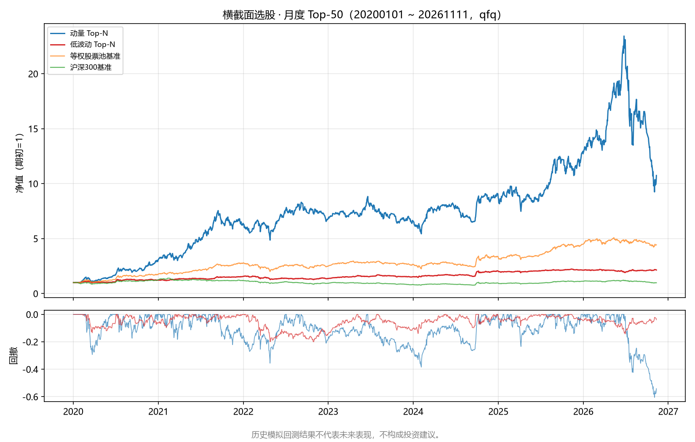
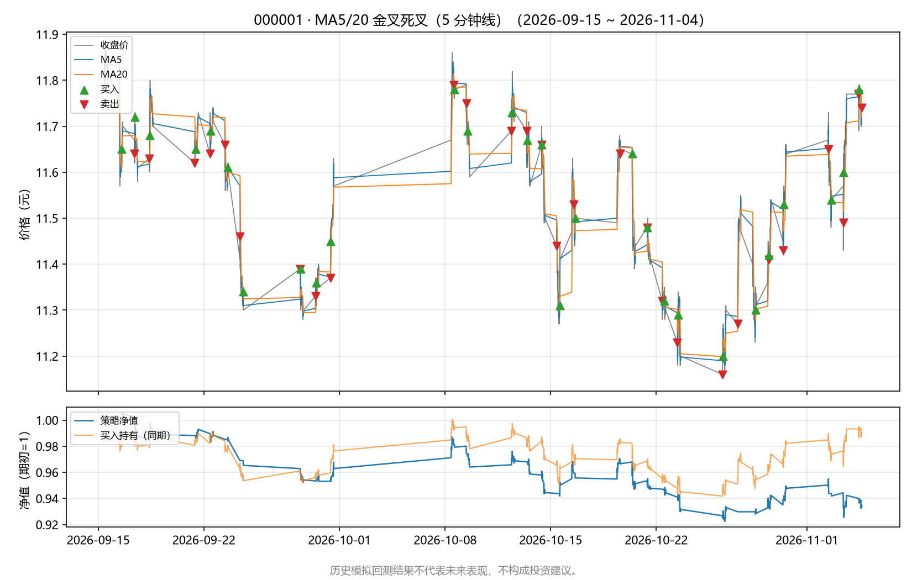
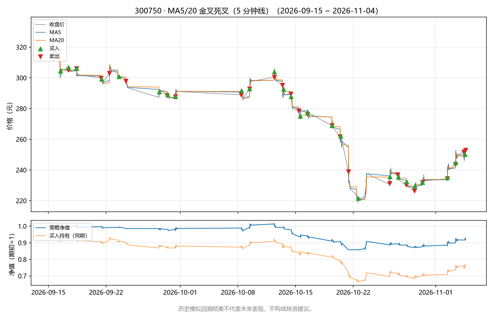
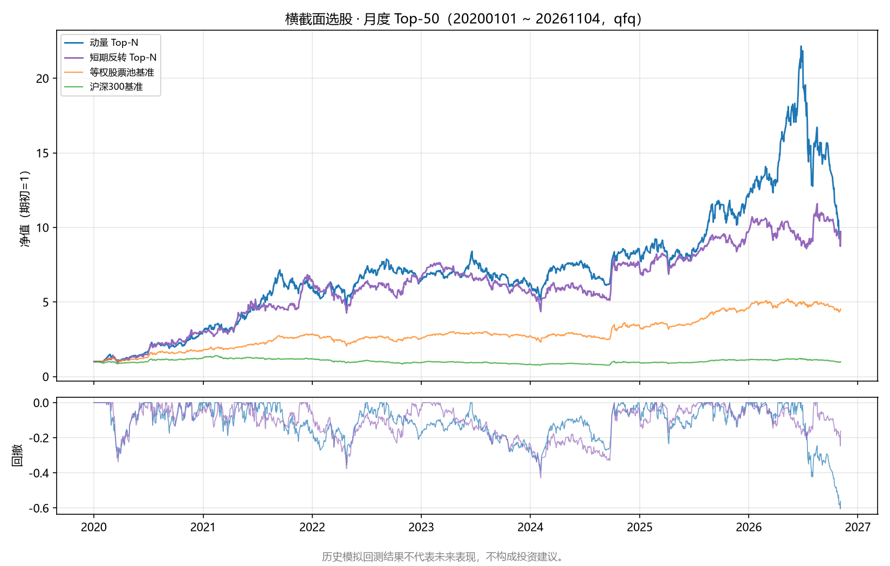
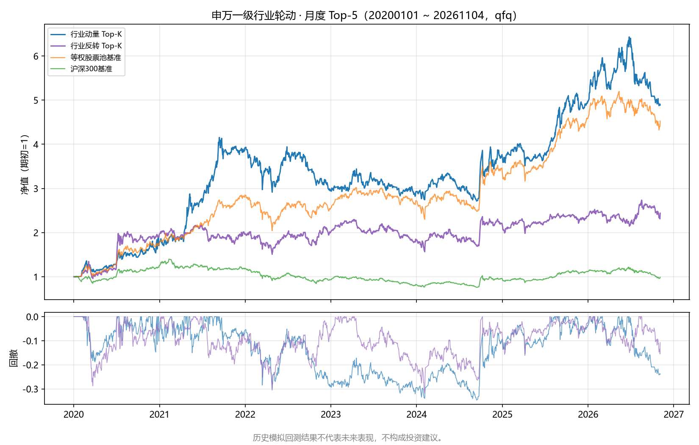

# 策略优化日志（量化学习项目第 3–6 步）

> 版本：v0.3（对应 `scripts/strategies.py` + `scripts/backtest.py` 重构后的策略库）
> 版本：v0.4（新增第 6 章：`scripts/optimize.py` 参数网格扫描 + walk-forward 样本外验证，第 4 步）
> 版本：v0.5（新增第 7 章：`scripts/portfolio.py` 组合构建与仓位管理，第 5 步）
> 版本：v0.6（新增第 8 章：`scripts/screener.py` 横截面选股，第 6 步）
> 版本：v0.7（新增第 10 章：`scripts/intraday_backtest.py` 日内 5 分钟线回测，第 7 步日内研究）
> 数据快照：2026-11-03 拉取的 qfq 前复权日线（个股经 akshare 腾讯源，沪深300 经新浪源；东财接口当时被限流）；第 4 步把行情起点前移至 2017-01-01（300750 自上市日 2018-06-11）用于参数热身，经 akshare 东财接口，2019-11-20 之后与第 3 步快照逐值一致
> **⚠ 免责声明：本日志所有回测均为历史模拟，仅用于学习方法验证；历史模拟回测结果不代表未来表现，不构成投资建议。**

## 0. 日志的使用方法与统一口径

本日志记录每个策略的**假设 → 改动 → 回测结果 → 结论**完整迭代过程（第 1 步研究报告 7.2 节"实验日志强制化"的落地）。每条结论都以表格数据为支撑，数据文件保存在 `output/backtest/`（可复现，复现命令见文末附录）。

所有实验共用同一口径，保证跨策略、跨迭代可比：

| 项目 | 口径 |
| --- | --- |
| 回测区间 | 2020-01-01 ~ 2025-12-31（约 6 年，与第 2 步一致以便对比） |
| 标的 | 000001 平安银行、600519 贵州茅台、600036 招商银行、300750 宁德时代（与第 2 步相同的 2 只 + 新增 2 只） |
| 数据 | qfq 前复权日线；信号热身数据自动前移拉取 |
| 执行规则 | t 日收盘产生目标仓位变化 → t+1 日开盘价成交；窗口内只响应窗口内产生的仓位变化 |
| 成本 | 买入佣金万三；卖出佣金万三 + 印花税万五；未建模滑点（实盘只会更差） |
| 资金与仓位 | 初始 10 万元；默认整手买入（1 手 = 100 股）；`--fractional` 为小数股全仓的学术口径 |
| 期末处理 | 期末仍持仓按最后收盘价强平，计入交易明细与胜率 |
| 基准 | 同期买入持有（BH）+ 沪深300（000300），三者同期归一比较 |
| 指标定义 | 总收益率 = 期末净值/期初净值 - 1；年化 = (1+总收益)^(252/交易日数)-1；最大回撤 = 净值相对历史高点的最大跌幅；胜率 = 盈利交易数/交易总数 |

已知局限（解释性声明，逐条诚实记录）：① 单票回测存在幸存者偏差（4 只票是今天仍在交易的、事后挑选的样本）；② qfq 前复权是"活数据"，未来除权除息后历史数值会整体变化，本日志对应 2026-11-03 快照；③ 未建模滑点与冲击成本；④ 参数扫描是在同一段历史上事后挑选参数，天然存在过拟合风险，所有"最优参数"只能当假设，不能当结论。

---

## 1. ma_cross：双均线金叉/死叉（第 2 步策略的迁移与回归验证）

- **来源**：本项目第 2 步自研框架（`docs/quant-platform-research.md` 第 9 节）。
- **假设 H1**：短均线上穿长均线代表趋势转多，跟随趋势能跑赢"傻持"。
- **本步改动**：无逻辑改动，仅把交叉信号算法迁移为统一 Strategy 接口的仓位状态（`short`、`long` 参数注册）。

### 迭代 1：接口迁移的等价性验证（第 3 步必须先证明"重构没有改变行为"）

改动：`ma_cross` 在统一引擎下按"仓位边沿"交易，替代第 2 步的"交叉事件"逻辑。

验证（两层）：
1. **合成数据逐笔对照**：随机游走合成序列上，新引擎与第 2 步交叉信号算法产生的逐笔交易与每日净值完全一致（脚本内 assert 通过）；
2. **真实数据结果对照**：同样 2020-2025、qfq、10 万、整手，新引擎结果与第 2 步报告 9.2 节逐项一致：

| 标的 | 第 2 步报告值 | 新引擎 v1 | 一致性 |
| --- | ---: | ---: | --- |
| 000001 总收益率 | -34.76% | -34.76% | ✅ 完全一致 |
| 000001 交易次数 | 45 | 45 | ✅ 完全一致 |
| 000001 最大回撤 | -60.37% | -60.37% | ✅ 完全一致 |
| 600519 总收益率 | -13.84% | -13.84% | ✅ 完全一致 |
| 600519 交易次数 | 2 | 2 | ✅ 完全一致 |

**结论**：接口重构等价，第 2 步的结论（参数扫描、整手约束坑等）全部继续有效，本日志不重复。

### 迭代 2：扩大到 4 只标的（默认参数 short=5, long=20）

| 标的 | 策略总收益 | 策略年化 | 最大回撤 | 胜率 | 交易次数 | BH 总收益 | 沪深300 |
| --- | ---: | ---: | ---: | ---: | ---: | ---: | ---: |
| 000001 | **-34.76%** | -7.13% | -60.37% | 35.6% | 45 | -21.68% | +11.50% |
| 600519 | **-13.84%** | -2.55% | -16.13% | 0.0% | 2 | +54.94% | +11.50% |
| 600036 | **+43.76%** | +6.49% | -38.09% | 38.5% | 39 | +47.46% | +11.50% |
| 300750 | **+248.21%** | +24.12% | -51.21% | 37.8% | 45 | +853.89% | +11.50% |

**观察（数据支撑）**：4 只标的 2 胜 2 负，胜的 2 只（600036、300750）也大幅跑输买入持有；000001 上比"傻持"多亏 13 个百分点。第 2 步"MA 金叉死叉在本样本不优于买入持有"的结论在扩大样本后依然成立。

**结论**：ma_cross 作为迁移对照与基准策略保留，不再投入迭代；其参数敏感性数据沿用第 2 步 9.3 节（本步已证明引擎等价）。

---

## 2. rsi：RSI 超卖反转（Wilder 1978）

- **来源**：J. Welles Wilder, *New Concepts in Technical Trading Systems* (Trend Research, 1978)；StockCharts ChartSchool [RSI 说明](https://chartschool.stockcharts.com/table-of-contents/technical-indicators-and-overlays/technical-indicators/relative-strength-index-rsi)。
- **假设 H1**：RSI 跌入超卖区（≤30）后向上穿越 30，说明抛压衰竭、短期反转概率上升；RSI 升到 70 上方再跌回 70 下方时离场（经典 30/70 规则）。RSI 按 Wilder 原始平滑口径计算。
- **实现**：`scripts/strategies.py` 的 `RSIReversalStrategy`，注册参数 `period`（默认 14）、`oversold`（默认 30）、`exit_level`（默认 70）。

### 迭代 1：默认参数 14/30/70

| 标的 | 策略总收益 | 策略年化 | 最大回撤 | 胜率 | 交易次数 | BH 总收益 | vs ma_cross |
| --- | ---: | ---: | ---: | ---: | ---: | ---: | ---: |
| 000001 | **-28.80%** | -5.71% | -55.60% | 50.0% | 6 | -21.68% | -34.76% |
| 600519 | **+15.50%** | +2.53% | -15.61% | 100.0% | 1 | +54.94% | -13.84% |
| 600036 | **+19.94%** | +3.20% | -55.37% | 50.0% | 6 | +47.46% | +43.76% |
| 300750 | **+124.74%** | +15.06% | -41.12% | 66.7% | 6 | +853.89% | +248.21% |

**观察（数据支撑）**：① 4 只标的上全部跑赢 ma_cross（交易次数从 2~45 次降到 1~6 次，成本磨损大幅下降）；② 但仍跑输买入持有（600519 只做了 1 笔交易，其余信号因整手约束被跳过）；③ 000001 上仍亏 28.80%——超卖区抄底在长阴跌中会反复接飞刀。

**新假设 H2**：离场阈值决定"赚多少才走"——`exit_level=70` 要求 RSI 到超买区才离场，可能回吐利润；`exit_level=50`（回归中轴离场）或 60 可能锁住更多利润，值得参数扫描。

### 迭代 2：exit_level / oversold / period 参数扫描

改动：围绕 H2 扫描 `exit_level ∈ {50, 60, 70}`、`oversold ∈ {20, 25, 30}`、`period ∈ {7, 14, 21}`（其余口径不变，每格数据见 `output/backtest/summary_rsi_*.csv`）：

| 配置 | 000001 | 600519 | 600036 | 300750 | 备注 |
| --- | ---: | ---: | ---: | ---: | --- |
| 14/30/**70**（基线） | -28.80% | +15.50% | +19.94% | +124.74% | 6 年间仅 1~6 笔交易 |
| 14/30/**50** | **+65.99%** | +3.95% | **+65.33%** | +90.44% | 11 笔、000001 胜率 81.8% |
| 14/30/**60** | -17.37% | +6.21% | +23.74% | -10.41% | 介于两者之间 |
| 14/**20**/70 | +15.20% | 0.00% | +7.48% | -0.99% | 更严苛入场→交易过少 |
| 14/**25**/70 | -9.68% | +15.50% | +94.99% | +36.93% | 600036 上最好 |
| **7**/30/70 | +1.88% | +16.10% | +91.68% | +36.30% | 交易最多（23 笔） |
| **21**/30/70 | -44.18% | +77.99% | +70.61% | +99.14% | 600519 上跑赢 BH |

**观察（数据支撑）**：
1. **离场阈值是收益的第一杠杆**：exit_level 从 70 降到 50，000001 从 -28.80% 变 +65.99%（+94.8 个百分点），600036 从 +19.94% 变 +65.33%——"RSI 回到中轴就走"比"等到超买区再走"在该样本上更有效；60 是中间值但收益也居中，关系单调；
2. **入场阈值（oversold）没有一致的收益方向**：20/25/30 三档下 4 只标的的排序各不相同——没有哪个 oversold 值全面占优；
3. **period 的影响同样不稳定**：p21 在 600519 上跑赢 BH（+77.99%），但在 000001 上大亏（-44.18%），p7 在 600036 上最好。

**结论**：H2 前半部分成立（exit_level=50 显著改善），但"扫描表里挑最好参数"本身就是过拟合：本表最优组合（如 600036 用 14/25/70）是事后选出来的，换个区间排序大概率重排。**可接受的结论只有一条：离场规则值得深入研究，exit_level=50 作为候选假设进入下一步样本外检验，而非作为最终参数。**

---

## 3. bollinger：布林带均值回归

- **来源**：John Bollinger, *Bollinger on Bollinger Bands* (McGraw-Hill, 2001)；官方站点[规则说明](https://www.bollingerbands.com/bollinger-bands)。
- **假设 H1**：价格偏离均值会回归。收盘价跌破下轨（-2σ）后回升入场，回到中轨上方离场——在震荡市赚"情绪修复"的钱。
- **实现**：`scripts/strategies.py` 的 `BollingerReversionStrategy`，注册参数 `period`（默认 20）、`num_std`（默认 2.0）、`trend_period`（默认 0=关闭趋势过滤）。

### 迭代 1：默认参数 20/2.0

| 标的 | 策略总收益 | 策略年化 | 最大回撤 | 胜率 | 交易次数 | BH 总收益 | vs ma_cross |
| --- | ---: | ---: | ---: | ---: | ---: | ---: | ---: |
| 000001 | **+23.55%** | +3.73% | -27.36% | 68.4% | 19 | -21.68% | -34.76% |
| 600519 | **+11.91%** | +1.97% | -11.58% | 100.0% | 2 | +54.94% | -13.84% |
| 600036 | **+74.03%** | +10.07% | -24.73% | 70.0% | 20 | +47.46% | +43.76% |
| 300750 | **-36.51%** | -7.57% | -43.05% | 38.5% | 13 | +853.89% | +248.21% |

**观察（数据支撑）**：① 4 只标的中唯一跑赢买入持有的策略组合：000001（+23.55% vs -21.68%）和 600036（+74.03% vs +47.46%）——两只银行股长期震荡/阴跌，均值回归恰好适用；② 300750 大亏 36.51%——强势上涨股跌破下轨往往是趋势破坏而非超跌，均值回归在单边上涨市"接了飞刀"。

**新假设 H2**：加趋势过滤（只在长期均线上方做多）应该能避免在下跌趋势中接飞刀；带宽（num_std）和窗口（period）影响信号频率与质量，需要扫描验证。

### 迭代 2：num_std / period / trend_period 参数扫描

改动：围绕 H2 扫描 `num_std ∈ {1.5, 2.0, 2.5}`、`period ∈ {20, 50}`、`trend_period ∈ {0, 60, 120}`（每格数据见 `output/backtest/summary_bollinger_*.csv`）：

| 配置 | 000001 | 600519 | 600036 | 300750 | 备注 |
| --- | ---: | ---: | ---: | ---: | --- |
| 20/2.0/**无过滤**（基线） | **+23.55%** | +11.91% | **+74.03%** | -36.51% | 19~20 笔 |
| 20/**1.5**/无过滤 | +22.88% | +9.52% | +31.35% | -20.73% | 交易增至 24~28 笔 |
| 20/**2.5**/无过滤 | +23.22% | +0.30% | +7.88% | **+28.66%** | 6 笔、000001 回撤仅 -10.82% |
| **50**/2.0/无过滤 | +16.76% | +11.61% | +27.93% | -11.82% | 窗口拉长略降 |
| 20/2.0/**MA60 过滤** | +0.09% | 0.00% | +3.50% | -19.85% | 收益几乎全部消失 |
| 20/2.0/**MA120 过滤** | -2.74% | 0.00% | +11.10% | -4.28% | 同样大幅变差 |

**观察（数据支撑）**：
1. **趋势过滤假设（H2）被数据否决**：加 MA60/MA120 过滤后，000001 从 +23.55% 掉到 +0.09%/-2.74%，600036 从 +74.03% 掉到 +3.50%/+11.10%。原因符合逻辑：均值回归最好的入场点正是"价格跌破均线后的恐慌下跌"，过滤条件把最有价值的入场全部挡掉了——"不在下跌中接飞刀"的直觉在这个策略上适得其反；
2. **带宽影响是二阶的**：num_std 1.5→2.5 的总收益变化远小于 trend_period 的影响；2.5 显著减少交易次数并压回撤（000001 最大回撤 -10.82% vs -27.36%），但 600036 的收益从 +74.03% 掉到 +7.88%；
3. **300750 是所有配置里最差或次差的标的**：唯一让它转正的是 num_std=2.5（+28.66%）——宽带宽恰好把 2021 年高点的接飞刀入场过滤掉了，属事后巧合。

**结论**：布林带均值回归在震荡/阴跌的银行股样本上成立（000001、600036 跑赢 BH），在强趋势股上失败；趋势过滤假设被否决，保留 `trend_period` 参数但默认关闭，理由与数据已记入本表。下一步候选：把"强趋势股上禁止均值回归"改为反向研究（趋势市用动量、震荡市用回归的轮换逻辑）。

---

## 4. momentum：绝对动量（动量轮动到现金）

- **来源**：Jegadeesh & Titman (1993), "Returns to Buying Winners and Selling Losers", *Journal of Finance* 48(1), 65-91（[Wharton-Jacobs Levy 奖页面](https://drupal.prod.pionline.com/awards/narasimhan-jegadeesh-and-sheridan-titman-win-wharton-jacobs-levy-prize)）；Antonacci, G., "Risk Premia Harvesting Through Dual Momentum"（[SSRN 2042750](https://papers.ssrn.com/sol3/Papers.cfm?abstract_id=2042750)）。
- **假设 H1**：价格动量有持续性（"强者恒强"）。单标的框架下横截面轮动退化为**绝对动量**：过去 lookback 日收益（跳过最近 skip 日）大于阈值则持有，否则空仓持现金——在"该资产"与"现金"之间轮动。
- **实现**：`scripts/strategies.py` 的 `MomentumStrategy`，注册参数 `lookback`（默认 120）、`skip`（默认 5）、`threshold`（默认 0）。

### 迭代 1：默认参数 120/5/0

| 标的 | 策略总收益 | 策略年化 | 最大回撤 | 胜率 | 交易次数 | BH 总收益 | vs ma_cross |
| --- | ---: | ---: | ---: | ---: | ---: | ---: | ---: |
| 000001 | **-0.75%** | -0.13% | -48.56% | 50.0% | 14 | -21.68% | -34.76% |
| 600519 | **0.00%** | 0.00% | 0.00% | — | 0 | +54.94% | -13.84% |
| 600036 | **+57.83%** | +8.22% | -46.78% | 38.7% | 31 | +47.46% | +43.76% |
| 300750 | **-10.77%** | -1.96% | -44.13% | 50.0% | 30 | +853.89% | +248.21% |

**观察（数据支撑）**：① 600519 全程 0 交易——38 次买入信号全部因"10 万元买不起 1 手"被跳过（qfq 约 880~1000 元/股），整手约束把策略"阉割"成了现金（第 2 步 9.4 节第 4 条同一坑的再现）；② 300750 亏 10.77% 而买入持有 +853.89%：绝对动量在剧烈波动的大牛股上反复"跌破动量线离场→涨回再追入"，30 次交易把趋势利润磨损殆尽；③ 600036 跑赢买入持有（+57.83% vs +47.46%），是 4 只标的里动量假设唯一成立的样本。

**新假设 H2**：skip=21（J-T 经典的"跳过最近一个月"）或 threshold=0.05（动量要显著跑赢现金才持有）可能减少追涨杀跌的磨损；lookback 长短改变信号频率。另外 600519 必须用 --fractional 单独看信号质量（与第 2 步处理一致）。

### 迭代 2：lookback / skip / threshold 参数扫描 + 600519 小数股对照

改动：围绕 H2 扫描 `lookback ∈ {60, 120, 250}`、`skip ∈ {0, 5, 21}`、`threshold ∈ {0, 0.05}`（每格数据见 `output/backtest/summary_momentum_*.csv`）：

| 配置 | 000001 | 600519 | 600036 | 300750 | 备注 |
| --- | ---: | ---: | ---: | ---: | --- |
| 120/5/0（基线） | -0.75% | 0.00% | +57.83% | -10.77% | 600519 整手下 0 交易 |
| **60**/5/0 | -1.95% | +37.07% | +38.74% | **+176.42%** | 短窗口在趋势股上大幅改善 |
| **250**/5/0 | -5.88% | 0.00% | -10.24% | +59.04% | J-T 年频窗口反而更差 |
| 120/**21**/0 | +14.30% | 0.00% | **+88.09%** | +7.75% | J-T 经典跳月，600036 最优 |
| 120/**0**/0 | **+31.76%** | 0.00% | +46.77% | -12.87% | 不跳最近日，000001 最优 |
| 120/5/**0.05** | -13.58% | 0.00% | +70.43% | -11.00% | 提门槛压回撤（-33.98%） |

600519 小数股全仓对照（信号质量口径，与第 2 步处理一致）：

| 策略（600519, fractional） | 总收益率 | 交易次数 | 对照：整手口径 |
| --- | ---: | ---: | ---: |
| ma_cross 5/20 | +22.13% | 45 | -13.84%（2 笔） |
| rsi 14/30/70 | +52.44% | 6 | +15.50%（1 笔） |
| bollinger 20/2.0 | +11.75% | 19 | +11.91%（2 笔） |
| momentum 120/5/0 | **-45.12%** | 38 | 0.00%（0 笔） |

**观察（数据支撑）**：
1. **lookback=60 让动量假设第一次在趋势股上成立**：300750 从 -10.77% 变 +176.42%、600519 从 0 变 +37.07%——A 股单标的的"持续性"尺度更接近季度而非年度；600036 上却是 120/21 最好（+88.09%）；
2. **skip 的效果同样分标的**：skip=0 让 000001 从 -0.75% 变 +31.76%（这只票的短期反转恰好被 skip=5 误伤），skip=21 让 600036 从 +57.83% 变 +88.09%；
3. **没有任何一组参数在 4 只标的上同时最优**——参数排序在不同标的上完全重排，这是"单票动量参数不可外推"的直接证据；
4. **整手约束对高价股的扭曲再次被量化**：600519 上 ma_cross 的"真实信号质量"是 +22.13%（45 笔），整手口径只剩 2 笔、-13.84%；同一策略、同一区间，口径不同结论差 36 个百分点。更极端的是 momentum：小数股口径暴露其信号质量实为 **-45.12%**（38 笔）——整手约束反而"保护"了这笔钱不被亏掉。**研究信号用小数股，研究可实盘性必须保留整手约束，两者结论不可混用**（第 2 步 9.4 节第 4 条在此再次应验）。

**结论**：H2 部分成立（lookback/skip 确实影响巨大），但参数与标的强耦合、不可外推。可接受的下一步不是"选最优参数"，而是：① 把 4 只标的按参数收益排序后做样本外（换区间）重测；② 在组合层面做横截面轮动（多标的选强者），把"参数敏感性"转化为"横截面分散"——这是第 4 步的候选课题。

---

## 5. 跨策略对比与总体结论

### 5.1 默认参数下的跨策略对比（2020-2025，qfq，10 万整手）

| 标的 | ma_cross 5/20 | rsi 14/30/70 | bollinger 20/2 | momentum 120/5/0 | 买入持有 | 沪深300 |
| --- | ---: | ---: | ---: | ---: | ---: | ---: |
| 000001 | -34.76% | -28.80% | **+23.55%** | -0.75% | -21.68% | +11.50% |
| 600519 | -13.84% | **+15.50%** | +11.91% | 0.00% | +54.94% | +11.50% |
| 600036 | +43.76% | +19.94% | **+74.03%** | +57.83% | +47.46% | +11.50% |
| 300750 | **+248.21%** | +124.74% | -36.51% | -10.77% | +853.89% | +11.50% |

对比图（4 只标的 × 4 策略，含回撤子图，均为历史模拟）：


### 5.2 数据支撑的观察

1. **没有常胜策略**：4 只标的上最优策略各不相同（000001/600036 是 bollinger，600519 是 rsi，300750 是 ma_cross），"选一个策略打天下"在本样本上不成立；
2. **市场状态比策略选择更关键**：银行股（000001、600036）六年震荡/阴跌，均值回归（bollinger）跑赢买入持有；强趋势股（300750）上趋势跟随（ma_cross）跑赢、均值回归大亏——策略与市场状态的匹配比策略本身更重要；
3. **参数敏感性 > 策略差异**：RSI 的 exit_level 70→50 在 000001 上带来 +94.8 个百分点的变化，大于任何两个策略默认参数之间的差距——"用什么参数"经常比"用什么策略"影响更大，这正是过拟合的重灾区；
4. **口径决定结论**：600519 上同一 momentum 策略，整手口径 0.00%、小数股口径 -45.12%——不对齐口径的策略比较没有意义；
5. **跑赢基准的局部性**：4 只标的上都至少有一个策略跑赢沪深300（+11.50%），但没有任何策略在全部 4 只标的上跑赢买入持有；4 只票是今天仍存在的事后样本（幸存者偏差），结论不能推广。

### 5.3 本步学到的可复用方法

1. **先证明重构等价，再谈新功能**：策略迁移用"合成数据逐笔对照 + 真实数据结果对照"双重验证（见 1.1 节），等价性没证明之前，任何新策略的结论都不可信；
2. **每个新假设都要能被数据否决**：本步有两条假设被明确否决——布林带趋势过滤（3.2 节）与"年频动量更有效"（4.2 节 lookback=250 反而最差）；被否决的假设和成立的假设同样有价值；
3. **参数扫描的产物是假设，不是参数**：所有扫描结果只用于提出候选假设（如 exit_level=50），必须经过样本外验证才能谈参数好坏。

### 5.4 下一步候选

1. **walk-forward / 样本外检验**：把 2020-2025 拆成样本内（前 4 年）选参 + 样本外（后 2 年）验证，直接检验本日志所有"候选参数"的过拟合程度；
2. **横截面轮动**：把 momentum 从单标的绝对动量扩展为多标的横截面轮动（真正的 J-T 1993 用法），并测试"趋势市用动量、震荡市用回归"的状态轮换；
3. **数据层补齐**（第 1 步原计划顺延）：交易日历、证券列表、历史指数成分，扩大样本并缓解幸存者偏差；
4. **滑点与冲击成本建模**：当前所有回测零滑点，交易次数越多的策略（ma_cross、momentum）实盘折损越大，应先做成本敏感性。

---

## 6. walk-forward 参数优化与样本外验证（第 4 步）

> 新增脚本：`scripts/optimize.py`——4 策略参数网格扫描 + 锚定式 walk-forward 样本外验证 + 过拟合诊断 + 参数热力图/收益-回撤散点图。
> **⚠ 免责声明：本章全部内容为历史模拟回测，仅用于学习方法验证；历史模拟回测结果不代表未来表现，不构成投资建议。**

### 6.0 方法与口径

**动机**：第 3 步的结论之一（5.3 节第 3 条）是"参数扫描的产物是假设，不是参数"——所有"最优参数"都是在同一段 2020-2025 历史上事后挑的，天然过拟合。本步落实 5.4 节候选 1：把历史拆成样本内/样本外，用 walk-forward 流程直接检验参数可外推性。

**流程**：锚定式滚动 3 折——每折只用样本内选参，把选出的参数原样放到随后的样本外年份评分；同时**全部**网格组合也在每个样本外年份跑一遍，用于计算样本内-样本外秩相关等诊断。选优规则为样本内总收益率最大（与第 3 步口径一致）。

| 项目 | 口径 |
| --- | --- |
| 区间与数据 | 2020-01-01 ~ 2025-12-31（与第 2/3 步一致）；行情自 2017-01-01 起预热（300750 自上市日 2018-06-11），经 akshare 东财接口 qfq 前复权，2019-11-20 之后与第 3 步快照逐值一致 |
| fold 设计 | fold1：样本内 2020-2022 选参 → 样本外 2023 验证；fold2：样本内 2020-2023 → 样本外 2024；fold3：样本内 2020-2024 → 样本外 2025（样本外共 3 年、互不重叠） |
| 选参规则 | 每折按**样本内总收益率**选最优组合；该组合的样本外表现 = "walk-forward 实现收益" |
| 全网格样本外 | 所有组合都跑样本外年份 → 得样本内/样本外两个收益面，比较其形状与排序 |
| 执行口径 | 与 `backtest.py` 完全一致：t 日收盘信号 t+1 日开盘成交、佣金万三 + 卖出印花税万五、初始 10 万整手；600519 因整手约束多产生 0 交易，另跑 `--fractional` 小数股全仓口径 |
| 诊断指标 | ① Spearman ρ（组合样本内均值 vs 样本外均值）：≈1 稳定，≤0 不可外推；② 样本内最优的样本外平均分位：掉到中位数以下是过拟合；③ 邻点粗糙度：收益面相邻格点年化收益的平均落差；④ 样本内最优的轴邻点落差：最优参数沿每根参数轴挪一步后的表现差，即"最优参数相邻点剧烈波动"的直接度量；⑤ 翻转率：样本内前 1/4 的组合掉进样本外后 1/4 的比例 |

**参数网格（每策略的范围与步长）**：

| 策略 | 参数 1（范围/步长） | 参数 2（范围/步长） | 参数 3（范围/步长） | 有效组合数 |
| --- | --- | --- | --- | --- |
| ma_cross | short：3–20，步长 5 | long：20–250 | — | 24 |
| rsi | period：7–28，步长 7 | oversold：20–35，步长 5 | exit_level：50–70，步长 10 | 48 |
| bollinger | period：10–50（经典 20） | num_std：1.5–3.0，步长 0.5 | trend_period：0/60/120，步长 60 | 36 |
| momentum | lookback：60–250（J-T 经典约 252） | skip：0/5/21（J-T 经典 21） | threshold：-0.05–0.05，步长 0.05 | 27 |

**已知局限（诚实声明）**：① 样本外只有 3 个年份，且仍是同一批 4 只幸存者标的，结论只对本样本成立；② "稳健参数"是在样本外数据上挑选的，属轻度数据挖掘，只能当候选假设，不能当结论；③ 折与折之间仓位状态不继承（引擎按窗口内边沿成交，见 `backtest.py` 口径说明）；④ 所有诊断的"统计显著性"都不足以支撑真实资金决策——本项目是学习方法验证。

**数据落盘**：`output/optimize/<策略>/<策略>_<代码>[_frac]_{grid,walkforward,diagnostics}.csv` 与 `{heatmap,scatter}.png`；全局汇总 `output/optimize/summary_walkforward.csv`。复现命令见文末附录。

---

### 6.1 ma_cross：双均线——参数不可外推的最清晰例证

**汇总（样本外年化为各 fold 样本外年化的均值；600519 整手口径因 0 交易全部失效，见 6.4 小数股对照）**：

| 标的 | Spearman ρ | 样本内全局最优参数 | 其样本外年化均值 | 样本外平均分位 | 稳健参数（样本外年化均值最优） | 稳健样本外年化 | 默认参数样本外年化 | 粗糙度 IS/OOS（每步） | 翻转率 |
| --- | ---: | --- | ---: | ---: | --- | ---: | ---: | ---: | ---: |
| 000001（平安银行） | -0.32 | short=20,long=120 | -1.29% | 49% | short=3,long=30 | +7.42% | +5.49% | 3.9%/2.1% | 8% |
| 600519（贵州茅台） | 无定义 | short=15,long=30 | +0.00% | 4% | short=15,long=30 | +0.00% | +0.00% | 4.6%/0.0% | 25% |
| 600036（招商银行） | +0.02 | short=5,long=60 | +3.82% | 60% | short=10,long=20 | +8.02% | +1.38% | 4.0%/2.0% | 8% |
| 300750（宁德时代） | +0.61 | short=15,long=30 | +24.03% | 49% | short=10,long=60 | +29.33% | +16.92% | 8.3%/5.5% | 0% |

**样本内最优的轴邻点落差（ma_cross，各标的）**：
| 标的 | 样本内最优参数 | 样本内邻点最大落差（年化） | 样本外邻点最大落差（年化） | 邻点数 |
| --- | --- | ---: | ---: | ---: |
| 000001 | short=20,long=120 | +5.55% | +2.58% | 3 |
| 600519 | short=15,long=30 | +14.63% | +0.00% | 4 |
| 600036 | short=5,long=60 | +7.09% | +4.21% | 4 |
| 300750 | short=15,long=30 | +14.36% | +4.75% | 4 |

**fold 级明细（000001 与 300750，最能说明问题的两只）**：

| fold | 样本内选出的参数 | 样本内总收益 | 样本外总收益 | 样本外排名 | 该年样本外最优参数 | 默认参数样本外 | 网格样本外均值 |
| ---: | --- | ---: | ---: | ---: | --- | ---: | ---: |
| 1 | short=20,long=120 | +61.16% | +0.00% | 1/24 | short=15,long=120 | -20.14% | -11.72% |
| 2 | short=20,long=120 | +51.93% | -8.17% | 20/24 | short=3,long=60 | +15.48% | +8.59% |
| 3 | short=3,long=120 | +44.15% | +2.57% | 14/24 | short=15,long=20 | +15.58% | +5.17% |

| fold | 样本内选出的参数 | 样本内总收益 | 样本外总收益 | 样本外排名 | 该年样本外最优参数 | 默认参数样本外 | 网格样本外均值 |
| ---: | --- | ---: | ---: | ---: | --- | ---: | ---: |
| 1 | short=15,long=30 | +693.70% | -13.63% | 5/24 | short=10,long=30 | -11.38% | -17.11% |
| 2 | short=15,long=30 | +310.66% | +119.93% | 8/24 | short=15,long=60 | +27.83% | +85.83% |
| 3 | short=20,long=30 | +840.84% | +15.82% | 22/24 | short=5,long=250 | +39.54% | +28.62% |

000001 样本内 vs 样本外热力图（整手口径）：


300750 收益-回撤散点图（虚线箭头 = 样本内全局最优 → 其在样本外的表现）：


其余标的图表见 `output/optimize/ma_cross/`（均为历史模拟）。

**观察（数据支撑）**：
1. **ρ 在 000001 上为负（-0.32）、600036 上接近零（+0.02）**：样本内表现好的参数组合，样本外平均表现更差——参数排序完全不可外推，是教科书式的过拟合；
2. **样本内最优反复掉出样本外上半区**：000001 上样本内全局最优（20/120）样本外平均分位 49%，600036 上（5/60）分位 60%——"选出来的参数"并不比"随机抽一组参数"强；
3. **300750 是唯一的例外**：ρ=+0.61，但它的收益面也最粗糙（粗糙度 8.3%/5.5% 每步，全样本最高），fold3 样本内选出的（20/30）样本外只排 22/24——即便是"最稳定"的标的，样本内最优相邻一点的表现可以差 14.4 个百分点（年化）；
4. **600519 整手口径全网格 0 交易**：10 万元在 2019 年后的茅台价格下买不起 1 手，整手口径下该标的完全没有信息量（第 3 步 4.1 节同一坑的再现）。

**结论**：ma_cross 的双均线参数在本样本上**不存在可外推的稳健参数**——ρ 非正、样本内最优无样本外溢价、收益面最粗糙。第 2 步"MA 金叉死叉不优于买入持有"、第 3 步"ma_cross 只作迁移对照"的结论在样本外检验后继续成立。**不为其选择任何"稳健参数"；其参数敏感性恰恰是本步方法论的反面教材。**

---

### 6.2 rsi：RSI 超卖反转——第 3 步候选假设部分存活

**汇总**：

| 标的 | Spearman ρ | 样本内全局最优参数 | 其样本外年化均值 | 样本外平均分位 | 稳健参数（样本外年化均值最优） | 稳健样本外年化 | 默认参数样本外年化 | 粗糙度 IS/OOS（每步） | 翻转率 |
| --- | ---: | --- | ---: | ---: | --- | ---: | ---: | ---: | ---: |
| 000001（平安银行） | +0.63 | period=14,oversold=25.0,exit_level=50.0 | +12.11% | 18% | period=14,oversold=25.0,exit_level=50.0 | +12.11% | +6.69% | 2.6%/2.7% | 0% |
| 600519（贵州茅台） | 无定义 | period=14,oversold=35.0,exit_level=50.0 | +0.00% | 2% | period=14,oversold=35.0,exit_level=50.0 | +0.00% | +0.00% | 1.2%/0.0% | 27% |
| 600036（招商银行） | +0.58 | period=21,oversold=30.0,exit_level=50.0 | +7.87% | 29% | period=7,oversold=25.0,exit_level=70.0 | +16.75% | +9.60% | 3.5%/3.1% | 0% |
| 300750（宁德时代） | +0.68 | period=14,oversold=35.0,exit_level=70.0 | +16.14% | 41% | period=28,oversold=35.0,exit_level=70.0 | +31.28% | +19.82% | 3.6%/5.1% | 0% |

**样本内最优的轴邻点落差（rsi，各标的）**：
| 标的 | 样本内最优参数 | 样本内邻点最大落差（年化） | 样本外邻点最大落差（年化） | 邻点数 |
| --- | --- | ---: | ---: | ---: |
| 000001 | period=14,oversold=25.0,exit_level=50.0 | +12.77% | +7.13% | 5 |
| 600519 | period=14,oversold=35.0,exit_level=50.0 | +9.29% | +0.00% | 4 |
| 600036 | period=21,oversold=30.0,exit_level=50.0 | +15.87% | +2.79% | 5 |
| 300750 | period=14,oversold=35.0,exit_level=70.0 | +18.76% | +3.68% | 4 |

**fold 级明细（000001 与 600036）**：

| fold | 样本内选出的参数 | 样本内总收益 | 样本外总收益 | 样本外排名 | 该年样本外最优参数 | 默认参数样本外 | 网格样本外均值 |
| ---: | --- | ---: | ---: | ---: | --- | ---: | ---: |
| 1 | period=14,oversold=25.0,exit_level=50.0 | +87.93% | +49.39% | 6/48 | period=21,oversold=30.0,exit_level=50.0 | +23.47% | +23.52% |
| 2 | period=14,oversold=25.0,exit_level=50.0 | +201.70% | +0.00% | 16/48 | period=7,oversold=25.0,exit_level=50.0 | +0.00% | +9.46% |
| 3 | period=14,oversold=25.0,exit_level=50.0 | +96.88% | +20.56% | 4/48 | period=14,oversold=30.0,exit_level=50.0 | +12.01% | +4.33% |

| fold | 样本内选出的参数 | 样本内总收益 | 样本外总收益 | 样本外排名 | 该年样本外最优参数 | 默认参数样本外 | 网格样本外均值 |
| ---: | --- | ---: | ---: | ---: | --- | ---: | ---: |
| 1 | period=21,oversold=30.0,exit_level=50.0 | +154.21% | +84.32% | 1/48 | period=14,oversold=25.0,exit_level=50.0 | +69.02% | +49.36% |
| 2 | period=21,oversold=30.0,exit_level=50.0 | +250.55% | +0.00% | 25/48 | period=7,oversold=30.0,exit_level=70.0 | +24.99% | +15.17% |
| 3 | period=14,oversold=25.0,exit_level=50.0 | +131.67% | +0.00% | 16/48 | period=14,oversold=35.0,exit_level=70.0 | -3.32% | +1.01% |

000001 样本内 vs 样本外热力图：


600036 收益-回撤散点图：


**观察（数据支撑）**：
1. **ρ 全样本最高（+0.58 ~ +0.68，三个可交易标的）**：RSI 的参数排序在样本内/样本外之间保持得最好，是这个参数家族"有真实信息"的最强证据；
2. **第 3 步候选假设 exit_level=50 在 000001 上完整存活**：样本内全局最优（14/25/50）连续 3 折都被选中，样本外年化 +12.11%（默认参数 +6.69%），样本外平均分位 18%——第 3 步 2.2 节"离场阈值是收益的第一杠杆"的结论通过样本外检验；600036 上三折样本内最优也全是 exit_level=50；
3. **但同样的参数不迁移**：300750 上样本内最优是 exit_level=70（14/35/70），600036 的样本外最优是（7/25/70）——"exit_level=50"不是普适真理，只是 000001/600036 这类震荡票上的有效假设；
4. **邻点落差仍然很大**：000001 上样本内最优（14/25/50）沿某根参数轴挪一步（如 oversold 25→20），样本内年化就差 12.8 个百分点——即便 ρ 最高的策略，最优参数也是"尖峰"，不是"平台"。

**结论**：RSI 是 4 个策略中参数最可外推的一个，第 3 步的 exit_level=50 候选假设在震荡票上通过样本外检验。**稳健参数候选：(period=7, oversold=25, exit_level=70)**——在 3 个整手可交易标的上样本外年化全部为正且不低于默认参数（详见 6.5 总表）；同时保留 (14/25/50) 作为震荡票专用候选。两者都是候选假设，仍需更多样本外年份检验。

---

### 6.3 bollinger：布林带均值回归——唯一的"全样本优于默认"候选

**汇总**：

| 标的 | Spearman ρ | 样本内全局最优参数 | 其样本外年化均值 | 样本外平均分位 | 稳健参数（样本外年化均值最优） | 稳健样本外年化 | 默认参数样本外年化 | 粗糙度 IS/OOS（每步） | 翻转率 |
| --- | ---: | --- | ---: | ---: | --- | ---: | ---: | ---: | ---: |
| 000001（平安银行） | +0.49 | period=10,num_std=1.5,trend_period=120 | +1.14% | 19% | period=50,num_std=2.0,trend_period=0 | +9.82% | +4.74% | 0.8%/1.0% | 3% |
| 600519（贵州茅台） | 无定义 | period=10,num_std=1.5,trend_period=0 | +0.00% | 3% | period=10,num_std=1.5,trend_period=0 | +0.00% | +0.00% | 0.3%/0.0% | 100% |
| 600036（招商银行） | +0.39 | period=50,num_std=2.5,trend_period=0 | +7.99% | 40% | period=50,num_std=1.5,trend_period=0 | +8.22% | +1.73% | 1.5%/1.2% | 6% |
| 300750（宁德时代） | +0.45 | period=50,num_std=1.5,trend_period=0 | +15.98% | 44% | period=50,num_std=2.0,trend_period=0 | +16.24% | -1.84% | 2.9%/3.0% | 6% |

**样本内最优的轴邻点落差（bollinger，各标的）**：
| 标的 | 样本内最优参数 | 样本内邻点最大落差（年化） | 样本外邻点最大落差（年化） | 邻点数 |
| --- | --- | ---: | ---: | ---: |
| 000001 | period=10,num_std=1.5,trend_period=120 | +3.91% | +0.67% | 3 |
| 600519 | period=10,num_std=1.5,trend_period=0 | +3.08% | +0.00% | 3 |
| 600036 | period=50,num_std=2.5,trend_period=0 | +11.41% | +9.49% | 4 |
| 300750 | period=50,num_std=1.5,trend_period=0 | +14.33% | +15.98% | 3 |

**fold 级明细（000001 与 300750）**：

| fold | 样本内选出的参数 | 样本内总收益 | 样本外总收益 | 样本外排名 | 该年样本外最优参数 | 默认参数样本外 | 网格样本外均值 |
| ---: | --- | ---: | ---: | ---: | --- | ---: | ---: |
| 1 | period=10,num_std=1.5,trend_period=120 | +24.58% | +0.49% | 5/36 | period=50,num_std=2.0,trend_period=0 | -17.35% | +0.68% |
| 2 | period=50,num_std=2.0,trend_period=0 | +37.69% | +8.57% | 6/36 | period=20,num_std=2.0,trend_period=0 | +39.10% | +4.88% |
| 3 | period=10,num_std=1.5,trend_period=120 | +27.78% | +2.10% | 9/36 | period=50,num_std=2.0,trend_period=0 | +1.84% | +0.93% |

| fold | 样本内选出的参数 | 样本内总收益 | 样本外总收益 | 样本外排名 | 该年样本外最优参数 | 默认参数样本外 | 网格样本外均值 |
| ---: | --- | ---: | ---: | ---: | --- | ---: | ---: |
| 1 | period=50,num_std=1.5,trend_period=120 | +42.27% | +0.00% | 11/36 | period=50,num_std=1.5,trend_period=0 | -14.60% | +9.27% |
| 2 | period=50,num_std=1.5,trend_period=0 | +164.54% | +10.35% | 4/36 | period=10,num_std=1.5,trend_period=60 | -0.37% | +4.57% |
| 3 | period=10,num_std=1.5,trend_period=60 | +60.06% | -2.04% | 33/36 | period=50,num_std=2.0,trend_period=0 | +0.00% | +2.60% |

000001 样本内 vs 样本外热力图：


300750 收益-回撤散点图：


**观察（数据支撑）**：
1. **ρ 中等稳定（+0.39 ~ +0.49）**，且收益面最平坦（粗糙度 0.8%~3.0% 每步，全策略最低）——布林带参数是"平台型"而非"尖峰型"，相邻参数表现接近，这是稳健性的好迹象；
2. **第 3 步被否决的趋势过滤再次被否决**：000001 样本内全局最优（10/1.5/120）带了 MA120 过滤，但其样本外年化只剩 +1.14%（分位 19%），而三只标的的样本外最优全是 trend_period=0——"不在下跌趋势中接飞刀"的过滤条件在样本外持续伤害收益；
3. **宽窗口 + 无过滤的候选（50/2.0/0）在全部 4 只标的上优于默认参数（20/2.0/0）**：000001 +9.82% vs +4.74%、600036 +8.14% vs +1.73%、300750 +16.24% vs -1.84%、600519 小数股 +4.91% vs +3.74%——这是本步唯一一个在**每一只**标的、每一种口径上都跑赢默认参数的参数组合；
4. **样本内最优的样本外分位仍然不高（19%~44%）**：即便最稳健的策略，"选样本内第一"也只能保住样本外前 1/4~1/2 的位置，样本外分位 19% 的 000001 已属最好水平。

**结论**：布林带均值回归的参数在本样本上最稳健，且延续第 3 步 3.2 节"趋势过滤适得其反"的结论。**稳健参数候选：(period=50, num_std=2.0, trend_period=0)**——全标的、全口径优于默认参数（理由见 6.5 总表）；该组合同时把交易频率压到更低（窗口 50 日），成本敏感性上也有优势（第 5 步候选）。

---

### 6.4 momentum：绝对动量——样本内怪兽、样本外平庸；600519 小数股对照

**汇总**：

| 标的 | Spearman ρ | 样本内全局最优参数 | 其样本外年化均值 | 样本外平均分位 | 稳健参数（样本外年化均值最优） | 稳健样本外年化 | 默认参数样本外年化 | 粗糙度 IS/OOS（每步） | 翻转率 |
| --- | ---: | --- | ---: | ---: | --- | ---: | ---: | ---: | ---: |
| 000001（平安银行） | +0.16 | lookback=60,skip=21,threshold=0.0 | +1.20% | 60% | lookback=120,skip=5,threshold=-0.05 | +5.11% | -1.36% | 2.5%/1.1% | 11% |
| 600519（贵州茅台） | 无定义 | lookback=60,skip=5,threshold=-0.05 | +0.00% | 4% | lookback=60,skip=5,threshold=-0.05 | +0.00% | +0.00% | 3.1%/0.0% | 26% |
| 600036（招商银行） | +0.53 | lookback=250,skip=21,threshold=0.0 | +5.35% | 31% | lookback=250,skip=21,threshold=-0.05 | +13.06% | +5.08% | 3.1%/2.6% | 0% |
| 300750（宁德时代） | -0.24 | lookback=60,skip=5,threshold=-0.05 | +19.48% | 42% | lookback=120,skip=5,threshold=-0.05 | +28.96% | +20.80% | 8.6%/6.7% | 4% |

**样本内最优的轴邻点落差（momentum，各标的）**：
| 标的 | 样本内最优参数 | 样本内邻点最大落差（年化） | 样本外邻点最大落差（年化） | 邻点数 |
| --- | --- | ---: | ---: | ---: |
| 000001 | lookback=60,skip=21,threshold=0.0 | +10.19% | +4.95% | 4 |
| 600519 | lookback=60,skip=5,threshold=-0.05 | +12.79% | +0.00% | 4 |
| 600036 | lookback=250,skip=21,threshold=0.0 | +7.63% | +7.71% | 4 |
| 300750 | lookback=60,skip=5,threshold=-0.05 | +39.16% | +9.48% | 4 |

**fold 级明细（300750）**：

| fold | 样本内选出的参数 | 样本内总收益 | 样本外总收益 | 样本外排名 | 该年样本外最优参数 | 默认参数样本外 | 网格样本外均值 |
| ---: | --- | ---: | ---: | ---: | --- | ---: | ---: |
| 1 | lookback=60,skip=5,threshold=-0.05 | +582.86% | -20.09% | 21/27 | lookback=250,skip=21,threshold=0.05 | -13.23% | -11.64% |
| 2 | lookback=60,skip=5,threshold=-0.05 | +188.76% | +93.91% | 3/27 | lookback=60,skip=0,threshold=-0.05 | +90.40% | +63.87% |
| 3 | lookback=60,skip=5,threshold=-0.05 | +490.80% | +23.87% | 10/27 | lookback=120,skip=5,threshold=-0.05 | +26.37% | +18.80% |

300750 样本内 vs 样本外热力图：


300750 收益-回撤散点图：


**观察（数据支撑）**：
1. **"样本内怪兽"在 300750 上连续 3 折当选、样本外却平庸**：（60/5/-0.05）样本内总收益 +582.86%/+188.76%/+490.80%，样本外只有 -20.09%/+93.91%/+23.87%（排名 21、3、10）——样本内 +583% 的"最优参数"在第一个样本外年份亏掉 20%，ρ 因此为负（-0.24）；
2. **相邻点剧烈波动的极端案例**：300750 上样本内最优（60/5/-0.05）把 lookback 从 60 挪到 120，样本内年化收益从 +31.9% 变 -7.3%，差 **39.2 个百分点**——而那个样本内亏钱的邻居（120/5/-0.05）恰恰是样本外年化最高（+29.0%）的组合。把参数挪一步，结论从"优秀"变"平庸"甚至反转，这是本步寻找的过拟合迹象的最极端样本；
3. **ρ 在 000001 上只有 +0.16、600036 上 +0.53**：动量参数排序的稳定性随标的剧烈变化，与第 3 步"参数与标的强耦合、不可外推"的结论一致；
4. **600519 小数股口径（整手口径 0 交易，无信息）**：ρ 仅 +0.24（momentum）~-0.08（rsi），样本内最优的样本外分位 57%~79%（bollinger 除外，20%）；各策略网格的样本外均值分化为负（ma_cross 三折 -8.7%~-20.7%、momentum -6.7%~-18.2%）与小幅为正（bollinger +0.8%~+2.6%）——茅台 2023-2025 本身走弱，样本内最优参数同样不可外推。

**600519 小数股口径的 fold 级明细（4 策略；整手口径下该标的全网格 0 交易）**：

| fold | 样本内选出的参数 | 样本内总收益 | 样本外总收益 | 样本外排名 | 该年样本外最优参数 | 默认参数样本外 | 网格样本外均值 |
| ---: | --- | ---: | ---: | ---: | --- | ---: | ---: |
| 1 | short=5,long=20 | +83.34% | -25.12% | 24/24 | short=15,long=60 | -25.12% | -11.70% |
| 2 | short=15,long=30 | +119.94% | -27.59% | 18/24 | short=20,long=250 | -32.21% | -20.74% |
| 3 | short=15,long=30 | +59.25% | -9.77% | 15/24 | short=5,long=60 | -4.39% | -8.68% |

| fold | 样本内选出的参数 | 样本内总收益 | 样本外总收益 | 样本外排名 | 该年样本外最优参数 | 默认参数样本外 | 网格样本外均值 |
| ---: | --- | ---: | ---: | ---: | --- | ---: | ---: |
| 1 | period=14,oversold=35.0,exit_level=50.0 | +93.08% | -0.69% | 34/48 | period=7,oversold=20.0,exit_level=50.0 | +5.08% | -0.33% |
| 2 | period=21,oversold=35.0,exit_level=70.0 | +144.59% | +0.00% | 31/48 | period=7,oversold=20.0,exit_level=70.0 | +0.00% | +4.90% |
| 3 | period=21,oversold=35.0,exit_level=70.0 | +175.35% | -3.77% | 45/48 | period=28,oversold=35.0,exit_level=60.0 | +2.94% | +0.66% |

| fold | 样本内选出的参数 | 样本内总收益 | 样本外总收益 | 样本外排名 | 该年样本外最优参数 | 默认参数样本外 | 网格样本外均值 |
| ---: | --- | ---: | ---: | ---: | --- | ---: | ---: |
| 1 | period=50,num_std=2.5,trend_period=0 | +54.57% | +10.17% | 4/36 | period=20,num_std=1.5,trend_period=0 | +5.36% | +2.60% |
| 2 | period=50,num_std=2.5,trend_period=0 | +106.96% | +9.39% | 2/36 | period=50,num_std=2.0,trend_period=0 | +7.98% | +0.75% |
| 3 | period=50,num_std=2.5,trend_period=0 | +126.40% | +1.07% | 16/36 | period=50,num_std=2.0,trend_period=0 | +5.11% | +1.45% |

| fold | 样本内选出的参数 | 样本内总收益 | 样本外总收益 | 样本外排名 | 该年样本外最优参数 | 默认参数样本外 | 网格样本外均值 |
| ---: | --- | ---: | ---: | ---: | --- | ---: | ---: |
| 1 | lookback=60,skip=5,threshold=-0.05 | +81.73% | -13.10% | 7/27 | lookback=60,skip=0,threshold=0.05 | -13.67% | -18.15% |
| 2 | lookback=60,skip=5,threshold=-0.05 | +57.62% | -25.60% | 25/27 | lookback=120,skip=21,threshold=0.05 | -9.06% | -12.02% |
| 3 | lookback=120,skip=21,threshold=-0.05 | +32.99% | -6.53% | 14/27 | lookback=250,skip=5,threshold=0.05 | -1.61% | -6.67% |

**结论**：动量的参数优化收益大部分是过拟合：样本内最亮的参数在样本外回归平庸，且单参数一步之差的年化收益差可达 39 个百分点。**不给出统一的"稳健参数"**；若按标的分别对待，600036 上（250/21/-0.05）样本外年化 +13.06%（默认 +5.08%）、300750 上（120/5/-0.05）样本外年化 +28.96%（默认 +20.80%）——参数与标的强耦合本身就是结论。

---

### 6.5 跨策略总结：哪类参数值得信任，以及本步选出的稳健参数

#### 6.5.1 参数稳定性排名（Spearman ρ 矩阵）

| 策略 \ 标的 | 000001 | 600036 | 300750 | 600519（小数股） | 稳定性评价 |
| --- | ---: | ---: | ---: | ---: | --- |
| ma_cross | **-0.32** | +0.02 | +0.61 | +0.07 | 最差：两个标的不可外推 |
| rsi | **+0.63** | **+0.58** | **+0.68** | -0.08 | 最好：三个标的都稳定为正 |
| bollinger | +0.49 | +0.39 | +0.45 | +0.21 | 次好：全为正且收益面最平坦 |
| momentum | +0.16 | +0.53 | **-0.24** | +0.24 | 不稳定：随标的剧烈变化 |

#### 6.5.2 第 3 步候选假设的样本外裁决

| 第 3 步候选假设 | 样本外裁决 | 依据 |
| --- | --- | --- |
| rsi exit_level=50 优于 70（2.2 节） | **部分存活** | 000001/600036 上样本内最优连续 3 折全选 exit_level=50 且样本外跑赢默认；300750 上样本内最优是 70——"离场阈值"方向对，具体值分标的 |
| momentum lookback=60 优于 120/250（4.2 节） | **部分存活** | 300750 上样本内最优三折全选 lookback=60（样本外 +19.5% 年化、分位 42%）；600036 上样本外最优是 lookback=250——"季度尺度动量"只在趋势票上成立 |
| bollinger 趋势过滤有害（3.2 节） | **完全存活** | 三只标的样本外最优全部 trend_period=0；带过滤的样本内最优（10/1.5/120）样本外只剩 +1.14% |
| 参数与标的强耦合、不可外推（5.2 节） | **再次确认** | 16 个有效单元（4 策略 × 3 个整手可交易标的 + 600519 小数股 4 策略）里只有 3 个样本内最优保住样本外前 20%，11 个掉出前 40% |

#### 6.5.3 本步选出的稳健参数组（含理由与保留）

按"3 个整手可交易标的的样本外年化均值最大"选出每组候选（600519 小数股单独核验）。**所有候选都是在样本外数据上挑的，只能当候选假设**：

**ma_cross**

- 稳健参数候选：`short=10, long=20`（3 标的样本外年化均值 +11.44%，样本内年化均值 +5.97%）

| 标的 | 候选参数样本外年化 | 候选参数样本内年化 | 默认参数样本外年化 |
| --- | ---: | ---: | ---: |
| 000001（平安银行） | +1.42% | -9.51% | +5.49% |
| 600036（招商银行） | +8.02% | -4.72% | +1.38% |
| 300750（宁德时代） | +24.88% | +32.13% | +16.92% |
- 600519 小数股口径下该候选：样本外年化 -12.61%，样本内年化 +6.16%

**rsi**

- 稳健参数候选：`period=7, oversold=25, exit_level=70`（3 标的样本外年化均值 +15.85%，样本内年化均值 +1.44%）

| 标的 | 候选参数样本外年化 | 候选参数样本内年化 | 默认参数样本外年化 |
| --- | ---: | ---: | ---: |
| 000001（平安银行） | +8.17% | -3.36% | +6.69% |
| 600036（招商银行） | +16.75% | +6.72% | +9.60% |
| 300750（宁德时代） | +22.63% | +0.98% | +19.82% |
- 600519 小数股口径下该候选：样本外年化 -1.76%，样本内年化 +0.37%

**bollinger**

- 稳健参数候选：`period=50, num_std=2, trend_period=0`（3 标的样本外年化均值 +11.40%，样本内年化均值 +2.07%）

| 标的 | 候选参数样本外年化 | 候选参数样本内年化 | 默认参数样本外年化 |
| --- | ---: | ---: | ---: |
| 000001（平安银行） | +9.82% | +1.46% | +4.74% |
| 600036（招商银行） | +8.14% | +4.41% | +1.73% |
| 300750（宁德时代） | +16.24% | +0.36% | -1.84% |
- 600519 小数股口径下该候选：样本外年化 +4.91%，样本内年化 +5.69%

**momentum**

- 稳健参数候选：`lookback=120, skip=5, threshold=-0.05`（3 标的样本外年化均值 +12.13%，样本内年化均值 -1.22%）

| 标的 | 候选参数样本外年化 | 候选参数样本内年化 | 默认参数样本外年化 |
| --- | ---: | ---: | ---: |
| 000001（平安银行） | +5.11% | +2.89% | -1.36% |
| 600036（招商银行） | +2.33% | +0.73% | +5.08% |
| 300750（宁德时代） | +28.96% | -7.27% | +20.80% |
- 600519 小数股口径下该候选：样本外年化 -9.53%，样本内年化 -4.55%

**选择理由汇总**：

| 策略 | 本步结论 | 理由 |
| --- | --- | --- |
| ma_cross | **不选**（无稳健参数） | ρ 非正/近零，样本内最优无样本外溢价，收益面最粗糙 |
| rsi | **候选 (7, 25, 70)** | 3 标的样本外年化全部为正（+8.17%/+16.75%/+22.63%）且不低于默认；ρ 全样本最高；与第 3 步 exit_level 结论一致（70 的变体在趋势票上更优）。震荡票上可另用 (14, 25, 50) |
| bollinger | **候选 (50, 2.0, 0)** | 全标的、全口径优于默认参数（含 600519 小数股 +4.91% vs +3.74%）；收益面最平坦；趋势过滤=0 与第 3 步否决结论一致 |
| momentum | **不选**（按标的区分） | 参数-标的强耦合：600036 用 (250, 21, -0.05)、300750 用 (120, 5, -0.05) 才成立；无跨标的统一参数 |

#### 6.5.4 本步学到的可复用方法

1. **"样本内最优"本身没有价值，它的样本外分位才有**：本步所有策略的样本内最优，样本外平均分位 18%~60%——只报告"我选出了最好参数"而不报样本外分位，就是自我欺骗；
2. **Spearman ρ 是参数稳健性的第一过滤器**：ρ≤0 的策略（ma_cross×000001、momentum×300750）直接判"参数不可外推"，不必再看任何"最优参数"；
3. **粗糙度与"尖峰 vs 平台"是第二过滤器**：bollinger（粗糙度 0.8%~3.0%/步）的参数是平台，选错一步损失小；momentum×300750（8.6%/6.7%/步、邻点落差 39.2 个百分点）是尖峰，选错一步结论反转；
4. **口径失真必须先于任何结论**：600519 整手口径全网格 0 交易（ρ 无定义、翻转率 100% 等"数字"全是假象），小数股口径才给出信号质量——第 3 步 4.2 节的教训在优化阶段再次应验。

#### 6.5.5 下一步候选

1. **组合层面的稳健参数检验**：把 6.5.3 的候选参数放到组合（等权 4 票）层面做样本外检验，并用更长的样本外（换数据源/换时段）交叉验证；
2. **横截面轮动**（第 3 步 5.4 候选 2 顺延）：momentum 在本步再次证明参数不可外推，只有扩展到多标的横截面（真正的 J-T 1993 用法）才可能稳定；
3. **成本敏感性**：bollinger(50/2.0/0) 交易更少，ma_cross/momentum 交易频繁——滑点与冲击成本建模后稳健性排名可能重排；
4. **数据层补齐**（第 1 步原计划继续顺延）：交易日历、证券列表、历史指数成分——样本外年份只有 3 个，样本只有 4 只幸存者，是本章结论推广性的最大软肋。

---

## 7. 组合构建与仓位管理（第 5 步）

### 7.0 本步做什么

把第 4 步 walk-forward 选出的**稳健参数策略**（首选 `rsi period=7,oversold=25,exit_level=70`，次选 `bollinger period=50,num_std=2.0,trend_period=0`，见 6.5.3 节）从单标的推广到 4 只标的的**组合层面**（`scripts/portfolio.py`）：每只标的按策略信号给出 0/1 目标仓位，组合目标权重 = 信号 × 权重方案；支持**等权 / 波动率倒数 / 风险平价**三种权重方案与**定期再平衡**（默认 21 交易日≈月度），可选**回撤目标再平衡**触发；输出组合净值曲线、年化收益率、最大回撤、年化单边换手率，并与**等权买入持有（EW-BH）** 和**沪深300** 对比。

### 7.1 调研：经典组合管理方法（含来源）

| 方法 | 要点（调研所得） | 来源 |
| --- | --- | --- |
| 等权 1/N | 在估计误差面前，"朴素等权"经常不输于甚至优于需要估计期望收益与协方差的均值-方差最优组合（样本外）；没有可估计参数的方案天然规避了估计误差 | DeMiguel, Garlappi & Uppal (2009), "Optimal Versus Naive Diversification: How Inefficient is the 1/N Portfolio Strategy?", *Review of Financial Studies* 22(5), 1915-1953. https://academic.oup.com/rfs/article-abstract/22/5/1915/1592901 |
| 波动率倒数加权 | 只按 1/σ 加权（也称"朴素风险平价"）；经验上低波动股票长期有"低波动异象"（风险与收益不匹配），低配高波动股票的规则在实证上常提高夏普 | Baker, Bradley & Wurgler (2011), "Benchmarks as Limits to Arbitrage: Understanding the Low-Volatility Anomaly", *Financial Analysts Journal* 67(1), 40-54；Roncalli 综述（见下）把 1/σ 归类为忽略相关性的朴素风险平价 |
| 风险平价（等风险贡献 ERC） | 要求每个资产的风险贡献 w_i·(Σw)_i 相等；长仓 ERC 解在正定协方差下存在且唯一；忽略相关性时退化为 1/σ | Maillard, Roncalli & Teiletche (2010), "The Properties of Equally Weighted Risk Contribution Portfolios", *Journal of Portfolio Management* 36(4), 60-70；实现算法与综述：Roncalli, "Asset Return and Risk Parity", http://www.thierry-roncalli.com/download/Asset-Return-and-Risk-Parity.pdf |
| 回撤目标再平衡 / 回撤控制 | 理论解（以回撤为约束的最优投资）会随着净值接近回撤目标而持续降低风险敞口——回撤控制以放弃部分长期增长为代价换回撤上限 | Grossman & Zhou (1993), "Optimal Investment Strategies for Controlling Drawdowns", *Mathematical Finance* 3(3), 241-276；回撤作为风险度量用于组合优化：Chekhlov, Uryasev & Zabarankin (2005), "Drawdown Measure in Portfolio Optimization", *International Journal of Theoretical and Applied Finance* 8(1), 13-58 |
| 定期再平衡 | 再平衡在均值回复市场里"低买高卖"收割波动溢价（volatility harvesting）；在单边趋势市场里则是持续削减赢家仓位 | Bouchey, Nemtchinov, Paulsen & Stein (2012), "Volatility Harvesting: Why Does Diversifying and Rebalancing Create Portfolio Growth?", *Journal of Wealth Management* 15(2), 26-35 |

开源实现参考（学习对照，未直接引用代码）：backtrader（GPLv3）组合与再平衡框架 https://github.com/cloudquant/backtrader （本项目第 3 步已引用）。实现选择：ew/iv/rp 三种权重方案 + 定期再平衡全部落地，回撤目标再平衡以"回撤穿越阈值的额外再平衡触发"落地（`--dd-trigger`）。

### 7.2 组合回测口径（与第 3 步引擎同源，组合特有处逐条声明）

沿用第 3 步统一口径：信号语义（t 日收盘产生目标仓位 → t+1 日开盘成交，无未来函数）、成本（买入佣金万三、卖出佣金万三+印花税万五、未建模滑点）、qfq 前复权、2020-01-01~2025-12-31、初始 10 万元、沪深300（000300）基准。组合特有口径：

| 项目 | 口径 |
| --- | --- |
| 持仓分配 | **小数股**全仓分配（学术口径）：10 万资金 × 25% 权重在 600519 上不足一手，整手约束无法表达任何权重方案（第 3/4 步已论证小数股口径的必要性） |
| 交易日历 | 4 只标的交易日的**并集**；停牌日价格前向填充、信号与持仓冻结 |
| 交易触发 | ① 每 21 交易日定期再平衡；② 任一标的信号 0↔1 边沿当日立即交易；③ 可选回撤触发：组合净值自高点回撤**穿越** `--dd-trigger` 阈值时额外再平衡一次（边沿语义，见 7.5.4） |
| 目标权重 | 信号=1 的"活跃标的"之间按权重方案归一分配，其余资金持现金；无活跃标的时 100% 现金 |
| 权重方案 | ew：1/n；iv：w ∝ 1/σ；rp：ERC 定点迭代 w ← w·√(σ_p²/(n·RC_i))，σ/协方差用最近 60 个交易日收益率（截至触发日前一交易日收盘）估计，协方差按"两两完整观测"构建，估计失败退化 iv。对角协方差时 rp≡iv、任意协方差下风险贡献相等的性质由 `--selftest` 断言守护 |
| 窗口起始 | 窗口首日按 t-1 收盘信号建立初始持仓（组合必须持仓才能存在；单标的引擎"只响应窗口内仓位变化"的规则不适用于组合建仓） |
| 换手率 | 触发日单边换手 = 0.5 × Σ\|交易金额\| / 当日净值；年化单边换手率 = 全窗口交易日均值 × 252 |
| 基准 | EW-BH：窗口首日收盘等权买入 4 只股票、之后不调仓（无成本，沿用第 3 步 BH 口径）；沪深300 同期归一 |

已知局限（诚实声明）：① 组合回测同样只有 4 只"今天还在交易"的幸存者样本（同第 4 步局限 ①）；② 现金不计利息，未建模滑点——高换手配置（见 7.4 观察 5）对这两个假设最敏感；③ 波动率窗口 60 日、再平衡频率 21 日、回撤阈值 10% 都是未做样本外检验的固定超参；④ 沪深300 基准与个股来自不同数据源接口，跨源口径可能有细微差异（同第 3 步声明）。

### 7.3 主要结果（2020-01-02 ~ 2025-12-31，qfq，10 万，佣金万三+印花万五）

**表 7-1：第 4 步首选稳健参数 rsi(7, 25, 70) × 三种权重方案（月度再平衡）**

| 指标 | 等权 ew | 波动率倒数 iv | 风险平价 rp | 等权买入持有 EW-BH | 沪深300 |
| --- | ---: | ---: | ---: | ---: | ---: |
| 总收益率 | **+49.33%** | +39.78% | +37.67% | +233.78% | +11.50% |
| 年化收益率 | **+7.19%** | +5.97% | +5.69% | +23.21% | +1.90% |
| 最大回撤 | **-42.82%** | -42.96% | -44.12% | -55.25% | -45.60% |
| 年化单边换手 | 804.0% | 791.2% | 795.8% | 0 | — |
| 交易天数 | 172 | 172 | 172 | 0 | — |

**表 7-2：第 4 步次选稳健参数 bollinger(50, 2.0, 0) × 三种权重方案**

| 指标 | 等权 ew | 波动率倒数 iv | 风险平价 rp |
| --- | ---: | ---: | ---: |
| 总收益率 | **+28.47%** | +24.06% | +21.93% |
| 年化收益率 | **+4.43%** | +3.80% | +3.49% |
| 最大回撤 | **-40.49%** | -41.07% | -41.41% |
| 年化单边换手 | 611.0% | 606.0% | 603.1% |
| 交易天数 | 144 | 144 | 144 |

**表 7-3：纯权重方案对照（无信号，全部标的始终持仓，仅定期再平衡）**

| 指标 | 等权 ew | 波动率倒数 iv | 风险平价 rp |
| --- | ---: | ---: | ---: |
| 总收益率 | **+149.29%** | +95.79% | +103.77% |
| 年化收益率 | **+17.14%** | +12.34% | +13.12% |
| 最大回撤 | -47.54% | -47.95% | -48.13% |
| 年化单边换手 | 42.0% | 62.4% | 64.0% |
| 交易天数 | 70 | 70 | 70 |

**表 7-4：回撤目标再平衡对照（rsi(7,25,70)，--dd-trigger 0.10 边沿触发）**

| 指标 | ew | ew+回撤触发 | iv | iv+回撤触发 | rp | rp+回撤触发 |
| --- | ---: | ---: | ---: | ---: | ---: | ---: |
| 总收益率 | +49.33% | +49.74% | +39.78% | +39.79% | +37.67% | +37.54% |
| 最大回撤 | -42.82% | -42.77% | -42.96% | -42.92% | -44.12% | -44.10% |
| 年化单边换手 | 804.0% | 804.9% | 791.2% | 792.2% | 795.8% | 796.3% |
| 交易天数 | 172 | 185 | 172 | 186 | 172 | 185 |

图表：`output/portfolio/*_compare.png`（各配置的组合净值曲线 vs EW-BH vs 沪深300，下子图各方案回撤）；每日净值与权重、交易明细、汇总 CSV 同目录。

### 7.4 数据支撑的观察

1. **第 4 步的"稳健参数策略"放到组合层面：跑赢沪深300，但大幅跑输等权买入持有**。rsi(7,25,70)×ew 总收益 +49.33%（年化 +7.19%），同期沪深300 +11.50%、EW-BH +233.78%（年化 +23.21%）。单标的口径下 rsi(7,25,70) 在 000001/600036/300750 上样本外年化 +8.17%/+16.75%/+22.63%（6.5.3 节），组合口径显著更低——**单标的年化不可外推到组合层面**：组合里每只标的的仓位从"0/1 全仓"变成"0/方案权重"、非活跃标的资金空置成现金、且窗口初期信号稀疏（2020-01-02 仅 600519 活跃 → 组合 100% 单票），口径完全不同。
2. **回撤控制有真实效果，但以收益为代价**。策略组合最大回撤 -40%~-44%，比 EW-BH 的 -55.25% 低 11~15 个百分点（择时离场 + 现金缓冲的贡献），但同期总收益只有 EW-BH 的 1/4~1/8。这个方向与 Grossman & Zhou (1993) 的理论一致：回撤上限要靠放弃上涨敞口来买。
3. **权重方案排序 ew > iv > rp（策略组合）与 ew > rp > iv（纯权重）**：波动率倒数/风险平价系统性低配 300750（样本里波动最高、涨幅 +853.89% 的股票），于是跑输等权。这是第 4 步"参数-标的强耦合、样本只有 4 只幸存者"教训在权重维度的翻版：**任何"低配高波动票"的规则都会被样本里的超级赢家惩罚，权重方案优劣与样本选择纠缠，不能脱离样本说"等权/低波动加权更好"**。
4. **本样本上"择时"与"再平衡"都没有提供超额收益**。纯权重 ew（无信号，+149.29%/年化 17.14%）显著跑赢带信号的 rsi/bollinger 组合（年化 3.5%~7.2%）；而定期再平衡的纯权重 ew 又跑输从不调仓的 EW-BH（+233.78%）——再平衡持续把 300750 的仓位拉回 25%，在单边趋势行情里是 Bouchey et al. (2012) "波动收割"的反面。**本样本 6 年的收益几乎全部来自"选股"（4 只事后挑选的幸存者），择时与权重方案是净减项**。
5. **换手率差异一个量级，成本敏感性（第 4 步 6.5.5 候选 3）在组合层面更尖锐**：策略组合年化单边换手 600%~800%（信号边沿 + 月度再平衡），纯权重仅 42%~64%（只修正漂移）。若按 0.1% 单边滑点粗算，前者年化成本约 0.6~0.8 个百分点，足以吃掉 rsi 组合年化收益的 1/10 以上；后者不到 0.06 个百分点。
6. **回撤目标再平衡（-10% 边沿触发）在本样本上接近中性**：rsi×ew 总收益 +49.33%→+49.74%，最大回撤 -42.82%→-42.77%，换手 +0.9 个百分点/年，交易天数 172→185。6 年窗口里 -10% 回撤穿越只额外触发了约 13 次再平衡，没有系统性改善——回撤控制"以增长换上限"的权衡在本样本上代价≈0、收益也≈0（触发语义的坑见 7.5.4）。

### 7.5 本步学到的可复用方法

1. **组合层面必须重新定义"信号语义"**：单标的 0/1 全仓 → 组合层面 0/方案权重 + 现金缓冲。信号稀疏时组合集中度会暴涨（本步 2020-01-02 就是 100% 单票），集中度应当作为组合层面的独立风险指标被监控；
2. **ERC 实现的三个坑**（全部由 `--selftest` 合成数据断言抓出）：① 朴素 w∝1/σ 是"忽略相关性的风险平价"，不是 ERC；② 定点迭代必须选对映射 w ← w·√(σ_p²/(n·RC_i))（等价形式 w←w⊙1/(Σw) 收敛到错误不动点）；③ 协方差的对角（`nanvar` ddof=0）与非对角（`np.cov` ddof=1）口径不一致时，迭代会收敛到"另一个矩阵"的 ERC 解——自检用"对角协方差 ⇒ rp≡iv"和"风险贡献相等"两条性质锁死；
3. **换手率要用"交易前"口径**：与交易后持仓比较永远是 ≈0（交易后已经调到目标），必须用交易前的持仓市值算 Σ|Δ市值|——本步第一版实现就踩了这个坑，输出 0.3%/年的假换手；
4. **回撤触发要定义边沿语义**：连续触发版（回撤期内每个交易日都触发）产生 845 个交易日、+4 个百分点换手的噪声交易；边沿触发版（穿越阈值触发一次）只有 185 个交易日，结果几乎相同——触发语义本身就是结果的一部分，必须先写清楚再跑数据；
5. **权重方案的评价与样本纠缠**：4 只股票样本里 1 只 +853% 的赢家就能反转任何低波动加权的相对排名——先声明样本结构（幸存者、高波动票的存在），再谈方案优劣。

### 7.6 下一步候选

1. **组合层面的 walk-forward 样本外检验**（第 4 步 6.5.5 候选 1 落地）：把权重方案、再平衡频率、波动率窗口、回撤阈值当组合参数做 walk-forward，检验本步的排序是否样本外稳定；
2. **成本敏感性定量化**（6.5.5 候选 3 在组合层面的延续）：600%~800%/年的换手下，滑点/冲击成本假设对策略组合与纯权重组合的排名影响；
3. **横截面动量轮动**（继续顺延）：本步再次确认单标的择时没有组合层面贡献，轮动（相对强弱而不是绝对信号）是下一个自然的假设；
4. **数据层补齐**（第 1 步原计划继续顺延）：交易日历、证券列表、历史指数成分——组合回测的"幸存者"问题比单标的更严重，因为没有退市样本就无法检验组合构建规则的真实成本。

**⚠ 免责声明**：本章全部内容为历史模拟回测（2020-2025、4 只标的），仅用于个人量化学习方法验证；历史模拟回测结果不代表未来表现，不构成投资建议。

---

## 8. 横截面选股：动量与低波动因子（第 6 步）

> 新增脚本：`scripts/screener.py` —— 沪深300+中证500 股票池日线拉取（分批限速 + 增量缓存 + 断点续跑）、动量/波动率因子、月度 Top-N 组合回测、与沪深300对比。
> 新增文档：`docs/quant-factor-research.md` —— 经典选股因子调研（动量/低波动/价值，注明来源）。
> 版本：v0.6。
> **⚠ 免责声明：本章全部内容为历史模拟回测，仅用于学习方法验证；历史模拟回测结果不代表未来表现，不构成投资建议。**

### 8.0 本步做什么与口径

**动机**：第 3 步 5.4 节、第 4 步 6.5.5 节、第 5 步 7.6 节连续三次把"横截面轮动"列为候选课题——单标的绝对动量已证明参数与标的强耦合、不可外推，只有扩展到多标的横截面（J-T 1993 的原始用法）才可能稳定。本步落地该课题：把股票池从 4 只幸存者扩大到约 800 只（沪深300+中证500 当前成分股），按月对**动量**（12-1 收益）与**波动率**（低波动）排序选 Top-N，与沪深300 对比。价值因子本轮只做调研（8.1 节 + `docs/quant-factor-research.md`），实现留作后续扩展。

| 项目 | 口径 |
| --- | --- |
| 股票池 | 沪深300 + 中证500 **当前**成分股（akshare 中证指数接口快照），共 800 只；全市场留作后续扩展 |
| 回测区间 | 2020-01-01 ~ 2025-12-31（与第 2~5 步一致）；行情自 2018-01-01 起预热（因子热身） |
| 数据 | akshare 东财接口 qfq 前复权日线；批量拉取间隔 0.3s（限速）；增量缓存 + 断点续跑（缓存键 = (起,止) 快照，见 8.2 节坑 4） |
| 因子 | momentum：t-250 相对 t-21 的收益（J-T 1993 经典 12-1）；volatility：个股自身最近 60 个交易日日收益率标准差（跳过停牌日） |
| 选股 | 每月最后一个交易日收盘排序 → Top-N（默认 50）等权；动量选**最大**、低波动选**最小**；上市历史不足 250 交易日的股票不参与排序 |
| 执行规则 | t 日收盘信号 → t+1 日开盘成交（无未来函数）；t+1 无开盘价（停牌/未上市）的股票跳过、份额留现金；持仓中停牌的股票冻结到下次调仓 |
| 成本 | 买入佣金万三；卖出佣金万三 + 印花税万五；未建模滑点（实盘只会更差） |
| 资金与仓位 | 初始 10 万元；小数股全仓分配（学术口径，第 5 步 7.2 节同款理由：数十只持仓无法用整手表达） |
| 换手率口径 | 调仓日单边换手 = 0.5 × Σ\|交易金额\| / 当日净值；年化单边换手 = 历次调仓换手之和 / 年数 |
| 基准 | 沪深300（000300，同期归一）；另加**等权股票池基准**（同池、同成本、同月度再平衡）——与策略同源的"幸存者对照组"，用来把"因子效果"与"幸存者池的天然收益"分开看 |

### 8.1 调研：经典选股因子（含来源）

全文见 [`docs/quant-factor-research.md`](../docs/quant-factor-research.md)（21 条来源逐一注明）。要点：

| 因子 | 要点（调研所得） | 来源 |
| --- | --- | --- |
| 动量 | 12-1 收益（跳过最近 1 月）排序持有，美国市场赢家-输家约 1%/月；**A 股特殊**：中期动量弱/不存在，1 周~1 月的**短期反转**强（散户主导、投机换手驱动）——本步按 J-T 经典口径实现中期动量，作为已知偏弱的基线 | Jegadeesh & Titman (1993), J. Finance 48(1) 65-91；中国动量综述：Research in International Business and Finance 47 (2019)；Cakici, Chan & Topyan (2017), Eur. J. Finance；Cheema & Nartea（市场状态依赖） |
| 低波动 | 低风险股票风险调整后收益更高（低波动异象）：实现口径有**已实现波动率**、特质波动率（IVOL，Ang et al. 2006：高 IVOL 预示低收益）、CAPM β（Frazzini & Pedersen 2014 BAB）；A 股上异象可复现（Hsu et al. 2018；散户彩票偏好放大 MAX/IVOL 效应） | Ang, Hodrick, Xing & Zhang (2006), J. Finance；Ang et al. (2009), JFE；Frazzini & Pedersen (2014), JFE；Baker, Bradley & Wurgler (2011), FAJ；Hsu, Viswanathan, Wang & Wool (2018), JPM |
| 价值 | B/P、E/P、Fama-French HML；**A 股关键**：E/P 优于 B/P；B/P 被最小市值公司的"壳价值"污染，应剔除最小 30% 市值（Liu-Stambaugh-Yuan 2019 的 CH-3/CH-4 因子模型口径）；价值陷阱（国企/困境/财务质量差） | Liu, Stambaugh & Yuan (2019), JFE；Fama & French (1993), JFE；Hu, Chen, Shao & Wang (2019), IRF |
| 尺寸/质量（补充） | A 股小市值溢价与壳价值纠缠（L-S-Y 的 30% 剔除是标准解法）；质量（毛利盈利性，Novy-Marx 2013）与价值/低波组合效果好 | Novy-Marx (2013), JFE；Asness, Frazzini & Pedersen (2019) |
| 因子构建惯例 | 横截面 z-score/分位数排序、1%/99% 或 3×MAD 缩尾、行业+市值中性化、剔除 ST/停牌/上市不足 6~12 个月的新股、保留退市股历史避免幸存者偏差 | Kakushadze (2016), "101 Formulaic Alphas", Wilmott |

### 8.2 数据坑与幸存者偏差处理

本步拉取 800 只 × 2018-01~2025-12 的 qfq 日线（约 150 万行），六个坑与对应处理：

1. **停牌**：akshare 只返回有交易的日期，停牌日整行缺失。处理：收盘价按该股票自身数据范围**前向填充**（用于估值与因子）；**可交易性**用原始开盘价判断——t+1 无开盘价的股票跳过不买、持仓冻结不卖（前向填充的旧开盘价绝不能当作可成交价，否则会用停牌前的价格"买到"停牌中的股票）。
2. **退市/成分变动（幸存者偏差）**：股票池是 2026-11 的**当前**成分股，2020-2025 区间内退市或被剔除的股票不在池内——这是本步最严重的已知局限。处理：① 如实声明并量化（数据质量报告见下）；② 加**等权股票池基准**作对照组：它与策略有完全相同的幸存者偏差，两者之差才接近"因子效果"；③ 沪深300 基准本身也是存活指数（其编制规则在 2020-2025 间同样调整过成分），所以"策略 vs 沪深300"与"策略 vs 同池等权"都报告；④ 真正的修复（point-in-time 历史成分股 + 退市股行情）需要更完整的数据源，列入下一步候选。
3. **新股**：上市日晚于因子回看窗口（250 交易日）的股票，因子为 NaN，自动排除出排序，满最短历史后才进入候选——避免"用上市初期的暴涨暴跌打分"。
4. **前复权快照**：qfq 是"活数据"，未来除权除息会整体改写历史。处理：缓存以 (fetch_start, fetch_end) 为**快照键**——同一窗口直接复用（断点续跑），换窗口**全量重拉**，禁止增量拼接（拼接会混入两个复权基准，制造假的价格跳跃）。本步数据是 2026-11-04 拉取的快照，与第 2~5 步的 4 只股票逐值一致（000001 抽查：2020-01-02 收盘 13.79、2025-12-31 收盘 10.80）。
5. **停牌对波动率估计的扭曲**：用并集日历前向填充序列算波动率，会把停牌期收益计成 0，系统性低估停牌多的股票的波动率。处理：波动率用个股**自身**最近 60 个交易日（跳过停牌日）计算。
6. **qfq 历史价可为 0/负数**：大额分红股的前复权早期价格可能 ≤0（如 300750 上市头两日 qfq 收盘 -2.09/-0.08，2021 年高分红相对 2018 年低复权基准所致）。处理：价格 ≤0 的行按缺失处理（收盘前向填充、开盘保持 NaN 不可成交），因子计算要求价格 >0。

数据质量报告（2026-11-04 快照，`data/screener/fetch_state.csv`）：800 只中 799 只拉取成功（行数 min=21、median=1938、max=1942）、1 只窗口内无行情（601112 振石股份，2026-01-29 上市，晚于窗口终点，记为 empty 而非失败）；553 只覆盖 2018-01 起完整历史；230 只上市较晚（2018 年 45 只、2019 年 35、2020 年 47、2021 年 35、2022 年 34、2023 年 16、2024 年 10、2025 年 8）；回测起点（2020-01）满足 250 根最短历史的 790 只；并集交易日 2018-01-02 ~ 2025-12-31 共 1942 天。**本样本的"股票池"只覆盖"今天还活着且还在指数里的公司"，所有绝对收益数字都向上偏**——这是第 2 步"4 只幸存者"问题的 800 只版本，只是偏差程度不同。

### 8.3 主要结果（2020-01-02 ~ 2025-12-31，qfq，10 万，Top-50，佣金万三+印花万五）

| 指标 | 动量 Top-50 | 低波动 Top-50 | 等权股票池 | 沪深300 |
| --- | ---: | ---: | ---: | ---: |
| 总收益率 | **+1102.54%** | +111.73% | +358.63% | +11.50% |
| 年化收益率 | **+53.84%** | +13.87% | +30.19% | +1.90% |
| 最大回撤 | -43.00% | **-23.97%** | -34.52% | -45.60% |
| 年化单边换手 | 372.7% | 371.3% | — | — |
| 平均持仓数 | 49.9 | 49.3 | 约 642~797（中位 764） | — |

> ⚠ **2026-11 更新（见第 9 章 9.4 节）**：本表「最大回撤」三列由修复前的净值计算路径产出（期末持仓回代到全部历史日期估值，每日净值曲线同时失真）；修正后为：动量 **-38.98%**、低波动 **-19.97%**、等权股票池 **-28.35%**。总收益率与年化收益率只依赖期末净值，不受该缺陷影响，仍然有效。

组合净值曲线（含回撤子图，均为历史模拟）：



月度持仓明细见 `output/screener/holdings_{momentum,volatility}.csv`；每日净值见 `output/screener/equity_curves.csv`；汇总见 `output/screener/summary_screener.csv`。

### 8.4 数据支撑的观察

1. **动量 Top-50 大幅跑赢一切基准**：+1102.54% 总收益（年化 +53.84%），vs 同池等权 +358.63%、沪深300 +11.50%。71 个月、月均 +4.19%、月胜率仅 52.1%——收益高度依赖少数大赢月份，复利放大，最大回撤 -43.00% 与沪深300（-45.60%）几乎同级；
2. **低波动 Top-50 跑赢沪深300 但跑输同池等权**：+111.73%（超额 +89.9pp），但同池等权 +358.63%——"回避高波动票"的规则在本样本系统性错过了大涨赢家（第 5 步 7.4 观察 3 的结论在 800 只样本上再次成立）；代价是回撤 -23.97%，显著低于动量与沪深300，低波动的"防御性"与文献一致（8.1 节）；
3. **幸存者偏差的直接证据**：等权池 +358.63% vs 沪深300 +11.50%，日收益相关仅 0.30——"今天的成分股"是过去 6 年活下来且变大的公司集合。所有绝对收益（含两个因子组合）都向上偏；因子组合与等权池的差（年化口径：动量 +23.7pp、低波动 -16.3pp）才是更接近"因子效果"的量；
4. **两组合几乎不重叠**：月度持仓平均重叠率 0.3%，动量 6 年共持有 472/799 只、低波动 349 只——动量集中在"近期大涨"的票、低波动集中在"波动最小"的票，选股正交；但日收益相关仍达 0.85，两者暴露于同一批系统性行情（2020-2021 强趋势市）；
5. **引擎验收**：与独立朴素 pandas 复算（零成本口径、71 个月复利）对比，动量组合总收益偏差 2.2%（+1105.8% vs +1132.4%），量级一致，差异来自等权再平衡的现金尾差与停牌处理等机械口径——引擎无系统性错误（`--selftest` 另有合成数据断言）；
6. **成本与换手**：年化单边换手 372%（≈月度 31%，Top-50 每月近全换），佣金+印花税已计入；未建模滑点/冲击成本——Top-50 单票仓位仅约 2000 元级别、冲击有限，但换手本身是主要磨损来源；
7. **本结果不能当结论**：Top-N=50、12-1 动量、60 日波动率窗口均为文献默认值/固定超参，未做样本外验证；A 股文献一致认为中期动量弱、短期反转强（8.1 节），本样本的动量溢价主要来自幸存者池 + 2020-2025 强趋势行情 + 月度集中三重合力——这是学习方法验证，不是对未来表现的推断。

### 8.5 本步学到的可复用方法

1. **qfq 快照键缓存**：把"增量缓存"理解为"按 (起,止) 窗口的完成状态复用"，而不是"按日期增量拼接"——前复权数据拼接 = 混入两个复权基准。第一版实现按"min<=start 且 max>=end"判覆盖，直接漏掉所有上市日晚于窗口起点的股票（每次重跑都全量重拉，被重跑日志当场抓出），最终改为"快照键 + 末端覆盖"双条件；
2. **停牌在两层有不同语义**：估值用前向填充价，可交易性必须用原始开盘价判断——同一只股票、同一个日子，两个口径不能混用（selftest 第 6d 条断言守护）；
3. **波动率必须用个股自身交易日算**：并集日历前向填充会把停牌期算成 0 收益，低估波动率、污染低波动排序；
4. **排序方向要有自检**：动量选最大、低波动选最小，方向搞反就是"买最差的"——本步 selftest 第一版就抓出了"动量 Top-2 选中了最弱两只"的方向错误，先于任何真实数据验证；
5. **幸存者偏差的对照组设计**：单有沪深300 基准不够——它与策略的池不同、偏差不同，比较混入两层差异；同池等权基准（同幸存者偏差、无因子）把"因子贡献"从"样本偏差"里分离出来；
6. **独立朴素复算是引擎验收的最后一道关**：selftest 保证合成数据正确，但真实数据上的 bug（如停牌成交、复权基准）只有"另一套独立实现、同一口径"的复算才能兜底——本步用 20 行 pandas 重写核心逻辑，偏差 2.2% 属于机械口径差，才敢把 +1102% 写进日志。

### 8.6 下一步候选

1. **价值因子实现**：按 Liu-Stambaugh-Yuan (2019) 口径（E/P、剔除最小 30% 市值）落地，与本步动量/低波动并列；
2. **因子合成与中性化**：动量+低波动 z-score 组合、行业/市值中性化（8.1 节惯例）；
3. **IC 分析与分位数组合**：用月度 IC/ICIR 和 quintile 分层替代"Top-N 单点"检验因子单调性；
4. **历史成分股（point-in-time）数据**：修复幸存者偏差的治本方案，也是"全市场扩展"的前置条件；
5. **成本敏感性**：Top-50 月度近全换仓的换手成本与滑点敏感性分析（第 4/5 步候选延续）。

**⚠ 免责声明**：本章全部内容为历史模拟回测（2020-2025、约 800 只当前成分股），仅用于个人量化学习方法验证；历史模拟回测结果不代表未来表现，不构成投资建议。

---

## 9. 数据与选股更新至 2026-11（第 6 步数据维护）

> 新增输出：`output/screener/latest_picks_{momentum,volatility}.csv` —— 最近一期 Top-50 清单（股票代码 + 中文名称两列，按因子排序），每次 `backtest` 运行时随 `holdings_*.csv` 一并刷新。
> 版本：v0.6.1（数据维护更新，选股口径与第 8 章完全一致）。
> **⚠ 免责声明：本节全部内容为历史模拟回测，仅用于学习方法验证；历史模拟回测结果不代表未来表现，不构成投资建议。**

### 9.1 本次更新做了什么

| 项目 | 内容 |
| --- | --- |
| 更新日期 | 2026-11-04（收盘后） |
| 研究标的 | 000001 平安银行、600519 贵州茅台、600036 招商银行、300750 宁德时代 —— 经 `scripts/fetch_daily.py` 补拉 qfq 日线至 2026-11-04（各 1656 行，2020-01-02 起） |
| 股票池 | 沪深300 + 中证500 当前成分股（800 只）—— 经 `scripts/screener.py fetch --fetch-end 20261104` 以快照窗口 2018-01-01 ~ 2026-11-04 全量重拉（qfq 活数据禁止增量拼接，见 8.2 节坑 4），800/800 全部成功 |
| 基准 | 沪深300（000300）日线同步更新至 2026-11-04，缓存于 `data/daily/000300_benchmark.csv`（不入库） |
| 重跑选股 | `scripts/screener.py backtest --end 20261104`：动量（12-1）与低波动（60 日波动率）月度 Top-50，回测区间 2020-01-02 ~ 2026-11-04，其余口径与第 8 章一致 |
| 新增输出 | `output/screener/latest_picks_momentum.csv` / `latest_picks_volatility.csv`（最近一期 Top-50，股票代码 + 中文名称两列） |

### 9.2 扩展区间回测结果（2020-01-02 ~ 2026-11-04）

| 指标 | 动量 Top-50 | 低波动 Top-50 | 等权股票池 | 沪深300 |
| --- | ---: | ---: | ---: | ---: |
| 总收益率 | **+871.41%** | +117.28% | +352.75% | -1.23% |
| 年化收益率 | **+41.34%** | +12.53% | +25.84% | -0.19% |
| 最大回撤 | -60.54% | **-19.97%** | -28.35% | -45.60% |
| 年化单边换手 | 368.6% | 370.4% | — | — |
| 平均持仓数 | 49.9 | 49.4 | — | — |

组合净值曲线（含回撤子图，均为历史模拟）：


与第 8 章（2020-2025）对比（总收益/年化只依赖期末净值，不受 9.4 节净值路径缺陷影响，可直接对比；最大回撤用修正后口径）：延长区间后动量组合总收益从 +1102.54% 回落至 +871.41%（年化 +53.84% → +41.34%）、最大回撤从 -38.98%（修正值）扩大到 -60.54%；低波动组合总收益小幅上升（+111.73% → +117.28%）、最大回撤持平于 -19.97%；沪深300 因 2026 年回撤由 +11.50% 转为 -1.23%。动量组合的高收益高度依赖区间选择，样本外延长即显著回落，不宜外推。

### 9.3 最近一个交易日的最新一期 Top-50 持仓

最新一期调仓日为 **2026-10-30**（当月最后一个交易日收盘按因子排序，2026-11-02 开盘成交；行情数据截至 2026-11-04 收盘）。以下清单与 `output/screener/latest_picks_*.csv` 一致，按因子排序（动量：12-1 收益从高到低；低波动：60 日波动率从低到高）。

**动量 Top-50**

| 排名 | 股票代码 | 股票名称 |
| ---: | --- | --- |
| 1 | 688498 | 源杰科技 |
| 2 | 601869 | 长飞光纤 |
| 3 | 301377 | 鼎泰高科 |
| 4 | 301526 | 国际复材 |
| 5 | 603256 | 宏和科技 |
| 6 | 000657 | 中钨高新 |
| 7 | 300604 | 长川科技 |
| 8 | 688361 | 中科飞测 |
| 9 | 688200 | 华峰测控 |
| 10 | 600105 | 永鼎股份 |
| 11 | 300285 | 国瓷材料 |
| 12 | 002281 | 光迅科技 |
| 13 | 000703 | 恒逸石化 |
| 14 | 300567 | 精测电子 |
| 15 | 002384 | 东山精密 |
| 16 | 600176 | 中国巨石 |
| 17 | 688072 | 拓荆科技 |
| 18 | 688702 | 盛科通信 |
| 19 | 688037 | 芯源微 |
| 20 | 688313 | 仕佳光子 |
| 21 | 300757 | 罗博特科 |
| 22 | 001389 | 广合科技 |
| 23 | 300666 | 江丰电子 |
| 24 | 301200 | 大族数控 |
| 25 | 600183 | 生益科技 |
| 26 | 300620 | 光库科技 |
| 27 | 300408 | 三环集团 |
| 28 | 002008 | 大族激光 |
| 29 | 688120 | 华海清科 |
| 30 | 003031 | 中瓷电子 |
| 31 | 601872 | 招商轮船 |
| 32 | 300394 | 天孚通信 |
| 33 | 300548 | 长芯博创 |
| 34 | 300857 | 协创数据 |
| 35 | 688002 | 睿创微纳 |
| 36 | 301536 | 星宸科技 |
| 37 | 002436 | 兴森科技 |
| 38 | 300570 | 太辰光 |
| 39 | 002353 | 杰瑞股份 |
| 40 | 300308 | 中际旭创 |
| 41 | 001309 | 德明利 |
| 42 | 300390 | 天华新能 |
| 43 | 300058 | 蓝色光标 |
| 44 | 002916 | 深南电路 |
| 45 | 300054 | 鼎龙股份 |
| 46 | 600522 | 中天科技 |
| 47 | 300136 | 信维通信 |
| 48 | 300751 | 迈为股份 |
| 49 | 603083 | 剑桥科技 |
| 50 | 688012 | 中微公司 |

**低波动 Top-50**

| 排名 | 股票代码 | 股票名称 |
| ---: | --- | --- |
| 1 | 601669 | 中国电建 |
| 2 | 600905 | 三峡能源 |
| 3 | 688425 | 铁建重工 |
| 4 | 600221 | 海航控股 |
| 5 | 601186 | 中国铁建 |
| 6 | 601868 | 中国能建 |
| 7 | 601456 | 国联民生 |
| 8 | 000598 | 兴蓉环境 |
| 9 | 000538 | 云南白药 |
| 10 | 600029 | 南方航空 |
| 11 | 601878 | 浙商证券 |
| 12 | 600900 | 长江电力 |
| 13 | 600008 | 首创环保 |
| 14 | 600511 | 国药股份 |
| 15 | 601985 | 中国核电 |
| 16 | 601377 | 兴业证券 |
| 17 | 601800 | 中国交建 |
| 18 | 000591 | 太阳能 |
| 19 | 600600 | 青岛啤酒 |
| 20 | 601916 | 浙商银行 |
| 21 | 000166 | 申万宏源 |
| 22 | 601818 | 光大银行 |
| 23 | 600004 | 白云机场 |
| 24 | 600023 | 浙能电力 |
| 25 | 601117 | 中国化学 |
| 26 | 688009 | 中国通号 |
| 27 | 600177 | 雅戈尔 |
| 28 | 601668 | 中国建筑 |
| 29 | 601390 | 中国中铁 |
| 30 | 600009 | 上海机场 |
| 31 | 601990 | 南京证券 |
| 32 | 600369 | 西南证券 |
| 33 | 000625 | 长安汽车 |
| 34 | 002939 | 长城证券 |
| 35 | 601128 | 常熟银行 |
| 36 | 601228 | 广州港 |
| 37 | 601816 | 京沪高铁 |
| 38 | 600958 | 东方证券 |
| 39 | 600050 | 中国联通 |
| 40 | 601788 | 光大证券 |
| 41 | 601881 | 中国银河 |
| 42 | 601006 | 大秦铁路 |
| 43 | 600887 | 伊利股份 |
| 44 | 000001 | 平安银行 |
| 45 | 600704 | 物产中大 |
| 46 | 600019 | 宝钢股份 |
| 47 | 601607 | 上海医药 |
| 48 | 600109 | 国金证券 |
| 49 | 600332 | 白云山 |
| 50 | 002500 | 山西证券 |

### 9.4 本次更新的观察与限制

1. **口径延续**：第 8 章的幸存者偏差声明继续适用——股票池仍是**当前**成分股快照，回测区间内退市/被剔除的股票不在池内；qfq 前复权快照为活数据，本次窗口即本次快照。
2. **11-04 当日为完整收盘行情**：数据与基准均更新至 2026-11-04 收盘。
3. **区间延长的影响**：见 9.2 节与第 8 章对比。动量组合 2026-11-04 单日净值上涨约 11%（当日持仓中多只创业板/科创板个股涨停 +20%），是因子暴露尾部波动的直观示例。
4. **清单使用方式**：`latest_picks_*.csv` 每次 `backtest` 运行覆盖为最近一期；历史各期持仓保留在 `holdings_{momentum,volatility}.csv`。
5. **本次更新修复了净值计算的一处缺陷**：原实现的每日净值循环在全部调仓完成之后执行，等价于把**期末持仓回代到全部历史日期估值**。总收益率/年化只依赖期末净值，不受影响；但每日净值曲线与最大回撤失真（第 8 章 8.3 表的 -43.00%/-23.97%/-34.52% 即受影响，修正后为 -38.98%/-19.97%/-28.35%）。修复后每日净值按当日实际持仓逐日估值，selftest 新增「执行日前全现金」断言守护；9.2 节对比已使用修正口径。

**⚠ 免责声明**：本节全部内容为历史模拟回测（2020-2026-11、800 只当前成分股），仅用于个人量化学习方法验证；历史模拟回测结果不代表未来表现，不构成投资建议。

---

## 10. 日内策略：5 分钟线 MA5/MA20 金叉死叉回测原型（第 7 步日内研究）

> 版本：v0.7（新增 `scripts/intraday_backtest.py`：5 分钟线数据拉取与覆盖范围记录 + 日内回测）。
> **⚠ 免责声明：本节全部内容为历史模拟回测，仅用于学习方法验证；历史模拟回测结果不代表未来表现，不构成投资建议。**

### 10.1 任务与口径

监控台已运行同逻辑的分钟线信号引擎（MA5/MA20），本步为该逻辑产出**历史回测验证**，两者口径一致。监控台代码不在本仓库内、无法直接读取其实现；因此本步把信号引擎所需口径全部显式化并固化在 `scripts/intraday_backtest.py`（docstring 即口径表），供监控台逐条对照校验：

| 项目 | 口径 |
| --- | --- |
| 数据 | akshare `stock_zh_a_hist_min_em(period=5)` **不复权** 5 分钟线（与监控台实时分钟数据同口径）；每次 fetch 校验 qfq 与不复权一致性并记录 |
| 信号 | 5 分钟收盘价 MA5 上穿 MA20 → 金叉（目标仓位 1）；下穿 → 死叉（目标仓位 0），与 `scripts/strategies.py` ma_cross 同一定义 |
| 成交 | t 根 K 线收盘产生信号 → t+1 根 K 线开盘价成交（与日线框架"t 收盘信号、t+1 开盘成交"一致） |
| T+1 与次日卖出 | 当日买入的仓位当日不得卖出；死叉卖出信号若与买入同处一个交易日，顺延至下一交易日第一根 K 线开盘价卖出（次日卖出规则）；顺延期间不响应新信号（仓位未落定） |
| 成本 | 买入佣金万三；卖出佣金万三 + 印花税万五（`--commission`/`--stamp` 可调） |
| 仓位 | 初始 10 万整手（1 手 = 100 股）；`--fractional` 为小数股全仓学术口径 |
| 期末处理 | 窗口末尾仍持仓按最后收盘价强平，计入交易明细与胜率（与日线框架一致） |
| 基准 | 同期买入持有（无成本，与日线框架 BH 口径一致）；窗口过短，不引入日频指数基准 |
| 滑点 | **未建模**：成交价 = 信号后第一根 K 线开盘价；实盘只会更差（详见 10.5） |

### 10.2 数据覆盖范围调研（如实记录）

2026-11-05 盘前经东财分钟接口拉取，4 只标的覆盖范围完全一致：

| 项目 | 实测值 |
| --- | --- |
| K 线数 | 每只 1488 根 5 分钟 K 线 |
| 覆盖区间 | 2026-09-15 09:35 ~ 2026-11-04 15:00（最近 31 个交易日） |
| 更早历史 | **拿不到**：即使显式把 start_date 设为 2025-01-01 / 2026-01-01，接口仍只返回最近 31 个交易日——这是接口的覆盖上限，不是拉取失败 |
| qfq vs 不复权 | 600519 / 600036 / 300750 完全一致；000001 除权日为 2026-09-24：该日及之后两者一致，之前的 K 线差 0.25 元/股（见 10.5） |

数据落盘 `data/minute/<代码>_5min.csv`（不复权，主口径）与 000001 的 qfq 对照文件；覆盖范围汇总 `data/minute/coverage_5min.csv`（`data/` 不入库，复现需重新 fetch）。

### 10.3 回测结果（2026-09-15 ~ 2026-11-04，共 31 个交易日）

口径：不复权 5 分钟线、初始资金 10 万元、佣金万三 + 卖出印花税万五、整手买入、未建模滑点；600519 另跑小数股全仓作信号质量对照。年化收益率按 252 天口径外推，窗口仅 31 个交易日，仅供参考：

| 标的 | 口径 | 策略总收益 | 策略年化（外推） | 最大回撤 | 胜率 | 交易次数 | 金叉/死叉信号 | BH 总收益 |
| --- | --- | ---: | ---: | ---: | ---: | ---: | ---: | ---: |
| 000001 平安银行 | 整手 | **-6.50%** | -42.07% | -8.28% | 39.3% | 28 | 39 / 40 | -0.93% |
| 600519 贵州茅台 | 整手 | +0.00%（0 交易） | — | 0.00% | — | 0 | 50 / 51 | +13.21% |
| 600519 贵州茅台 | 小数股 | +1.58% | +13.59% | -3.13% | 48.1% | 27 | 50 / 51 | +13.21% |
| 600036 招商银行 | 整手 | -0.75% | -5.96% | -6.47% | 46.4% | 28 | 46 / 45 | +3.35% |
| 300750 宁德时代 | 整手 | **-7.68%** | -47.75% | -15.79% | 53.8% | 26 | 41 / 40 | -23.53% |





### 10.4 初步观察与结论

1. **MA5/20 金叉死叉在 5 分钟线上依然不优于买入持有**：3 只可整手交易的标的中，000001（-6.50% vs -0.93%）、600036（-0.75% vs +3.35%）跑输 BH；300750（-7.68% vs -23.53%）相对 BH 占优但本身亏损。600519 小数股口径 +1.58% 也远跑输 BH +13.21%。第 2/3 步"MA 金叉死叉在本样本不优于买入持有"的日线结论在 5 分钟线上继续成立。
2. **T+1 约束的影响巨大**：54%（600036）~ 85%（300750）的卖出因"死叉与买入同处一个交易日"被顺延到次日开盘（000001 57%、600519 小数股 74%），隔夜跳空直接决定往返盈亏；5 分钟级金叉死叉日内反转频繁，"当日买、当日卖"的信号收益在 T+1 规则下无法实现。
3. **胜率不低（39%~54%）但赚不到钱**：单笔盈亏幅度小，双边约万 11 的成本与隔夜跳空把净收益磨损掉；31 个交易日内 26~28 次完整往返，换手极高。
4. **整手约束再次改变一切**：10 万元买不起 1 手贵州茅台（约 1259 元/股），50 次金叉信号全部跳过、0 交易——与第 2 步 9.4 节"整手约束会改变一切"的坑完全一致；研究信号质量用小数股（+1.58%），研究可实盘性必须保留整手，两者结论不可混用。
5. **对监控台的验证意义**：信号引擎逻辑本身可复现、口径已显式化；但其历史表现（本样本）不支持作为独立交易策略，仅可作为研究信号源继续观察。

### 10.5 数据覆盖限制与滑点假设（如实声明）

1. **分钟线历史覆盖上限**：东财分钟接口只提供最近约 31 个交易日（1488 根 5 分钟 K 线），更早历史无论 start_date 如何设置都拿不到。本样本窗口仅 31 个交易日、4 只标的，所有结论**不可外推**；如需更长验证需另找分钟数据源（如 qmt/本地行情库）。
2. **除权影响**：000001 窗口内含一次除权（除权日 2026-09-24，不复权与 qfq 在该日之前差 0.25 元/股）。本回测用不复权价格，与监控台实时看到的价格完全一致；若改用 qfq，2026-09-15 ~ 09-23 的信号与结果会不同。其余 3 只窗口内不复权与 qfq 完全一致。
3. **滑点假设**：未建模滑点与冲击成本。成交价假设为"信号后第一根 K 线开盘价"且全额按开盘价成交；5 分钟级信号频繁（4 只合计 176 次金叉、176 次死叉），实盘成交价必然偏离开盘价，结果只会更差、不会更好。
4. **期末强平口径**：若最后仓位在最后交易日当天买入（本样本 000001 一笔：2026-11-04 10:55 买入），按当日收盘强平仅为净值记账口径，真实 T+1 规则下当日不可卖出——只影响该笔退出时点，不影响总体结论。
5. **幸存者偏差**：与日线框架相同，4 只标的为事后挑选的在市股票，结论不能推广到全市场。
6. **数据快照**：分钟线 CSV 在 `data/minute/`（不入库），本表结果对应 2026-11-05 盘前拉取的快照；复现命令见附录，qfq/不复权一致性每次 fetch 时重新校验。

**⚠ 免责声明**：本节全部内容为历史模拟回测（2026-09-15 ~ 2026-11-04、5 分钟线、4 只标的），仅用于个人量化学习方法验证；历史模拟回测结果不代表未来表现，不构成投资建议。

---

## 11. A 股因子扩展：短期反转与申万行业动量轮动（第 8 步）

> 任务来源：[GitHub issue #21](https://github.com/jmyxu/superagent-sandbox/issues/21)（JIANGMINGYA）。
> 修改脚本：`scripts/screener.py` —— 新增**短期反转**因子（21/5 窗口收益、选最小），与中期动量同池同口径对比。
> 新增脚本：`scripts/industry_rotation.py` —— 申万一级行业动量轮动（月度行业指数动量排序选 Top-K 行业、行业内等权）。
> 新增输出：`output/screener/screener_compare_momentum_reversal.png`、`holdings_reversal.csv`、`latest_picks_reversal.csv`；`output/industry_rotation/` 全套。
> 版本：v0.8。
> **⚠ 免责声明：本章全部内容为历史模拟回测，仅用于学习方法验证；历史模拟回测结果不代表未来表现，不构成投资建议。**

### 11.0 本步做什么与口径

**动机**：第 8 章 8.6 节把"价值因子/因子合成/IC 分析"列为候选，issue #21 指定了三项具体扩展：① 实现短期反转因子并与中期动量量化对比（收益/回撤/换手/对沪深300）；② 用开源资料实现申万一级行业动量轮动；③ 简要调研北向资金跟随策略可行性。三项共用第 6/9 步的 800 只股票池与数据缓存（快照窗口 2018-01-01 ~ 2026-11-04）。

| 项目 | 口径 |
| --- | --- |
| 股票池 | 沪深300 + 中证500 当前成分股（800 只，2026-11-04 快照），与第 8/9 章完全一致 |
| 回测区间 | 2020-01-02 ~ 2026-11-04（与第 9 章一致；行情自 2018-01-01 预热） |
| 短期反转因子 | 过去 21 个交易日（约 1 个月）累计收益、跳过最近 5 个交易日（约 1 周，避开 bid-ask bounce），排序取**最小**（近期跌最惨的票） |
| 中期动量因子 | 与第 8/9 章相同：250 日收益跳过 21 日（12-1），排序取最大 |
| 行业轮动策略 | 月度：申万一级行业指数过去 --ind-lookback（默认 20）交易日收益排序，动量取 Top-K（默认 5）行业；行业间等权、行业内对池内该行业股票等权 |
| 执行/成本/换手 | 与第 6 步逐条一致：t 收盘信号 → t+1 开盘成交；停牌跳过、份额留现金；佣金万三 + 印花万五；小数股；调仓日单边换手 0.5×Σ\|交易金额\|/净值 |
| 基准 | 沪深300 + 同池等权基准（同幸存者偏差的对照组） |

### 11.1 调研：短期反转、行业动量与北向资金（含来源）

| 课题 | 要点（调研所得） | 来源 |
| --- | --- | --- |
| 短期反转 | 美国市场 1 周~1 月收益负自相关（输家组合未来 1 月跑赢约 2%），学术源头 Jegadeesh (1990)、Lehmann (1990)；**A 股特殊**：散户占比高、投机换手驱动，1 周~1 月反转显著强于美股，而 6~12 个月中期动量弱甚至不存在（第 8 章 8.1 节已引综述） | Jegadeesh (1990), J. Finance 45(3) 881-898；Lehmann (1990), QJE 105(1) 1-28；中国动量综述：Research in International Business and Finance 47 (2019)；Cakici, Chan & Topyan (2017) |
| 行业动量 | 行业指数动量可解释个股动量收益的相当部分（M-G 1999）；中文社区开源实现普遍用"申万一级指数过去 20 日涨幅排序、买前 N 行业、行业等权"口径（聚宽/BigQuant 教程）；亦有研究指出 A 股行业层面日内动量 + 隔夜反转的组合效应 | Moskowitz & Grinblatt (1999), J. Finance 54(4) 1249-1290；[聚宽：基于申万行业指数的动量策略](https://easyquant.ai/e/joinquant/sw-industry-rotation-strategy)；[BigQuant：行业轮动策略（优化版）](https://wiki2.bigquant.com/wiki/doc/oGZs02a2Lf)；[聚宽社区：行业轮动的黄金律](https://www.joinquant.com/view/community/detail/770646f27ea44a0076ae9113316c7f23) |
| 北向资金 | 学术上北向资金对短期收益有预测力（"聪明钱"），但效应时变；**数据可得性已发生根本变化**：2024-05-13 起交易所停止盘中实时净买入披露，2024-08-19 起停止每日买卖金额与持股明细披露，改为季度披露持股、每日仅披露前十大活跃股成交 | [腾讯新闻：北向资金实时动态关闭](https://news.qq.com/rain/a/20240522A01E2P00)；[财经网：沪深港通交易信息披露机制调整](https://finance.sina.com.cn/jjxw/2024-08-19/doc-inckcrwu6638380.shtml)；[东方财富：北向资金真有那么重要吗](https://finance.eastmoney.com/a/202408263165166650.html)；[ScienceDirect：Northbound flows and A-share returns](https://www.sciencedirect.com/science/article/abs/pii/S1544612324011061) |

### 11.2 短期反转 vs 中期动量：同池同口径对比（2020-01-02 ~ 2026-11-04，Top-50，qfq，10 万）

| 指标 | 中期动量 Top-50 | 短期反转 Top-50 | 等权股票池 | 沪深300 |
| --- | ---: | ---: | ---: | ---: |
| 总收益率 | +871.41% | +871.96% | +352.75% | -1.23% |
| 年化收益率 | +41.34% | +41.35% | +25.84% | -0.19% |
| 最大回撤 | -60.54% | **-43.02%** | -28.35% | -45.60% |
| 年化单边换手 | **368.61%** | 1097.38% | — | — |
| 平均持仓数 | 49.9 | 49.8 | — | — |
| 月均收益 | +3.58% | +3.31% | +2.04% | +0.12% |
| 相对等权池的月度超额胜率 | 60.2% | 51.8% | — | — |

分年收益率（同期等权池 / 沪深300）：

| 年份 | 动量 | 反转 | 等权池 | 沪深300 |
| --- | ---: | ---: | ---: | ---: |
| 2020 | +98.5% | +101.7% | +76.9% | +25.5% |
| 2021 | -8.1% | +11.9% | +57.8% | -6.2% |
| 2022 | +7.8% | +3.3% | -10.8% | -21.3% |
| 2023 | -4.7% | -13.1% | +5.7% | -11.7% |
| 2024 | +34.3% | +27.1% | +24.5% | +16.2% |
| 2025 | +49.6% | +36.4% | +40.1% | +21.2% |
| 2026（至 11-04） | -21.7% | -2.8% | -3.2% | -13.1% |

组合净值曲线（含回撤子图，均为历史模拟）：



月度持仓明细见 `output/screener/holdings_{momentum,reversal}.csv`；每日净值见 `output/screener/equity_curves_momentum_reversal.csv`；汇总见 `output/screener/summary_screener_momentum_reversal.csv`；最近一期反转清单见 `output/screener/latest_picks_reversal.csv`。

关键观察（数据支撑见 11.6 节结论）：

1. **总收益几乎打平是巧合，路径完全不同**：月度持仓平均重叠率仅 9.6%、日收益相关 0.677；分年方向互异（2021 动量 -8.1% vs 反转 +11.9%；2023 动量 -4.7% vs 反转 -13.1%；2026 动量 -21.7% vs 反转 -2.8%）；
2. **反转的回撤显著更小**（-43.0% vs -60.5%，谷底分别在 2024-02-05 与 2026-11-03），但换手接近 3 倍（1097% vs 369%）——按费率拆解，全年交易费用动量约 0.4% 净值、反转约 1.2% 净值（均已计入净值曲线）；
3. **动量超额更稳定**（相对等权池的月胜率 60.2% vs 51.8%），反转的超额集中于少数大反弹月份；
4. 最新一期（2026-10-30 调仓）反转 Top-50 几乎全是 10 月大跌 40% 上下的 AI/光模块个股（抽查：入选股 21/5 窗口收益均值 -40.0%，全池均值 -6.5%）——反转因子在"强势股月级别回撤"后介入，与动量持仓在部分时期趋同，这正是两策略相关性来源。

### 11.3 申万一级行业动量轮动（2020-01-02 ~ 2026-11-04，Top-K=5，20 日动量，qfq，10 万）

| 指标 | 行业动量 Top-5 | 行业反转 Top-5 | 等权股票池 | 沪深300 |
| --- | ---: | ---: | ---: | ---: |
| 总收益率 | +389.00% | +144.02% | +352.75% | -1.23% |
| 年化收益率 | +27.32% | +14.54% | +25.84% | -0.19% |
| 最大回撤 | -34.67% | -31.86% | -28.35% | -45.60% |
| 年化单边换手 | 926.12% | 948.55% | — | — |
| 平均持仓数 | 139.5 | 128.2 | — | — |



月度持仓明细见 `output/industry_rotation/holdings_{momentum,reversal}.csv`。持仓样例：2021-06-30 → 电力设备/电子/综合/汽车/基础化工；2025-06-30 → 通信/国防军工/有色金属/电子/传媒；最新一期（2026-10-30）→ 银行/交通运输/石油石化/食品饮料/煤炭（10 月 AI 板块回撤后轮入防御行业）。

参数敏感性（总收益率，同口径扫 Top-K × 回看窗口）：

| Top-K | 10 日 | 20 日 | 60 日 | 120 日 |
| ---: | ---: | ---: | ---: | ---: |
| 3（动量） | +266.3% | +310.3% | +188.9% | +313.1% |
| 5（动量） | +142.9% | +389.0% | +229.3% | **+754.1%** |
| 7（动量） | +154.2% | +384.9% | +135.6% | +658.4% |
| 5（反转） | — | +144.0% | +386.9% | +175.6% |

关键观察：

1. **行业动量微弱跑赢同池等权**：Top-5/20 日口径 +389.00% vs +352.75%（6.8 年累计 36pp），月均 +2.19% vs +2.04%；最大回撤略大（-34.7% vs -28.4%）；
2. **行业反转在默认窗口显著跑输**（+144.02%）——与个股层面的"短期反转打平动量"不同，行业指数层面 20 日窗口的反转在本样本无效；
3. **参数面极不平滑**：20 日动量从 +389% 变成 120 日的 +754%、10 日的 +143%；行业反转 60 日 +386.9% 反而接近动量 20 日——收益面随窗口剧烈跳变、无单调规律，任何"事后挑参数"都会大幅高估策略；
4. **与个股动量 Top-50 的差距**：行业轮动 +389% 远低于个股动量 +871%——行业 beta 选择稀释了个股 alpha；但换手口径差异大（行业轮动 926% vs 动量 369%），费用磨损亦高（约 1.0% 净值/年，已计入净值）；
5. **已知局限**：行业成分用**当前**快照映射（800 只中 799 只映射成功，689009 九号公司未映射），历史换行业的股票按今天归属参与全程回测（point-in-time 行业分类数据 `stock_industry_clf_hist_sw` 存在但上游不稳定，留作后续）；"行业内等权"仅覆盖池内股票，全行业成分未入池。

### 11.4 北向资金跟随策略：可行性调研结论（简要）

**结论：用免费数据源做日频"北向跟随"策略目前已不可行，故本步只调研、不实现。** 依据：

1. **信号源已停止披露**：2024-05-13 起沪深交易所停止盘中实时净买入额披露；2024-08-19 起停止每日北向买卖金额与个股持股明细披露，改为**季度**披露持股、每日仅披露前十大活跃股成交——日频跟随的信号不存在了；
2. **免费数据验证**（本步实测）：akshare `stock_hsgt_hist_em`（北向每日净买额）2782 行中有效值只到 **2024-08-16**（新规生效前最后一个交易日），此后净买额/买卖成交额全部为 NaN；`stock_hsgt_hold_stock_em`（持股明细）接口调用已报错——上游数据结构冻结，免费数据源不会有新的日频信号；
3. **学术证据只是"历史"**：北向资金对 A 股短期收益有预测力（聪明钱效应）的研究均基于 2014-2024 的日频披露数据（如 [ScienceDirect 2024 综述](https://www.sciencedirect.com/science/article/abs/pii/S1544612324011061)）；该效应时变，且已无法在新披露体制下用免费数据复现；
4. **可行的替代路径**（超出本步范围，仅记录）：① 用 2014-08~2024-08 历史数据做**回测研究**（结论只能描述历史）；② 付费数据库（Wind/Choice）的季度持仓太低频，不适合跟随策略，只能做低频持仓因子；③ 用每日前十大活跃股成交构造弱化版信号（信息量显著缩水）。

### 11.5 本步学到的可复用方法

1. **"总收益打平"≠"策略等价"**：动量与反转期末净值相差 0.06pp，但持仓重叠 9.6%、回撤差 17.5pp、换手差 3 倍——评估因子必须看全路径指标（净值曲线、回撤、换手、分年收益），单一终点指标会给出完全错误的等价结论；
2. **因子方向自检**：反转与动量共用同一窗口收益公式、只差选择方向，selftest 1b 用"必须选中窗口收益最小者、不得选中上涨股"双向断言守护——方向搞反就是"买最贵的"；
3. **参数扫描表是过拟合风险最直观的证据**：行业轮动 12 个 (Top-K, 窗口) 组合的收益从 +136% 到 +754%，无任何单调规律，扫描表本身就是"不要信单点最优"的说明；
4. **数据可得性是策略的前置约束**：北向调研先验证"信号今天还在不在"（实测 2024-08-16 断供），再谈学术效应——避免实现一个信号源已消失的策略；
5. **行业映射的当前快照口径**：与第 6 步股票池幸存者偏差同源，必须逐条声明（11.3 观察 5），并给出上游修复路径。

### 11.6 结论：哪个因子/策略在样本内更好，以及过拟合风险

**样本内（2020-01-02 ~ 2026-11-04，800 只当前成分股快照）的明确结论：**

1. **个股层面，短期反转在风险调整后略优于中期动量**：两者总收益打平（+871.96% vs +871.41%），反转的最大回撤显著更小（-43.0% vs -60.5%），收益/回撤比反转 0.96 vs 动量 0.68；但反转的代价是近 3 倍换手（年化 1097% vs 369%）与更低的超额月胜率（51.8% vs 60.2%）。"更好"取决于目标：追求同等收益下更小回撤选反转，追求低换手与更稳定的相对超额选动量。文献预期"A 股短期反转强、中期动量弱"在本样本**只得到部分印证**——反转在防御性（回撤）上占优，但收益上并未碾压动量（动量溢价来自幸存者池 + 2020-2021/2024-2025 两轮强趋势市，第 8.4/9.2 节已述）。
2. **行业层面，行业动量（20 日）微弱优于同池等权**（+389% vs +353%，6.8 年累计 36pp），行业反转默认窗口跑输；**没有任何一个行业轮动配置显著优于个股因子组合**。
3. **过拟合风险（必须声明）**：
   - 全部参数（21/5、250/21、Top-50、Top-5、20 日窗口）是文献/教程默认值，**未做样本外验证**，也无 walk-forward 检验；
   - 行业轮动参数扫描显示单参数扰动可使总收益在 +136%~+754% 间波动——本样本的"最优"（120 日动量 +754%）没有任何先验理由可信，属典型数据挖掘假象；
   - 幸存者偏差（当前成分股快照、无退市股）使所有绝对收益上偏；行业映射用当前快照（11.3 观察 5）；
   - 未建模滑点与冲击成本，实际执行只会更差；反转/行业轮动的换手均接近年化 1000%，执行难度远高于动量；
   - 结论的有效范围严格限定为"2020-2026、800 只当前成分股、qfq 快照"的样本内描述，**不可外推**。

**⚠ 免责声明**：本章全部内容为历史模拟回测（2020-2026-11、800 只当前成分股、申万行业指数），仅用于个人量化学习方法验证；历史模拟回测结果不代表未来表现，不构成投资建议。

---

## 12. 数据与选股更新至 2026-11-05（每日例行维护）

> 版本：v0.6.2（数据维护更新，选股口径与第 8/9 章完全一致）。
> **⚠ 免责声明：本节全部内容为历史模拟回测，仅用于学习方法验证；历史模拟回测结果不代表未来表现，不构成投资建议。**

### 12.1 本次更新做了什么

| 项目 | 内容 |
| --- | --- |
| 更新日期 | 2026-11-05（收盘后） |
| 研究标的 | 000001 平安银行、600519 贵州茅台、600036 招商银行、300750 宁德时代 —— 经 `scripts/fetch_daily.py` 补拉 qfq 日线至 2026-11-05（各 1657 行，2020-01-02 起） |
| 股票池 | 沪深300 + 中证500 当前成分股（800 只）—— 经 `scripts/screener.py fetch --fetch-end 20261105` 以快照窗口 2018-01-01 ~ 2026-11-05 全量重拉（qfq 活数据禁止增量拼接，见 8.2 节坑 4），800/800 全部成功 |
| 基准 | 沪深300（000300）日线同步更新至 2026-11-05，缓存于 `data/daily/000300_benchmark.csv`（不入库） |
| 重跑选股 | `scripts/screener.py backtest --end 20261105`：动量（12-1）与低波动（60 日波动率）月度 Top-50，回测区间 2020-01-02 ~ 2026-11-05，其余口径与第 8/9 章一致 |

### 12.2 扩展区间回测结果（2020-01-02 ~ 2026-11-05）

| 指标 | 动量 Top-50 | 低波动 Top-50 | 等权股票池 | 沪深300 |
| --- | ---: | ---: | ---: | ---: |
| 总收益率 | +877.91% | +116.88% | +359.19% | -0.94% |
| 年化收益率 | +41.45% | +12.49% | +26.09% | -0.14% |
| 最大回撤 | -60.54% | -19.97% | -28.35% | -45.60% |
| 年化单边换手 | 368.7% | 370.3% | — | — |
| 平均持仓数 | 49.9 | 49.4 | — | — |

组合净值曲线（含回撤子图，均为历史模拟）：


与第 9 章（数据截至 2026-11-04）对比：区间延长一个交易日后，动量组合总收益从 +871.41% 升至 +877.91%（年化 +41.34% → +41.45%）、最大回撤 -60.54% 持平；低波动组合总收益从 +117.28% 微降至 +116.88%（年化 +12.53% → +12.49%）、最大回撤 -19.97% 持平；等权股票池从 +352.75% 升至 +359.19%（年化 +25.84% → +26.09%）；沪深300 由 -1.23% 收窄至 -0.94%（年化 -0.19% → -0.14%）。2026-11-05 单日净值变化：动量 +0.92%、低波动 -0.30%、等权股票池 +1.42%、沪深300 +0.29%。

### 12.3 最近一个交易日的最新一期 Top-50 持仓

最新一期调仓日为 **2026-10-30**（当月最后一个交易日收盘按因子排序，2026-11-02 开盘成交；行情数据截至 2026-11-05 收盘）。以下清单与 `output/screener/latest_picks_*.csv` 一致，按因子排序（动量：12-1 收益从高到低；低波动：60 日波动率从低到高）。

**动量 Top-50**

| 排名 | 股票代码 | 股票名称 |
| ---: | --- | --- |
| 1 | 688498 | 源杰科技 |
| 2 | 601869 | 长飞光纤 |
| 3 | 301377 | 鼎泰高科 |
| 4 | 301526 | 国际复材 |
| 5 | 603256 | 宏和科技 |
| 6 | 000657 | 中钨高新 |
| 7 | 300604 | 长川科技 |
| 8 | 688361 | 中科飞测 |
| 9 | 688200 | 华峰测控 |
| 10 | 600105 | 永鼎股份 |
| 11 | 300285 | 国瓷材料 |
| 12 | 002281 | 光迅科技 |
| 13 | 000703 | 恒逸石化 |
| 14 | 300567 | 精测电子 |
| 15 | 002384 | 东山精密 |
| 16 | 600176 | 中国巨石 |
| 17 | 688072 | 拓荆科技 |
| 18 | 688702 | 盛科通信 |
| 19 | 688037 | 芯源微 |
| 20 | 688313 | 仕佳光子 |
| 21 | 300757 | 罗博特科 |
| 22 | 001389 | 广合科技 |
| 23 | 300666 | 江丰电子 |
| 24 | 301200 | 大族数控 |
| 25 | 600183 | 生益科技 |
| 26 | 300620 | 光库科技 |
| 27 | 300408 | 三环集团 |
| 28 | 002008 | 大族激光 |
| 29 | 688120 | 华海清科 |
| 30 | 003031 | 中瓷电子 |
| 31 | 601872 | 招商轮船 |
| 32 | 300394 | 天孚通信 |
| 33 | 300548 | 长芯博创 |
| 34 | 300857 | 协创数据 |
| 35 | 688002 | 睿创微纳 |
| 36 | 301536 | 星宸科技 |
| 37 | 002436 | 兴森科技 |
| 38 | 300570 | 太辰光 |
| 39 | 002353 | 杰瑞股份 |
| 40 | 300308 | 中际旭创 |
| 41 | 001309 | 德明利 |
| 42 | 300390 | 天华新能 |
| 43 | 300058 | 蓝色光标 |
| 44 | 002916 | 深南电路 |
| 45 | 300054 | 鼎龙股份 |
| 46 | 600522 | 中天科技 |
| 47 | 300136 | 信维通信 |
| 48 | 300751 | 迈为股份 |
| 49 | 603083 | 剑桥科技 |
| 50 | 688012 | 中微公司 |

**低波动 Top-50**

| 排名 | 股票代码 | 股票名称 |
| ---: | --- | --- |
| 1 | 601669 | 中国电建 |
| 2 | 600905 | 三峡能源 |
| 3 | 688425 | 铁建重工 |
| 4 | 600221 | 海航控股 |
| 5 | 601186 | 中国铁建 |
| 6 | 601868 | 中国能建 |
| 7 | 601456 | 国联民生 |
| 8 | 000598 | 兴蓉环境 |
| 9 | 000538 | 云南白药 |
| 10 | 600029 | 南方航空 |
| 11 | 601878 | 浙商证券 |
| 12 | 600900 | 长江电力 |
| 13 | 600008 | 首创环保 |
| 14 | 600511 | 国药股份 |
| 15 | 601985 | 中国核电 |
| 16 | 601377 | 兴业证券 |
| 17 | 601800 | 中国交建 |
| 18 | 000591 | 太阳能 |
| 19 | 600600 | 青岛啤酒 |
| 20 | 601916 | 浙商银行 |
| 21 | 000166 | 申万宏源 |
| 22 | 601818 | 光大银行 |
| 23 | 600004 | 白云机场 |
| 24 | 600023 | 浙能电力 |
| 25 | 601117 | 中国化学 |
| 26 | 688009 | 中国通号 |
| 27 | 600177 | 雅戈尔 |
| 28 | 601668 | 中国建筑 |
| 29 | 601390 | 中国中铁 |
| 30 | 600009 | 上海机场 |
| 31 | 601990 | 南京证券 |
| 32 | 600369 | 西南证券 |
| 33 | 000625 | 长安汽车 |
| 34 | 002939 | 长城证券 |
| 35 | 601128 | 常熟银行 |
| 36 | 601228 | 广州港 |
| 37 | 601816 | 京沪高铁 |
| 38 | 600958 | 东方证券 |
| 39 | 600050 | 中国联通 |
| 40 | 601788 | 光大证券 |
| 41 | 601881 | 中国银河 |
| 42 | 601006 | 大秦铁路 |
| 43 | 600887 | 伊利股份 |
| 44 | 000001 | 平安银行 |
| 45 | 600704 | 物产中大 |
| 46 | 600019 | 宝钢股份 |
| 47 | 601607 | 上海医药 |
| 48 | 600109 | 国金证券 |
| 49 | 600332 | 白云山 |
| 50 | 002500 | 山西证券 |

### 12.4 本次更新的观察与限制

1. **口径延续**：第 8/9 章的幸存者偏差声明继续适用——股票池仍是**当前**成分股快照，回测区间内退市/被剔除的股票不在池内；qfq 前复权快照为活数据，本次窗口即本次快照。
2. **11-05 当日为完整收盘行情**：数据与基准均更新至 2026-11-05 收盘。
3. **区间延长一个交易日的影响**：最新一期 Top-50 清单与第 9 章（11-04 版）**完全一致**：调仓日同为 2026-10-30（2026-11-02 开盘执行）。两次快照间仅 3 只个股（000967 盈峰环境、002142 宁波银行、603858 步长制药）的 qfq 历史整体平移（对应历史价差 0.05 / 0.40 / 0.47 元，上游复权因子数据更新所致），未改变因子排序；历史净值曲线因此出现小幅快照漂移（动量组合 2026-11-04 净值较旧快照 -0.24%，等权池 <0.01%），属 qfq 活数据的预期行为（见 8.2 节坑 4），期末指标不受影响。
4. **清单使用方式**：`latest_picks_*.csv` 每次 `backtest` 运行覆盖为最近一期；历史各期持仓保留在 `holdings_{momentum,volatility}.csv`。

**⚠ 免责声明**：本节全部内容为历史模拟回测（2020-2026-11、800 只当前成分股），仅用于个人量化学习方法验证；历史模拟回测结果不代表未来表现，不构成投资建议。

---

## 13. 数据与选股更新至 2026-11-06（每日例行维护）

> 版本：v0.6.3（数据维护更新，选股口径与第 8/9/12 章完全一致）。
> **⚠ 免责声明：本节全部内容为历史模拟回测，仅用于学习方法验证；历史模拟回测结果不代表未来表现，不构成投资建议。**

### 13.1 本次更新做了什么

| 项目 | 内容 |
| --- | --- |
| 更新日期 | 2026-11-06（收盘后） |
| 研究标的 | 000001 平安银行、600519 贵州茅台、600036 招商银行、300750 宁德时代 —— 经 `scripts/fetch_daily.py` 补拉 qfq 日线至 2026-11-06（各 1658 行，2020-01-02 起） |
| 股票池 | 沪深300 + 中证500 成分股快照 2026-11-06（800 只，与 11-05 快照完全一致）—— 经 `scripts/screener.py fetch --fetch-end 20261106` 以快照窗口 2018-01-01 ~ 2026-11-06 全量重拉（qfq 活数据禁止增量拼接，见 8.2 节坑 4），800/800 全部成功 |
| 基准 | 沪深300（000300）日线同步更新至 2026-11-06，缓存于 `data/daily/000300_benchmark.csv`（不入库） |
| 重跑选股 | `scripts/screener.py backtest --end 20261106`：动量（12-1）与低波动（60 日波动率）月度 Top-50，回测区间 2020-01-02 ~ 2026-11-06，其余口径与第 8/9 章一致 |

### 13.2 扩展区间回测结果（2020-01-02 ~ 2026-11-06）

| 指标 | 动量 Top-50 | 低波动 Top-50 | 等权股票池 | 沪深300 |
| --- | ---: | ---: | ---: | ---: |
| 总收益率 | +829.23% | +117.00% | +352.55% | -2.36% |
| 年化收益率 | +40.33% | +12.50% | +25.79% | -0.36% |
| 最大回撤 | -60.54% | -19.97% | -28.35% | -45.60% |
| 年化单边换手 | 368.6% | 370.4% | — | — |
| 平均持仓数 | 49.9 | 49.4 | — | — |

组合净值曲线（含回撤子图，均为历史模拟）：


与第 12 章（数据截至 2026-11-05）对比：区间延长一个交易日后，动量组合总收益从 +877.91% 降至 +829.23%（年化 +41.45% → +40.33%）、最大回撤 -60.54% 持平；低波动组合总收益从 +116.88% 微升至 +117.00%（年化 +12.49% → +12.50%）、最大回撤 -19.97% 持平；等权股票池从 +359.19% 降至 +352.55%（年化 +26.09% → +25.79%）；沪深300 由 -0.94% 扩大至 -2.36%（年化 -0.14% → -0.36%）。2026-11-06 为全市场普跌日（800 只池内个股中位单日 -1.28%）：动量组合单日 -4.98%（持仓当日中位 -5.11%、最差 -10.0%）、低波动 +0.07%、等权股票池 -1.45%、沪深300 -1.44%——高动量科技持仓在普跌日跌幅最深，低波动组合当日逆势微涨，两因子组合当日表现分化显著。

### 13.3 最近一个交易日的最新一期 Top-50 持仓

最新一期调仓日为 **2026-10-30**（当月最后一个交易日收盘按因子排序，2026-11-02 开盘成交；行情数据截至 2026-11-06 收盘）。以下清单与 `output/screener/latest_picks_*.csv` 一致，按因子排序（动量：12-1 收益从高到低；低波动：60 日波动率从低到高）。与第 12 章（11-05 版）完全一致。

**动量 Top-50**

| 排名 | 股票代码 | 股票名称 |
| ---: | --- | --- |
| 1 | 688498 | 源杰科技 |
| 2 | 601869 | 长飞光纤 |
| 3 | 301377 | 鼎泰高科 |
| 4 | 301526 | 国际复材 |
| 5 | 603256 | 宏和科技 |
| 6 | 000657 | 中钨高新 |
| 7 | 300604 | 长川科技 |
| 8 | 688361 | 中科飞测 |
| 9 | 688200 | 华峰测控 |
| 10 | 600105 | 永鼎股份 |
| 11 | 300285 | 国瓷材料 |
| 12 | 002281 | 光迅科技 |
| 13 | 000703 | 恒逸石化 |
| 14 | 300567 | 精测电子 |
| 15 | 002384 | 东山精密 |
| 16 | 600176 | 中国巨石 |
| 17 | 688072 | 拓荆科技 |
| 18 | 688702 | 盛科通信 |
| 19 | 688037 | 芯源微 |
| 20 | 688313 | 仕佳光子 |
| 21 | 300757 | 罗博特科 |
| 22 | 001389 | 广合科技 |
| 23 | 300666 | 江丰电子 |
| 24 | 301200 | 大族数控 |
| 25 | 600183 | 生益科技 |
| 26 | 300620 | 光库科技 |
| 27 | 300408 | 三环集团 |
| 28 | 002008 | 大族激光 |
| 29 | 688120 | 华海清科 |
| 30 | 003031 | 中瓷电子 |
| 31 | 601872 | 招商轮船 |
| 32 | 300394 | 天孚通信 |
| 33 | 300548 | 长芯博创 |
| 34 | 300857 | 协创数据 |
| 35 | 688002 | 睿创微纳 |
| 36 | 301536 | 星宸科技 |
| 37 | 002436 | 兴森科技 |
| 38 | 300570 | 太辰光 |
| 39 | 002353 | 杰瑞股份 |
| 40 | 300308 | 中际旭创 |
| 41 | 001309 | 德明利 |
| 42 | 300390 | 天华新能 |
| 43 | 300058 | 蓝色光标 |
| 44 | 002916 | 深南电路 |
| 45 | 300054 | 鼎龙股份 |
| 46 | 600522 | 中天科技 |
| 47 | 300136 | 信维通信 |
| 48 | 300751 | 迈为股份 |
| 49 | 603083 | 剑桥科技 |
| 50 | 688012 | 中微公司 |

**低波动 Top-50**

| 排名 | 股票代码 | 股票名称 |
| ---: | --- | --- |
| 1 | 601669 | 中国电建 |
| 2 | 600905 | 三峡能源 |
| 3 | 688425 | 铁建重工 |
| 4 | 600221 | 海航控股 |
| 5 | 601186 | 中国铁建 |
| 6 | 601868 | 中国能建 |
| 7 | 601456 | 国联民生 |
| 8 | 000598 | 兴蓉环境 |
| 9 | 000538 | 云南白药 |
| 10 | 600029 | 南方航空 |
| 11 | 601878 | 浙商证券 |
| 12 | 600900 | 长江电力 |
| 13 | 600008 | 首创环保 |
| 14 | 600511 | 国药股份 |
| 15 | 601985 | 中国核电 |
| 16 | 601377 | 兴业证券 |
| 17 | 601800 | 中国交建 |
| 18 | 000591 | 太阳能 |
| 19 | 600600 | 青岛啤酒 |
| 20 | 601916 | 浙商银行 |
| 21 | 000166 | 申万宏源 |
| 22 | 601818 | 光大银行 |
| 23 | 600004 | 白云机场 |
| 24 | 600023 | 浙能电力 |
| 25 | 601117 | 中国化学 |
| 26 | 688009 | 中国通号 |
| 27 | 600177 | 雅戈尔 |
| 28 | 601668 | 中国建筑 |
| 29 | 601390 | 中国中铁 |
| 30 | 600009 | 上海机场 |
| 31 | 601990 | 南京证券 |
| 32 | 600369 | 西南证券 |
| 33 | 000625 | 长安汽车 |
| 34 | 002939 | 长城证券 |
| 35 | 601128 | 常熟银行 |
| 36 | 601228 | 广州港 |
| 37 | 601816 | 京沪高铁 |
| 38 | 600958 | 东方证券 |
| 39 | 600050 | 中国联通 |
| 40 | 601788 | 光大证券 |
| 41 | 601881 | 中国银河 |
| 42 | 601006 | 大秦铁路 |
| 43 | 600887 | 伊利股份 |
| 44 | 000001 | 平安银行 |
| 45 | 600704 | 物产中大 |
| 46 | 600019 | 宝钢股份 |
| 47 | 601607 | 上海医药 |
| 48 | 600109 | 国金证券 |
| 49 | 600332 | 白云山 |
| 50 | 002500 | 山西证券 |

### 13.4 本次更新的观察与限制

1. **口径延续**：第 8/9/12 章的幸存者偏差声明继续适用——股票池仍是**当前**成分股快照，回测区间内退市/被剔除的股票不在池内；qfq 前复权快照为活数据，本次窗口即本次快照。
2. **11-06 当日为完整收盘行情**：数据与基准均更新至 2026-11-06 收盘；当日全市场普跌（池内个股中位 -1.28%、沪深300 -1.44%），动量组合单日 -4.98%、低波动组合 +0.07%，两因子组合当日表现明显分化。
3. **区间延长一个交易日的影响**：最新一期 Top-50 清单与第 12 章（11-05 版）**完全一致**：调仓日同为 2026-10-30（2026-11-02 开盘执行）。两次快照间 5 只个股（601319 中国人保、002736 国信证券、600516 方大炭素、601696 中银证券、688336 三生国健）的 qfq 历史整体平移（对应 11-05 收盘口径历史价差 -1.48% / -1.09% / -0.65% / -0.28% / -0.12%，上游复权因子数据更新所致），未改变最新一期因子排序；各组合 11-05 净值较旧快照漂移 <0.02%，但低波动组合 2022-11-30 一期历史持仓因 002736 波动率重排由 002736 换成 003035（见 `holdings_volatility.csv`），属 qfq 活数据的预期行为（见 8.2 节坑 4），期末指标不受影响。
4. **停牌处理**：000831 中国稀土自 2026-10-30 起停牌（数据截至 10-30），不在最新一期 Top-50 中，与第 12 章口径一致。
5. **清单使用方式**：`latest_picks_*.csv` 每次 `backtest` 运行覆盖为最近一期；历史各期持仓保留在 `holdings_{momentum,volatility}.csv`。

**⚠ 免责声明**：本节全部内容为历史模拟回测（2020-2026-11、800 只当前成分股），仅用于个人量化学习方法验证；历史模拟回测结果不代表未来表现，不构成投资建议。

---

## 14. 数据与选股更新至 2026-11-11（每日例行维护）

> 版本：v0.6.4（数据维护更新，选股口径与第 8/9/12/13 章完全一致）。
> **⚠ 免责声明：本节全部内容为历史模拟回测，仅用于学习方法验证；历史模拟回测结果不代表未来表现，不构成投资建议。**

### 14.1 本次更新做了什么

| 项目 | 内容 |
| --- | --- |
| 更新日期 | 2026-11-11（收盘后） |
| 研究标的 | 000001 平安银行、600519 贵州茅台、600036 招商银行、300750 宁德时代 —— 本轮上游东财接口对当前 IP 持续限流，经 `scripts/screener.py fetch --prefer tx`（腾讯源优先，新选项）随股票池一并补拉 qfq 日线至 2026-11-11（腾讯与东财 qfq 近 250/60 个交易日逐笔一致，见 14.4 节） |
| 股票池 | 沪深300 + 中证500 成分股快照 2026-11-12（800 只，与 11-06 快照完全一致）—— 经 `scripts/screener.py fetch --fetch-end 20261111 --prefer tx` 以快照窗口 2018-01-01 ~ 2026-11-11 全量重拉（qfq 活数据禁止增量拼接，见 8.2 节坑 4），800/800 全部成功；受执行环境后台作业 30 分钟生命周期限制，分 4 批断点续跑完成 |
| 基准 | 沪深300（000300）日线同步更新至 2026-11-11（东财接口限流，经新浪备用源），缓存于 `data/daily/000300_benchmark.csv`（不入库） |
| 重跑选股 | `scripts/screener.py backtest --end 20261111`：动量（12-1）与低波动（60 日波动率）月度 Top-50，回测区间 2020-01-02 ~ 2026-11-11，其余口径与第 8/9 章一致 |
| 工程加固 | `scripts/screener.py fetch` 三项加固：① 拉取状态每 25 只原子落盘（此前仅整批结束才写，进程中断即丢失全部进度）；② 检查点与既有同窗口状态按 symbol 合并（续跑批次不抹掉未处理股票的进度）；③ 新增 `--prefer {em,tx}` 数据源选项，且腾讯源改用带交易所前缀的代码（修复 302132/689009 等新代码裸号被拒） |

### 14.2 扩展区间回测结果（2020-01-02 ~ 2026-11-11）

| 指标 | 动量 Top-50 | 低波动 Top-50 | 等权股票池 | 沪深300 |
| --- | ---: | ---: | ---: | ---: |
| 总收益率 | +974.41% | +114.14% | +343.29% | -1.84% |
| 年化收益率 | +43.37% | +12.25% | +25.35% | -0.28% |
| 最大回撤 | -60.54% | -19.98% | -28.36% | -45.60% |
| 年化单边换手 | 368.5% | 369.4% | — | — |
| 平均持仓数 | 49.9 | 49.4 | — | — |

组合净值曲线（含回撤子图，均为历史模拟）：


与第 13 章（数据截至 2026-11-06）对比：区间延长三个交易日后，动量组合总收益从 +829.23% 升至 +974.41%（年化 +40.33% → +43.37%）、最大回撤 -60.54% 持平；低波动组合总收益从 +117.00% 降至 +114.14%（年化 +12.50% → +12.25%）、最大回撤 -19.97% 持平；等权股票池从 +352.55% 降至 +343.29%（年化 +26.09% → +25.35%）；沪深300 由 -2.36% 收窄至 -1.84%。11-07 ~ 11-11 三个交易日动量持仓大涨（50 只持仓个股区间中位 +8.65%，组合净值 +9.05%，其中 11-11 单日 +5.44%），同期等权股票池 +0.25%、沪深300 +0.53%——高动量科技持仓（光模块/光纤/CPO 等）延续强势，与持仓个股区间收益互相印证。注意总收益变动中含历史净值曲线快照漂移成分（数据源切换所致，见 14.4 节第 3 条）。

### 14.3 最近一个交易日的最新一期 Top-50 持仓

最新一期调仓日为 **2026-10-30**（当月最后一个交易日收盘按因子排序，2026-11-02 开盘成交；行情数据截至 2026-11-11 收盘）。以下清单与 `output/screener/latest_picks_*.csv` 一致，按因子排序（动量：12-1 收益从高到低；低波动：60 日波动率从低到高）。与第 13 章（11-06 版）完全一致。

**动量 Top-50**

| 排名 | 股票代码 | 股票名称 |
| ---: | --- | --- |
| 1 | 688498 | 源杰科技 |
| 2 | 601869 | 长飞光纤 |
| 3 | 301377 | 鼎泰高科 |
| 4 | 301526 | 国际复材 |
| 5 | 603256 | 宏和科技 |
| 6 | 000657 | 中钨高新 |
| 7 | 300604 | 长川科技 |
| 8 | 688361 | 中科飞测 |
| 9 | 688200 | 华峰测控 |
| 10 | 600105 | 永鼎股份 |
| 11 | 300285 | 国瓷材料 |
| 12 | 002281 | 光迅科技 |
| 13 | 000703 | 恒逸石化 |
| 14 | 300567 | 精测电子 |
| 15 | 002384 | 东山精密 |
| 16 | 600176 | 中国巨石 |
| 17 | 688072 | 拓荆科技 |
| 18 | 688702 | 盛科通信 |
| 19 | 688037 | 芯源微 |
| 20 | 688313 | 仕佳光子 |
| 21 | 300757 | 罗博特科 |
| 22 | 001389 | 广合科技 |
| 23 | 300666 | 江丰电子 |
| 24 | 301200 | 大族数控 |
| 25 | 600183 | 生益科技 |
| 26 | 300620 | 光库科技 |
| 27 | 300408 | 三环集团 |
| 28 | 002008 | 大族激光 |
| 29 | 688120 | 华海清科 |
| 30 | 003031 | 中瓷电子 |
| 31 | 601872 | 招商轮船 |
| 32 | 300394 | 天孚通信 |
| 33 | 300548 | 长芯博创 |
| 34 | 300857 | 协创数据 |
| 35 | 688002 | 睿创微纳 |
| 36 | 301536 | 星宸科技 |
| 37 | 002436 | 兴森科技 |
| 38 | 300570 | 太辰光 |
| 39 | 002353 | 杰瑞股份 |
| 40 | 300308 | 中际旭创 |
| 41 | 001309 | 德明利 |
| 42 | 300390 | 天华新能 |
| 43 | 300058 | 蓝色光标 |
| 44 | 002916 | 深南电路 |
| 45 | 300054 | 鼎龙股份 |
| 46 | 600522 | 中天科技 |
| 47 | 300136 | 信维通信 |
| 48 | 300751 | 迈为股份 |
| 49 | 603083 | 剑桥科技 |
| 50 | 688012 | 中微公司 |

**低波动 Top-50**

| 排名 | 股票代码 | 股票名称 |
| ---: | --- | --- |
| 1 | 601669 | 中国电建 |
| 2 | 600905 | 三峡能源 |
| 3 | 688425 | 铁建重工 |
| 4 | 600221 | 海航控股 |
| 5 | 601186 | 中国铁建 |
| 6 | 601868 | 中国能建 |
| 7 | 601456 | 国联民生 |
| 8 | 000598 | 兴蓉环境 |
| 9 | 000538 | 云南白药 |
| 10 | 600029 | 南方航空 |
| 11 | 601878 | 浙商证券 |
| 12 | 600900 | 长江电力 |
| 13 | 600008 | 首创环保 |
| 14 | 600511 | 国药股份 |
| 15 | 601985 | 中国核电 |
| 16 | 601377 | 兴业证券 |
| 17 | 601800 | 中国交建 |
| 18 | 000591 | 太阳能 |
| 19 | 600600 | 青岛啤酒 |
| 20 | 601916 | 浙商银行 |
| 21 | 000166 | 申万宏源 |
| 22 | 601818 | 光大银行 |
| 23 | 600004 | 白云机场 |
| 24 | 600023 | 浙能电力 |
| 25 | 601117 | 中国化学 |
| 26 | 688009 | 中国通号 |
| 27 | 600177 | 雅戈尔 |
| 28 | 601668 | 中国建筑 |
| 29 | 601390 | 中国中铁 |
| 30 | 600009 | 上海机场 |
| 31 | 601990 | 南京证券 |
| 32 | 600369 | 西南证券 |
| 33 | 000625 | 长安汽车 |
| 34 | 002939 | 长城证券 |
| 35 | 601128 | 常熟银行 |
| 36 | 601228 | 广州港 |
| 37 | 601816 | 京沪高铁 |
| 38 | 600958 | 东方证券 |
| 39 | 600050 | 中国联通 |
| 40 | 601788 | 光大证券 |
| 41 | 601881 | 中国银河 |
| 42 | 601006 | 大秦铁路 |
| 43 | 600887 | 伊利股份 |
| 44 | 000001 | 平安银行 |
| 45 | 600704 | 物产中大 |
| 46 | 600019 | 宝钢股份 |
| 47 | 601607 | 上海医药 |
| 48 | 600109 | 国金证券 |
| 49 | 600332 | 白云山 |
| 50 | 002500 | 山西证券 |

### 14.4 本次更新的观察与限制

1. **上游东财限流与数据源切换**：2026-11-12 凌晨东财行情接口对当前 IP 持续限流（多次探测未恢复，此前一个卡死的拉取作业可能是诱因），本轮股票池与研究标的改用腾讯源（`screener.py fetch --prefer tx`，逐股记录来源）、沪深300 基准经新浪备用源更新。腾讯与东财 qfq 收盘价在近 250 个交易日（以及 60 日波动率窗口）逐笔一致（800 只全部验证），仅历史久远区间因复权因子更新存在差异（见第 3 条），不影响最新一期因子排序。
2. **断点续跑落地**：受执行环境后台作业 30 分钟生命周期限制，800 只分 4 批拉取，状态每 25 只原子落盘；本批中途多次中断均从检查点续跑，最终 800/800 成功、0 失败（含 302132/689009 两只因腾讯源裸号不识别而失败、改用带交易所前缀代码后成功）。
3. **新旧快照逐股比对**：266/800 只个股 qfq 历史整体平移（大多 0.0x%~0.3%，个别小市值股早期价格基数低、相对差最大约 4%，为上游复权因子在 11-09 ~ 11-12 间更新所致），未改变最新一期因子排序：`latest_picks_*` 与第 13 章（11-06 版）**完全一致**。历史净值曲线因此出现快照漂移（以 2026-11-06 计：动量组合 +6.02%、低波动 +0.23%、等权池 -2.29%、沪深300 <0.01%）；14.2 节动量总收益的 +829.23% → +974.41% 变动中含该漂移成分，11-06 之后三个交易日 +9.05% 为真实行情。
4. **11-07 ~ 11-11 三日行情**：动量持仓区间中位 +8.65%（组合净值 +9.05%，11-11 单日 +5.44%），等权股票池 +0.25%、沪深300 +0.53%，高动量科技持仓（光模块/光纤/CPO 等）强势延续，与持仓个股逐股区间收益互相印证。
5. **停牌处理**：000831 中国稀土自 2026-10-30 起停牌（数据截至 10-30），不在最新一期 Top-50 中，与第 12/13 章口径一致。
6. **清单使用方式**：`latest_picks_*.csv` 每次 `backtest` 运行覆盖为最近一期；历史各期持仓保留在 `holdings_{momentum,volatility}.csv`。

**⚠ 免责声明**：本节全部内容为历史模拟回测（2020-2026-11、800 只当前成分股），仅用于个人量化学习方法验证；历史模拟回测结果不代表未来表现，不构成投资建议。

---

## 附录：复现命令

```bash
# 基础用法（默认策略 ma_cross 等价于第 2 步）
python scripts/backtest.py 000001 600519 600036 300750 --start 20200101 --end 20251231 --short 5 --long 20

# 任一策略 + 参数覆盖
python scripts/backtest.py 000001 600519 600036 300750 --strategy rsi --params period=14,oversold=30,exit_level=70
python scripts/backtest.py 000001 600519 600036 300750 --strategy bollinger --params period=20,num_std=2.0
python scripts/backtest.py 000001 600519 600036 300750 --strategy momentum --params lookback=120,skip=5,threshold=0.0

# 参数扫描（本日志各扫描表的数据来源，--tag 区分配置、--no-plot 跳过绘图）
python scripts/backtest.py 000001 600519 600036 300750 --strategy rsi --params exit_level=50 --no-plot --tag exit50
python scripts/backtest.py 000001 600519 600036 300750 --strategy rsi --params exit_level=60 --no-plot --tag exit60
python scripts/backtest.py 000001 600519 600036 300750 --strategy rsi --params oversold=20 --no-plot --tag os20
python scripts/backtest.py 000001 600519 600036 300750 --strategy rsi --params oversold=25 --no-plot --tag os25
python scripts/backtest.py 000001 600519 600036 300750 --strategy rsi --params period=7 --no-plot --tag p7
python scripts/backtest.py 000001 600519 600036 300750 --strategy rsi --params period=21 --no-plot --tag p21
python scripts/backtest.py 000001 600519 600036 300750 --strategy bollinger --params num_std=1.5 --no-plot --tag ns15
python scripts/backtest.py 000001 600519 600036 300750 --strategy bollinger --params num_std=2.5 --no-plot --tag ns25
python scripts/backtest.py 000001 600519 600036 300750 --strategy bollinger --params period=50 --no-plot --tag p50
python scripts/backtest.py 000001 600519 600036 300750 --strategy bollinger --params trend_period=60 --no-plot --tag t60
python scripts/backtest.py 000001 600519 600036 300750 --strategy bollinger --params trend_period=120 --no-plot --tag t120
python scripts/backtest.py 000001 600519 600036 300750 --strategy momentum --params lookback=60 --no-plot --tag lb60
python scripts/backtest.py 000001 600519 600036 300750 --strategy momentum --params lookback=250 --no-plot --tag lb250
python scripts/backtest.py 000001 600519 600036 300750 --strategy momentum --params skip=21 --no-plot --tag sk21
python scripts/backtest.py 000001 600519 600036 300750 --strategy momentum --params skip=0 --no-plot --tag sk0
python scripts/backtest.py 000001 600519 600036 300750 --strategy momentum --params threshold=0.05 --no-plot --tag th05

# 高价股信号质量对照（小数股全仓，学术口径）
python scripts/backtest.py 600519 --strategy ma_cross --fractional --no-plot --tag frac
python scripts/backtest.py 600519 --strategy rsi --fractional --no-plot --tag frac
python scripts/backtest.py 600519 --strategy bollinger --fractional --no-plot --tag frac
python scripts/backtest.py 600519 --strategy momentum --fractional --no-plot --tag frac

# 跨策略对比图（读取统一报告产出的每日净值 CSV）
python scripts/plot_compare.py 000001 600519 600036 300750

# 第 4 步 walk-forward 参数优化（第 6 章全部数据的来源；默认 4 策略 × 4 标的）
python scripts/optimize.py

# 单个策略/标的、自定义区间与 fold 结构
python scripts/optimize.py --strategy bollinger --symbols 000001 600036
python scripts/optimize.py --start 20200101 --end 20251231 --train-years 3 --test-years 1

# 600519 小数股全仓口径（整手口径该标的 0 交易，第 6.4 节）
python scripts/optimize.py --fractional --symbols 600519

# 第 5 步组合构建（第 7 章全部数据的来源；默认第 4 步稳健参数 rsi(7,25,70) × 三种权重方案，月度再平衡）
python scripts/portfolio.py --end 20251231

# 第 4 步次选稳健参数 bollinger(50,2.0,0) / 纯权重方案对照（无信号）/ 回撤触发再平衡
python scripts/portfolio.py --strategy bollinger --params period=50,num_std=2.0,trend_period=0 --end 20251231
python scripts/portfolio.py --strategy none --end 20251231
python scripts/portfolio.py --end 20251231 --dd-trigger 0.10 --tag dd10

# 组合权重算法自检（ERC/IV/EW 合成数据断言，不访问网络）
python scripts/portfolio.py --selftest

# 第 6 步横截面选股（第 8 章全部数据的来源；默认沪深300+中证500 约 800 只，动量与低波动各一组）
python scripts/screener.py fetch          # 拉取成分股+日线（增量缓存+断点续跑，可重复运行）
python scripts/screener.py status         # 拉取进度/失败清单
python scripts/screener.py backtest       # 月度 Top-50 回测（2020-2025，qfq）
python scripts/screener.py backtest --factor momentum --top-n 30   # 单因子/Top-N 覆盖
python scripts/screener.py selftest       # 合成数据算法自检（不访问网络）

# 数据更新至 2026-11-04（第 9 章数据来源）：研究标的经 fetch_daily，股票池经 screener fetch（快照窗口 20180101~20261104）
python scripts/fetch_daily.py 000001 600519 600036 300750 --start 20200101 --end 20261104
python scripts/screener.py fetch --fetch-end 20261104     # 断点续跑，可重复运行
python scripts/screener.py backtest --end 20261104        # 重跑并输出 latest_picks_{momentum,volatility}.csv

# 数据更新至 2026-11-05（第 12 章数据来源，每日例行）：研究标的经 fetch_daily，股票池经 screener fetch（快照窗口 20180101~20261105）
python scripts/fetch_daily.py 000001 600519 600036 300750 --start 20200101 --end 20261105
python scripts/screener.py fetch --fetch-end 20261105     # 断点续跑，可重复运行
python scripts/screener.py backtest --end 20261105        # 重跑并输出 latest_picks_{momentum,volatility}.csv

# 数据更新至 2026-11-06（第 13 章数据来源，每日例行）：研究标的经 fetch_daily，股票池经 screener fetch（快照窗口 20180101~20261106）
python scripts/fetch_daily.py 000001 600519 600036 300750 --start 20200101 --end 20261106
python scripts/screener.py fetch --fetch-end 20261106     # 断点续跑，可重复运行
python scripts/screener.py backtest --end 20261106        # 重跑并输出 latest_picks_{momentum,volatility}.csv

# 数据更新至 2026-11-11（第 14 章数据来源，每日例行）：东财 IP 限流时段，股票池与研究标的经 screener fetch（--prefer tx 腾讯源，快照窗口 20180101~20261111，分批断点续跑）
python scripts/fetch_daily.py 000001 600519 600036 300750 --start 20200101 --end 20261111   # 东财恢复后可选（本轮研究标的已随股票池经腾讯源覆盖）
python scripts/screener.py fetch --fetch-end 20261111 --prefer tx   # 断点续跑，可重复运行
python scripts/screener.py backtest --end 20261111        # 重跑并输出 latest_picks_{momentum,volatility}.csv

# 第 7 步日内原型（第 10 章全部数据的来源）：拉取 5 分钟线并记录覆盖范围，然后回测
python scripts/intraday_backtest.py fetch                  # 拉取 data/minute/<代码>_5min.csv + coverage_5min.csv
python scripts/intraday_backtest.py backtest               # MA5/MA20 金叉死叉日内回测（默认 4 只、10 万整手）
python scripts/intraday_backtest.py backtest 600519 --fractional --tag frac   # 高价股信号质量对照（小数股）
python scripts/intraday_backtest.py selftest               # 合成数据算法自检（不访问网络）

# 第 8 步 A 股因子扩展（第 11 章全部数据的来源；issue #21）
python scripts/screener.py backtest --factor momentum,reversal --end 20261104   # 短期反转(21/5) vs 中期动量(250/21)
python scripts/screener.py backtest --factor momentum,reversal,volatility --end 20261104   # 三因子同图
python scripts/screener.py selftest       # 含反转因子方向/无未来函数断言
python scripts/industry_rotation.py fetch                       # 拉取申万一级行业列表/指数日线/成分股（增量缓存）
python scripts/industry_rotation.py backtest --end 20261104 --direction both   # 行业动量与行业反转（Top-5、20 日窗口）
python scripts/industry_rotation.py backtest --end 20261104 --ind-lookback 120 --top-k 5   # 参数敏感性（10.3 节扫描表）
python scripts/industry_rotation.py selftest                    # 行业动量/权重规划/迷你回测断言
```

数据落盘与输出：行情 CSV 在 `data/daily/`（不入库，含沪深300基准缓存 `000300_benchmark.csv`）；统一报告在 `output/backtest/`：`<代码>_<策略标签>_equity.csv`（每日净值）、`<代码>_<策略标签>_trades.csv`（交易明细）、`<代码>_<策略标签>.png`（收益曲线）、`summary_<策略名>.csv`（汇总）。第 4 步输出在 `output/optimize/`：`<策略>/<策略>_<代码>[_frac]_{grid,walkforward,diagnostics}.csv`（全网格指标、fold 级选参、过拟合诊断）与 `{heatmap,scatter}.png`（热力图、收益-回撤散点图），全局汇总 `summary_walkforward.csv`。第 5 步输出在 `output/portfolio/`：`<策略标签>_<方案>[_tag]_equity.csv`（每日净值与各标的/现金权重）、`_trades.csv`（交易明细）、`<策略标签>[_tag]_compare.png`（组合净值对比图）与 `summary_<策略名>[_tag].csv`（汇总，含换手率）。第 6 步输出在 `output/screener/`：`summary_screener.csv`（汇总）、`equity_curves.csv`（每日净值）、`holdings_{momentum,volatility}.csv`（月度持仓）、`latest_picks_{momentum,volatility}.csv`（最近一期 Top-50，股票代码+中文名称两列）与 `screener_compare.png`（净值对比图）；拉取状态与股票池快照在 `data/screener/`（不入库）。第 7 步输出在 `output/intraday/`：`<代码>_ma5_20_equity.csv`（每根 K 线的价格、均线与净值）、`<代码>_ma5_20_trades.csv`（交易明细）、`<代码>_ma5_20.png`（价格+买卖点/净值对比图）与 `summary_ma5_20[_frac].csv`（汇总，含覆盖范围与信号统计）；分钟线数据在 `data/minute/`（不入库，含 `coverage_5min.csv` 覆盖范围记录）。第 8 步新增：`output/screener/` 下的 `*_momentum_reversal.csv`/`screener_compare_momentum_reversal.png`（非默认因子组合用内容化文件名，不覆盖第 8/9 章引用的默认输出）；`output/industry_rotation/`：`summary_sw_rotation.csv`、`equity_curves.csv`、`holdings_{momentum,reversal}.csv`、`latest_picks_{momentum,reversal}.csv` 与 `sw_rotation_compare.png`；申万行业数据缓存 `data/sw/`（不入库）。

**⚠ 免责声明**：本日志全部内容为历史模拟回测，仅用于个人量化学习，不代表未来表现，不构成投资建议。
