# 策略优化日志（量化学习项目第 3–5 步）

> 版本：v0.3（对应 `scripts/strategies.py` + `scripts/backtest.py` 重构后的策略库）
> 版本：v0.4（新增第 6 章：`scripts/optimize.py` 参数网格扫描 + walk-forward 样本外验证，第 4 步）
> 版本：v0.5（新增第 7 章：`scripts/portfolio.py` 组合构建与仓位管理，第 5 步）
> 数据快照：2026-11-03 拉取的 qfq 前复权日线（个股经 akshare 腾讯源，沪深300 经新浪源；东财接口当时被限流）；第 4 步把行情起点前移至 2017-01-01（300750 自上市日 2018-06-11）用于参数热身，经 akshare 东财接口，2019-11-20 之后与第 3 步快照逐值一致
> **⚠ 免责声明：本日志所有回测均为历史模拟，仅用于学习方法验证；历史模拟回测结果不代表未来表现，不构成投资建议。**

## 0. 日志的使用方法与统一口径

本日志记录每个策略的**假设 → 改动 → 回测结果 → 结论**完整迭代过程（第 1 步研究报告 7.2 节"实验日志强制化"的落地）。每条结论都以表格数据为支撑，数据文件保存在 `output/backtest/`（可复现，复现命令见文末附录）。

所有实验共用同一口径，保证跨策略、跨迭代可比：

| 项目 | 口径 |
| --- | --- |
| 回测区间 | 2020-01-01 ~ 2025-12-31（约 6 年，与第 2 步一致以便对比） |
| 标的 | 000001 平安银行、600519 贵州茅台、600036 招商银行、300750 宁德时代（与第 2 步相同的 2 只 + 新增 2 只） |
| 数据 | qfq 前复权日线；信号热身数据自动前移拉取 |
| 执行规则 | t 日收盘产生目标仓位变化 → t+1 日开盘价成交；窗口内只响应窗口内产生的仓位变化 |
| 成本 | 买入佣金万三；卖出佣金万三 + 印花税万五；未建模滑点（实盘只会更差） |
| 资金与仓位 | 初始 10 万元；默认整手买入（1 手 = 100 股）；`--fractional` 为小数股全仓的学术口径 |
| 期末处理 | 期末仍持仓按最后收盘价强平，计入交易明细与胜率 |
| 基准 | 同期买入持有（BH）+ 沪深300（000300），三者同期归一比较 |
| 指标定义 | 总收益率 = 期末净值/期初净值 - 1；年化 = (1+总收益)^(252/交易日数)-1；最大回撤 = 净值相对历史高点的最大跌幅；胜率 = 盈利交易数/交易总数 |

已知局限（解释性声明，逐条诚实记录）：① 单票回测存在幸存者偏差（4 只票是今天仍在交易的、事后挑选的样本）；② qfq 前复权是"活数据"，未来除权除息后历史数值会整体变化，本日志对应 2026-11-03 快照；③ 未建模滑点与冲击成本；④ 参数扫描是在同一段历史上事后挑选参数，天然存在过拟合风险，所有"最优参数"只能当假设，不能当结论。

---

## 1. ma_cross：双均线金叉/死叉（第 2 步策略的迁移与回归验证）

- **来源**：本项目第 2 步自研框架（`docs/quant-platform-research.md` 第 9 节）。
- **假设 H1**：短均线上穿长均线代表趋势转多，跟随趋势能跑赢"傻持"。
- **本步改动**：无逻辑改动，仅把交叉信号算法迁移为统一 Strategy 接口的仓位状态（`short`、`long` 参数注册）。

### 迭代 1：接口迁移的等价性验证（第 3 步必须先证明"重构没有改变行为"）

改动：`ma_cross` 在统一引擎下按"仓位边沿"交易，替代第 2 步的"交叉事件"逻辑。

验证（两层）：
1. **合成数据逐笔对照**：随机游走合成序列上，新引擎与第 2 步交叉信号算法产生的逐笔交易与每日净值完全一致（脚本内 assert 通过）；
2. **真实数据结果对照**：同样 2020-2025、qfq、10 万、整手，新引擎结果与第 2 步报告 9.2 节逐项一致：

| 标的 | 第 2 步报告值 | 新引擎 v1 | 一致性 |
| --- | ---: | ---: | --- |
| 000001 总收益率 | -34.76% | -34.76% | ✅ 完全一致 |
| 000001 交易次数 | 45 | 45 | ✅ 完全一致 |
| 000001 最大回撤 | -60.37% | -60.37% | ✅ 完全一致 |
| 600519 总收益率 | -13.84% | -13.84% | ✅ 完全一致 |
| 600519 交易次数 | 2 | 2 | ✅ 完全一致 |

**结论**：接口重构等价，第 2 步的结论（参数扫描、整手约束坑等）全部继续有效，本日志不重复。

### 迭代 2：扩大到 4 只标的（默认参数 short=5, long=20）

| 标的 | 策略总收益 | 策略年化 | 最大回撤 | 胜率 | 交易次数 | BH 总收益 | 沪深300 |
| --- | ---: | ---: | ---: | ---: | ---: | ---: | ---: |
| 000001 | **-34.76%** | -7.13% | -60.37% | 35.6% | 45 | -21.68% | +11.50% |
| 600519 | **-13.84%** | -2.55% | -16.13% | 0.0% | 2 | +54.94% | +11.50% |
| 600036 | **+43.76%** | +6.49% | -38.09% | 38.5% | 39 | +47.46% | +11.50% |
| 300750 | **+248.21%** | +24.12% | -51.21% | 37.8% | 45 | +853.89% | +11.50% |

**观察（数据支撑）**：4 只标的 2 胜 2 负，胜的 2 只（600036、300750）也大幅跑输买入持有；000001 上比"傻持"多亏 13 个百分点。第 2 步"MA 金叉死叉在本样本不优于买入持有"的结论在扩大样本后依然成立。

**结论**：ma_cross 作为迁移对照与基准策略保留，不再投入迭代；其参数敏感性数据沿用第 2 步 9.3 节（本步已证明引擎等价）。

---

## 2. rsi：RSI 超卖反转（Wilder 1978）

- **来源**：J. Welles Wilder, *New Concepts in Technical Trading Systems* (Trend Research, 1978)；StockCharts ChartSchool [RSI 说明](https://chartschool.stockcharts.com/table-of-contents/technical-indicators-and-overlays/technical-indicators/relative-strength-index-rsi)。
- **假设 H1**：RSI 跌入超卖区（≤30）后向上穿越 30，说明抛压衰竭、短期反转概率上升；RSI 升到 70 上方再跌回 70 下方时离场（经典 30/70 规则）。RSI 按 Wilder 原始平滑口径计算。
- **实现**：`scripts/strategies.py` 的 `RSIReversalStrategy`，注册参数 `period`（默认 14）、`oversold`（默认 30）、`exit_level`（默认 70）。

### 迭代 1：默认参数 14/30/70

| 标的 | 策略总收益 | 策略年化 | 最大回撤 | 胜率 | 交易次数 | BH 总收益 | vs ma_cross |
| --- | ---: | ---: | ---: | ---: | ---: | ---: | ---: |
| 000001 | **-28.80%** | -5.71% | -55.60% | 50.0% | 6 | -21.68% | -34.76% |
| 600519 | **+15.50%** | +2.53% | -15.61% | 100.0% | 1 | +54.94% | -13.84% |
| 600036 | **+19.94%** | +3.20% | -55.37% | 50.0% | 6 | +47.46% | +43.76% |
| 300750 | **+124.74%** | +15.06% | -41.12% | 66.7% | 6 | +853.89% | +248.21% |

**观察（数据支撑）**：① 4 只标的上全部跑赢 ma_cross（交易次数从 2~45 次降到 1~6 次，成本磨损大幅下降）；② 但仍跑输买入持有（600519 只做了 1 笔交易，其余信号因整手约束被跳过）；③ 000001 上仍亏 28.80%——超卖区抄底在长阴跌中会反复接飞刀。

**新假设 H2**：离场阈值决定"赚多少才走"——`exit_level=70` 要求 RSI 到超买区才离场，可能回吐利润；`exit_level=50`（回归中轴离场）或 60 可能锁住更多利润，值得参数扫描。

### 迭代 2：exit_level / oversold / period 参数扫描

改动：围绕 H2 扫描 `exit_level ∈ {50, 60, 70}`、`oversold ∈ {20, 25, 30}`、`period ∈ {7, 14, 21}`（其余口径不变，每格数据见 `output/backtest/summary_rsi_*.csv`）：

| 配置 | 000001 | 600519 | 600036 | 300750 | 备注 |
| --- | ---: | ---: | ---: | ---: | --- |
| 14/30/**70**（基线） | -28.80% | +15.50% | +19.94% | +124.74% | 6 年间仅 1~6 笔交易 |
| 14/30/**50** | **+65.99%** | +3.95% | **+65.33%** | +90.44% | 11 笔、000001 胜率 81.8% |
| 14/30/**60** | -17.37% | +6.21% | +23.74% | -10.41% | 介于两者之间 |
| 14/**20**/70 | +15.20% | 0.00% | +7.48% | -0.99% | 更严苛入场→交易过少 |
| 14/**25**/70 | -9.68% | +15.50% | +94.99% | +36.93% | 600036 上最好 |
| **7**/30/70 | +1.88% | +16.10% | +91.68% | +36.30% | 交易最多（23 笔） |
| **21**/30/70 | -44.18% | +77.99% | +70.61% | +99.14% | 600519 上跑赢 BH |

**观察（数据支撑）**：
1. **离场阈值是收益的第一杠杆**：exit_level 从 70 降到 50，000001 从 -28.80% 变 +65.99%（+94.8 个百分点），600036 从 +19.94% 变 +65.33%——"RSI 回到中轴就走"比"等到超买区再走"在该样本上更有效；60 是中间值但收益也居中，关系单调；
2. **入场阈值（oversold）没有一致的收益方向**：20/25/30 三档下 4 只标的的排序各不相同——没有哪个 oversold 值全面占优；
3. **period 的影响同样不稳定**：p21 在 600519 上跑赢 BH（+77.99%），但在 000001 上大亏（-44.18%），p7 在 600036 上最好。

**结论**：H2 前半部分成立（exit_level=50 显著改善），但"扫描表里挑最好参数"本身就是过拟合：本表最优组合（如 600036 用 14/25/70）是事后选出来的，换个区间排序大概率重排。**可接受的结论只有一条：离场规则值得深入研究，exit_level=50 作为候选假设进入下一步样本外检验，而非作为最终参数。**

---

## 3. bollinger：布林带均值回归

- **来源**：John Bollinger, *Bollinger on Bollinger Bands* (McGraw-Hill, 2001)；官方站点[规则说明](https://www.bollingerbands.com/bollinger-bands)。
- **假设 H1**：价格偏离均值会回归。收盘价跌破下轨（-2σ）后回升入场，回到中轨上方离场——在震荡市赚"情绪修复"的钱。
- **实现**：`scripts/strategies.py` 的 `BollingerReversionStrategy`，注册参数 `period`（默认 20）、`num_std`（默认 2.0）、`trend_period`（默认 0=关闭趋势过滤）。

### 迭代 1：默认参数 20/2.0

| 标的 | 策略总收益 | 策略年化 | 最大回撤 | 胜率 | 交易次数 | BH 总收益 | vs ma_cross |
| --- | ---: | ---: | ---: | ---: | ---: | ---: | ---: |
| 000001 | **+23.55%** | +3.73% | -27.36% | 68.4% | 19 | -21.68% | -34.76% |
| 600519 | **+11.91%** | +1.97% | -11.58% | 100.0% | 2 | +54.94% | -13.84% |
| 600036 | **+74.03%** | +10.07% | -24.73% | 70.0% | 20 | +47.46% | +43.76% |
| 300750 | **-36.51%** | -7.57% | -43.05% | 38.5% | 13 | +853.89% | +248.21% |

**观察（数据支撑）**：① 4 只标的中唯一跑赢买入持有的策略组合：000001（+23.55% vs -21.68%）和 600036（+74.03% vs +47.46%）——两只银行股长期震荡/阴跌，均值回归恰好适用；② 300750 大亏 36.51%——强势上涨股跌破下轨往往是趋势破坏而非超跌，均值回归在单边上涨市"接了飞刀"。

**新假设 H2**：加趋势过滤（只在长期均线上方做多）应该能避免在下跌趋势中接飞刀；带宽（num_std）和窗口（period）影响信号频率与质量，需要扫描验证。

### 迭代 2：num_std / period / trend_period 参数扫描

改动：围绕 H2 扫描 `num_std ∈ {1.5, 2.0, 2.5}`、`period ∈ {20, 50}`、`trend_period ∈ {0, 60, 120}`（每格数据见 `output/backtest/summary_bollinger_*.csv`）：

| 配置 | 000001 | 600519 | 600036 | 300750 | 备注 |
| --- | ---: | ---: | ---: | ---: | --- |
| 20/2.0/**无过滤**（基线） | **+23.55%** | +11.91% | **+74.03%** | -36.51% | 19~20 笔 |
| 20/**1.5**/无过滤 | +22.88% | +9.52% | +31.35% | -20.73% | 交易增至 24~28 笔 |
| 20/**2.5**/无过滤 | +23.22% | +0.30% | +7.88% | **+28.66%** | 6 笔、000001 回撤仅 -10.82% |
| **50**/2.0/无过滤 | +16.76% | +11.61% | +27.93% | -11.82% | 窗口拉长略降 |
| 20/2.0/**MA60 过滤** | +0.09% | 0.00% | +3.50% | -19.85% | 收益几乎全部消失 |
| 20/2.0/**MA120 过滤** | -2.74% | 0.00% | +11.10% | -4.28% | 同样大幅变差 |

**观察（数据支撑）**：
1. **趋势过滤假设（H2）被数据否决**：加 MA60/MA120 过滤后，000001 从 +23.55% 掉到 +0.09%/-2.74%，600036 从 +74.03% 掉到 +3.50%/+11.10%。原因符合逻辑：均值回归最好的入场点正是"价格跌破均线后的恐慌下跌"，过滤条件把最有价值的入场全部挡掉了——"不在下跌中接飞刀"的直觉在这个策略上适得其反；
2. **带宽影响是二阶的**：num_std 1.5→2.5 的总收益变化远小于 trend_period 的影响；2.5 显著减少交易次数并压回撤（000001 最大回撤 -10.82% vs -27.36%），但 600036 的收益从 +74.03% 掉到 +7.88%；
3. **300750 是所有配置里最差或次差的标的**：唯一让它转正的是 num_std=2.5（+28.66%）——宽带宽恰好把 2021 年高点的接飞刀入场过滤掉了，属事后巧合。

**结论**：布林带均值回归在震荡/阴跌的银行股样本上成立（000001、600036 跑赢 BH），在强趋势股上失败；趋势过滤假设被否决，保留 `trend_period` 参数但默认关闭，理由与数据已记入本表。下一步候选：把"强趋势股上禁止均值回归"改为反向研究（趋势市用动量、震荡市用回归的轮换逻辑）。

---

## 4. momentum：绝对动量（动量轮动到现金）

- **来源**：Jegadeesh & Titman (1993), "Returns to Buying Winners and Selling Losers", *Journal of Finance* 48(1), 65-91（[Wharton-Jacobs Levy 奖页面](https://drupal.prod.pionline.com/awards/narasimhan-jegadeesh-and-sheridan-titman-win-wharton-jacobs-levy-prize)）；Antonacci, G., "Risk Premia Harvesting Through Dual Momentum"（[SSRN 2042750](https://papers.ssrn.com/sol3/Papers.cfm?abstract_id=2042750)）。
- **假设 H1**：价格动量有持续性（"强者恒强"）。单标的框架下横截面轮动退化为**绝对动量**：过去 lookback 日收益（跳过最近 skip 日）大于阈值则持有，否则空仓持现金——在"该资产"与"现金"之间轮动。
- **实现**：`scripts/strategies.py` 的 `MomentumStrategy`，注册参数 `lookback`（默认 120）、`skip`（默认 5）、`threshold`（默认 0）。

### 迭代 1：默认参数 120/5/0

| 标的 | 策略总收益 | 策略年化 | 最大回撤 | 胜率 | 交易次数 | BH 总收益 | vs ma_cross |
| --- | ---: | ---: | ---: | ---: | ---: | ---: | ---: |
| 000001 | **-0.75%** | -0.13% | -48.56% | 50.0% | 14 | -21.68% | -34.76% |
| 600519 | **0.00%** | 0.00% | 0.00% | — | 0 | +54.94% | -13.84% |
| 600036 | **+57.83%** | +8.22% | -46.78% | 38.7% | 31 | +47.46% | +43.76% |
| 300750 | **-10.77%** | -1.96% | -44.13% | 50.0% | 30 | +853.89% | +248.21% |

**观察（数据支撑）**：① 600519 全程 0 交易——38 次买入信号全部因"10 万元买不起 1 手"被跳过（qfq 约 880~1000 元/股），整手约束把策略"阉割"成了现金（第 2 步 9.4 节第 4 条同一坑的再现）；② 300750 亏 10.77% 而买入持有 +853.89%：绝对动量在剧烈波动的大牛股上反复"跌破动量线离场→涨回再追入"，30 次交易把趋势利润磨损殆尽；③ 600036 跑赢买入持有（+57.83% vs +47.46%），是 4 只标的里动量假设唯一成立的样本。

**新假设 H2**：skip=21（J-T 经典的"跳过最近一个月"）或 threshold=0.05（动量要显著跑赢现金才持有）可能减少追涨杀跌的磨损；lookback 长短改变信号频率。另外 600519 必须用 --fractional 单独看信号质量（与第 2 步处理一致）。

### 迭代 2：lookback / skip / threshold 参数扫描 + 600519 小数股对照

改动：围绕 H2 扫描 `lookback ∈ {60, 120, 250}`、`skip ∈ {0, 5, 21}`、`threshold ∈ {0, 0.05}`（每格数据见 `output/backtest/summary_momentum_*.csv`）：

| 配置 | 000001 | 600519 | 600036 | 300750 | 备注 |
| --- | ---: | ---: | ---: | ---: | --- |
| 120/5/0（基线） | -0.75% | 0.00% | +57.83% | -10.77% | 600519 整手下 0 交易 |
| **60**/5/0 | -1.95% | +37.07% | +38.74% | **+176.42%** | 短窗口在趋势股上大幅改善 |
| **250**/5/0 | -5.88% | 0.00% | -10.24% | +59.04% | J-T 年频窗口反而更差 |
| 120/**21**/0 | +14.30% | 0.00% | **+88.09%** | +7.75% | J-T 经典跳月，600036 最优 |
| 120/**0**/0 | **+31.76%** | 0.00% | +46.77% | -12.87% | 不跳最近日，000001 最优 |
| 120/5/**0.05** | -13.58% | 0.00% | +70.43% | -11.00% | 提门槛压回撤（-33.98%） |

600519 小数股全仓对照（信号质量口径，与第 2 步处理一致）：

| 策略（600519, fractional） | 总收益率 | 交易次数 | 对照：整手口径 |
| --- | ---: | ---: | ---: |
| ma_cross 5/20 | +22.13% | 45 | -13.84%（2 笔） |
| rsi 14/30/70 | +52.44% | 6 | +15.50%（1 笔） |
| bollinger 20/2.0 | +11.75% | 19 | +11.91%（2 笔） |
| momentum 120/5/0 | **-45.12%** | 38 | 0.00%（0 笔） |

**观察（数据支撑）**：
1. **lookback=60 让动量假设第一次在趋势股上成立**：300750 从 -10.77% 变 +176.42%、600519 从 0 变 +37.07%——A 股单标的的"持续性"尺度更接近季度而非年度；600036 上却是 120/21 最好（+88.09%）；
2. **skip 的效果同样分标的**：skip=0 让 000001 从 -0.75% 变 +31.76%（这只票的短期反转恰好被 skip=5 误伤），skip=21 让 600036 从 +57.83% 变 +88.09%；
3. **没有任何一组参数在 4 只标的上同时最优**——参数排序在不同标的上完全重排，这是"单票动量参数不可外推"的直接证据；
4. **整手约束对高价股的扭曲再次被量化**：600519 上 ma_cross 的"真实信号质量"是 +22.13%（45 笔），整手口径只剩 2 笔、-13.84%；同一策略、同一区间，口径不同结论差 36 个百分点。更极端的是 momentum：小数股口径暴露其信号质量实为 **-45.12%**（38 笔）——整手约束反而"保护"了这笔钱不被亏掉。**研究信号用小数股，研究可实盘性必须保留整手约束，两者结论不可混用**（第 2 步 9.4 节第 4 条在此再次应验）。

**结论**：H2 部分成立（lookback/skip 确实影响巨大），但参数与标的强耦合、不可外推。可接受的下一步不是"选最优参数"，而是：① 把 4 只标的按参数收益排序后做样本外（换区间）重测；② 在组合层面做横截面轮动（多标的选强者），把"参数敏感性"转化为"横截面分散"——这是第 4 步的候选课题。

---

## 5. 跨策略对比与总体结论

### 5.1 默认参数下的跨策略对比（2020-2025，qfq，10 万整手）

| 标的 | ma_cross 5/20 | rsi 14/30/70 | bollinger 20/2 | momentum 120/5/0 | 买入持有 | 沪深300 |
| --- | ---: | ---: | ---: | ---: | ---: | ---: |
| 000001 | -34.76% | -28.80% | **+23.55%** | -0.75% | -21.68% | +11.50% |
| 600519 | -13.84% | **+15.50%** | +11.91% | 0.00% | +54.94% | +11.50% |
| 600036 | +43.76% | +19.94% | **+74.03%** | +57.83% | +47.46% | +11.50% |
| 300750 | **+248.21%** | +124.74% | -36.51% | -10.77% | +853.89% | +11.50% |

对比图（4 只标的 × 4 策略，含回撤子图，均为历史模拟）：

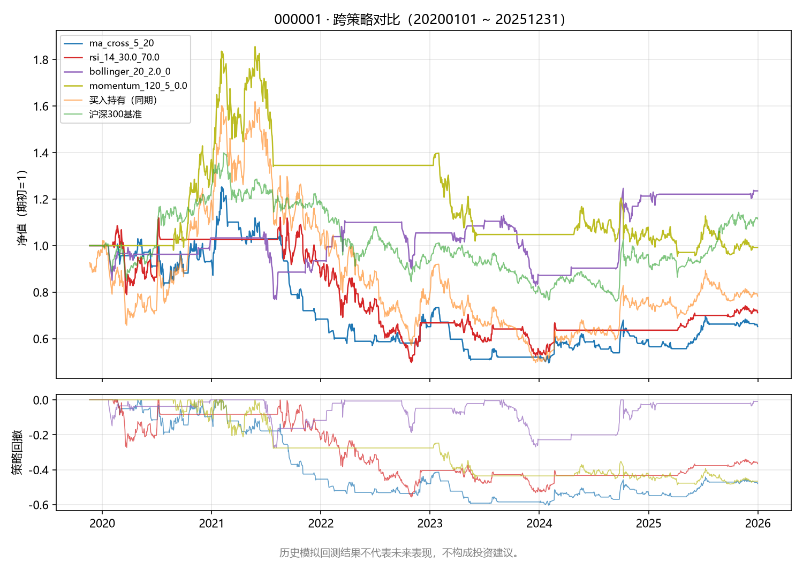

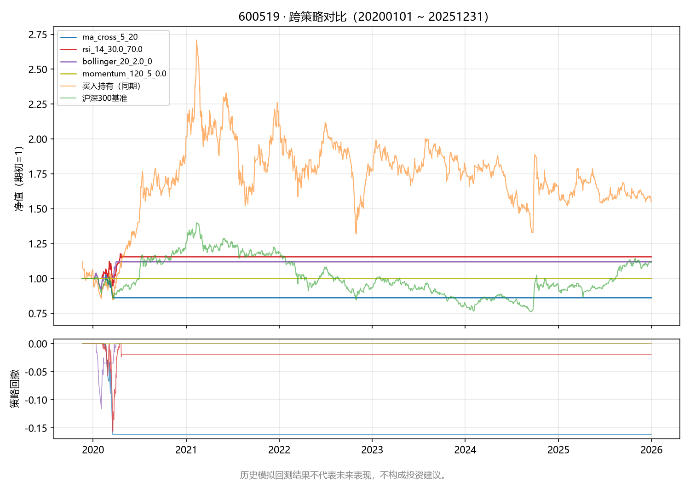

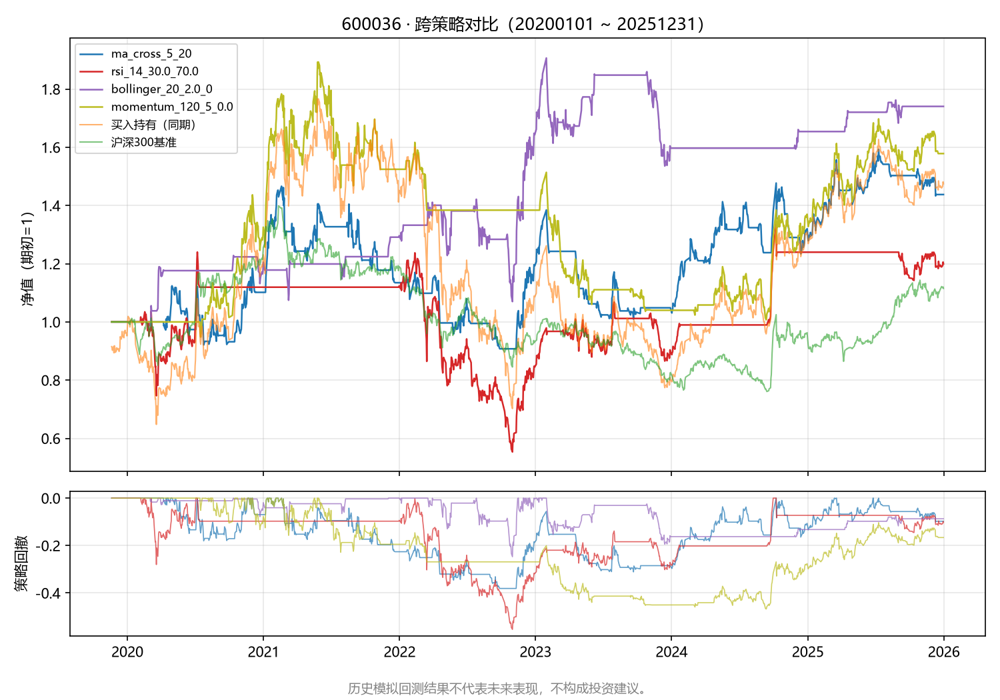

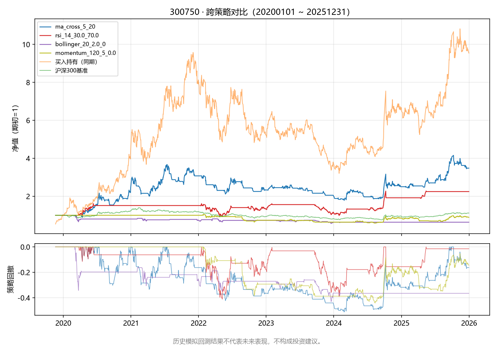

### 5.2 数据支撑的观察

1. **没有常胜策略**：4 只标的上最优策略各不相同（000001/600036 是 bollinger，600519 是 rsi，300750 是 ma_cross），"选一个策略打天下"在本样本上不成立；
2. **市场状态比策略选择更关键**：银行股（000001、600036）六年震荡/阴跌，均值回归（bollinger）跑赢买入持有；强趋势股（300750）上趋势跟随（ma_cross）跑赢、均值回归大亏——策略与市场状态的匹配比策略本身更重要；
3. **参数敏感性 > 策略差异**：RSI 的 exit_level 70→50 在 000001 上带来 +94.8 个百分点的变化，大于任何两个策略默认参数之间的差距——"用什么参数"经常比"用什么策略"影响更大，这正是过拟合的重灾区；
4. **口径决定结论**：600519 上同一 momentum 策略，整手口径 0.00%、小数股口径 -45.12%——不对齐口径的策略比较没有意义；
5. **跑赢基准的局部性**：4 只标的上都至少有一个策略跑赢沪深300（+11.50%），但没有任何策略在全部 4 只标的上跑赢买入持有；4 只票是今天仍存在的事后样本（幸存者偏差），结论不能推广。

### 5.3 本步学到的可复用方法

1. **先证明重构等价，再谈新功能**：策略迁移用"合成数据逐笔对照 + 真实数据结果对照"双重验证（见 1.1 节），等价性没证明之前，任何新策略的结论都不可信；
2. **每个新假设都要能被数据否决**：本步有两条假设被明确否决——布林带趋势过滤（3.2 节）与"年频动量更有效"（4.2 节 lookback=250 反而最差）；被否决的假设和成立的假设同样有价值；
3. **参数扫描的产物是假设，不是参数**：所有扫描结果只用于提出候选假设（如 exit_level=50），必须经过样本外验证才能谈参数好坏。

### 5.4 下一步候选

1. **walk-forward / 样本外检验**：把 2020-2025 拆成样本内（前 4 年）选参 + 样本外（后 2 年）验证，直接检验本日志所有"候选参数"的过拟合程度；
2. **横截面轮动**：把 momentum 从单标的绝对动量扩展为多标的横截面轮动（真正的 J-T 1993 用法），并测试"趋势市用动量、震荡市用回归"的状态轮换；
3. **数据层补齐**（第 1 步原计划顺延）：交易日历、证券列表、历史指数成分，扩大样本并缓解幸存者偏差；
4. **滑点与冲击成本建模**：当前所有回测零滑点，交易次数越多的策略（ma_cross、momentum）实盘折损越大，应先做成本敏感性。

---

## 6. walk-forward 参数优化与样本外验证（第 4 步）

> 新增脚本：`scripts/optimize.py`——4 策略参数网格扫描 + 锚定式 walk-forward 样本外验证 + 过拟合诊断 + 参数热力图/收益-回撤散点图。
> **⚠ 免责声明：本章全部内容为历史模拟回测，仅用于学习方法验证；历史模拟回测结果不代表未来表现，不构成投资建议。**

### 6.0 方法与口径

**动机**：第 3 步的结论之一（5.3 节第 3 条）是"参数扫描的产物是假设，不是参数"——所有"最优参数"都是在同一段 2020-2025 历史上事后挑的，天然过拟合。本步落实 5.4 节候选 1：把历史拆成样本内/样本外，用 walk-forward 流程直接检验参数可外推性。

**流程**：锚定式滚动 3 折——每折只用样本内选参，把选出的参数原样放到随后的样本外年份评分；同时**全部**网格组合也在每个样本外年份跑一遍，用于计算样本内-样本外秩相关等诊断。选优规则为样本内总收益率最大（与第 3 步口径一致）。

| 项目 | 口径 |
| --- | --- |
| 区间与数据 | 2020-01-01 ~ 2025-12-31（与第 2/3 步一致）；行情自 2017-01-01 起预热（300750 自上市日 2018-06-11），经 akshare 东财接口 qfq 前复权，2019-11-20 之后与第 3 步快照逐值一致 |
| fold 设计 | fold1：样本内 2020-2022 选参 → 样本外 2023 验证；fold2：样本内 2020-2023 → 样本外 2024；fold3：样本内 2020-2024 → 样本外 2025（样本外共 3 年、互不重叠） |
| 选参规则 | 每折按**样本内总收益率**选最优组合；该组合的样本外表现 = "walk-forward 实现收益" |
| 全网格样本外 | 所有组合都跑样本外年份 → 得样本内/样本外两个收益面，比较其形状与排序 |
| 执行口径 | 与 `backtest.py` 完全一致：t 日收盘信号 t+1 日开盘成交、佣金万三 + 卖出印花税万五、初始 10 万整手；600519 因整手约束多产生 0 交易，另跑 `--fractional` 小数股全仓口径 |
| 诊断指标 | ① Spearman ρ（组合样本内均值 vs 样本外均值）：≈1 稳定，≤0 不可外推；② 样本内最优的样本外平均分位：掉到中位数以下是过拟合；③ 邻点粗糙度：收益面相邻格点年化收益的平均落差；④ 样本内最优的轴邻点落差：最优参数沿每根参数轴挪一步后的表现差，即"最优参数相邻点剧烈波动"的直接度量；⑤ 翻转率：样本内前 1/4 的组合掉进样本外后 1/4 的比例 |

**参数网格（每策略的范围与步长）**：

| 策略 | 参数 1（范围/步长） | 参数 2（范围/步长） | 参数 3（范围/步长） | 有效组合数 |
| --- | --- | --- | --- | --- |
| ma_cross | short：3–20，步长 5 | long：20–250 | — | 24 |
| rsi | period：7–28，步长 7 | oversold：20–35，步长 5 | exit_level：50–70，步长 10 | 48 |
| bollinger | period：10–50（经典 20） | num_std：1.5–3.0，步长 0.5 | trend_period：0/60/120，步长 60 | 36 |
| momentum | lookback：60–250（J-T 经典约 252） | skip：0/5/21（J-T 经典 21） | threshold：-0.05–0.05，步长 0.05 | 27 |

**已知局限（诚实声明）**：① 样本外只有 3 个年份，且仍是同一批 4 只幸存者标的，结论只对本样本成立；② "稳健参数"是在样本外数据上挑选的，属轻度数据挖掘，只能当候选假设，不能当结论；③ 折与折之间仓位状态不继承（引擎按窗口内边沿成交，见 `backtest.py` 口径说明）；④ 所有诊断的"统计显著性"都不足以支撑真实资金决策——本项目是学习方法验证。

**数据落盘**：`output/optimize/<策略>/<策略>_<代码>[_frac]_{grid,walkforward,diagnostics}.csv` 与 `{heatmap,scatter}.png`；全局汇总 `output/optimize/summary_walkforward.csv`。复现命令见文末附录。

---

### 6.1 ma_cross：双均线——参数不可外推的最清晰例证

**汇总（样本外年化为各 fold 样本外年化的均值；600519 整手口径因 0 交易全部失效，见 6.4 小数股对照）**：

| 标的 | Spearman ρ | 样本内全局最优参数 | 其样本外年化均值 | 样本外平均分位 | 稳健参数（样本外年化均值最优） | 稳健样本外年化 | 默认参数样本外年化 | 粗糙度 IS/OOS（每步） | 翻转率 |
| --- | ---: | --- | ---: | ---: | --- | ---: | ---: | ---: | ---: |
| 000001（平安银行） | -0.32 | short=20,long=120 | -1.29% | 49% | short=3,long=30 | +7.42% | +5.49% | 3.9%/2.1% | 8% |
| 600519（贵州茅台） | 无定义 | short=15,long=30 | +0.00% | 4% | short=15,long=30 | +0.00% | +0.00% | 4.6%/0.0% | 25% |
| 600036（招商银行） | +0.02 | short=5,long=60 | +3.82% | 60% | short=10,long=20 | +8.02% | +1.38% | 4.0%/2.0% | 8% |
| 300750（宁德时代） | +0.61 | short=15,long=30 | +24.03% | 49% | short=10,long=60 | +29.33% | +16.92% | 8.3%/5.5% | 0% |

**样本内最优的轴邻点落差（ma_cross，各标的）**：
| 标的 | 样本内最优参数 | 样本内邻点最大落差（年化） | 样本外邻点最大落差（年化） | 邻点数 |
| --- | --- | ---: | ---: | ---: |
| 000001 | short=20,long=120 | +5.55% | +2.58% | 3 |
| 600519 | short=15,long=30 | +14.63% | +0.00% | 4 |
| 600036 | short=5,long=60 | +7.09% | +4.21% | 4 |
| 300750 | short=15,long=30 | +14.36% | +4.75% | 4 |

**fold 级明细（000001 与 300750，最能说明问题的两只）**：

| fold | 样本内选出的参数 | 样本内总收益 | 样本外总收益 | 样本外排名 | 该年样本外最优参数 | 默认参数样本外 | 网格样本外均值 |
| ---: | --- | ---: | ---: | ---: | --- | ---: | ---: |
| 1 | short=20,long=120 | +61.16% | +0.00% | 1/24 | short=15,long=120 | -20.14% | -11.72% |
| 2 | short=20,long=120 | +51.93% | -8.17% | 20/24 | short=3,long=60 | +15.48% | +8.59% |
| 3 | short=3,long=120 | +44.15% | +2.57% | 14/24 | short=15,long=20 | +15.58% | +5.17% |

| fold | 样本内选出的参数 | 样本内总收益 | 样本外总收益 | 样本外排名 | 该年样本外最优参数 | 默认参数样本外 | 网格样本外均值 |
| ---: | --- | ---: | ---: | ---: | --- | ---: | ---: |
| 1 | short=15,long=30 | +693.70% | -13.63% | 5/24 | short=10,long=30 | -11.38% | -17.11% |
| 2 | short=15,long=30 | +310.66% | +119.93% | 8/24 | short=15,long=60 | +27.83% | +85.83% |
| 3 | short=20,long=30 | +840.84% | +15.82% | 22/24 | short=5,long=250 | +39.54% | +28.62% |

000001 样本内 vs 样本外热力图（整手口径）：

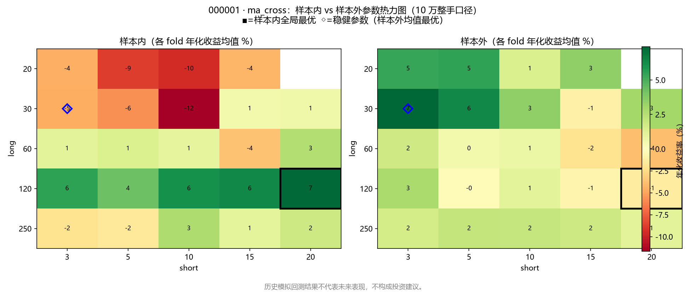

300750 收益-回撤散点图（虚线箭头 = 样本内全局最优 → 其在样本外的表现）：

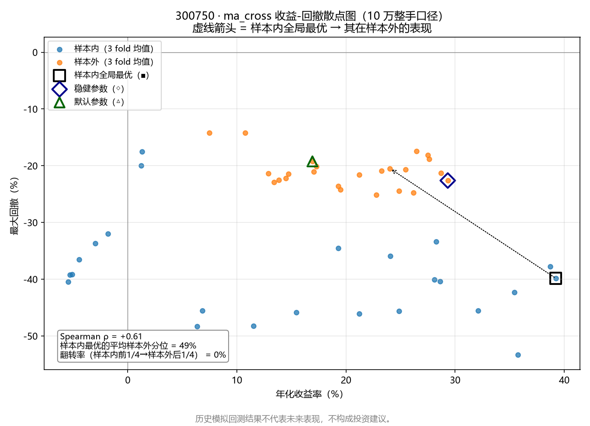

其余标的图表见 `output/optimize/ma_cross/`（均为历史模拟）。

**观察（数据支撑）**：
1. **ρ 在 000001 上为负（-0.32）、600036 上接近零（+0.02）**：样本内表现好的参数组合，样本外平均表现更差——参数排序完全不可外推，是教科书式的过拟合；
2. **样本内最优反复掉出样本外上半区**：000001 上样本内全局最优（20/120）样本外平均分位 49%，600036 上（5/60）分位 60%——"选出来的参数"并不比"随机抽一组参数"强；
3. **300750 是唯一的例外**：ρ=+0.61，但它的收益面也最粗糙（粗糙度 8.3%/5.5% 每步，全样本最高），fold3 样本内选出的（20/30）样本外只排 22/24——即便是"最稳定"的标的，样本内最优相邻一点的表现可以差 14.4 个百分点（年化）；
4. **600519 整手口径全网格 0 交易**：10 万元在 2019 年后的茅台价格下买不起 1 手，整手口径下该标的完全没有信息量（第 3 步 4.1 节同一坑的再现）。

**结论**：ma_cross 的双均线参数在本样本上**不存在可外推的稳健参数**——ρ 非正、样本内最优无样本外溢价、收益面最粗糙。第 2 步"MA 金叉死叉不优于买入持有"、第 3 步"ma_cross 只作迁移对照"的结论在样本外检验后继续成立。**不为其选择任何"稳健参数"；其参数敏感性恰恰是本步方法论的反面教材。**

---

### 6.2 rsi：RSI 超卖反转——第 3 步候选假设部分存活

**汇总**：

| 标的 | Spearman ρ | 样本内全局最优参数 | 其样本外年化均值 | 样本外平均分位 | 稳健参数（样本外年化均值最优） | 稳健样本外年化 | 默认参数样本外年化 | 粗糙度 IS/OOS（每步） | 翻转率 |
| --- | ---: | --- | ---: | ---: | --- | ---: | ---: | ---: | ---: |
| 000001（平安银行） | +0.63 | period=14,oversold=25.0,exit_level=50.0 | +12.11% | 18% | period=14,oversold=25.0,exit_level=50.0 | +12.11% | +6.69% | 2.6%/2.7% | 0% |
| 600519（贵州茅台） | 无定义 | period=14,oversold=35.0,exit_level=50.0 | +0.00% | 2% | period=14,oversold=35.0,exit_level=50.0 | +0.00% | +0.00% | 1.2%/0.0% | 27% |
| 600036（招商银行） | +0.58 | period=21,oversold=30.0,exit_level=50.0 | +7.87% | 29% | period=7,oversold=25.0,exit_level=70.0 | +16.75% | +9.60% | 3.5%/3.1% | 0% |
| 300750（宁德时代） | +0.68 | period=14,oversold=35.0,exit_level=70.0 | +16.14% | 41% | period=28,oversold=35.0,exit_level=70.0 | +31.28% | +19.82% | 3.6%/5.1% | 0% |

**样本内最优的轴邻点落差（rsi，各标的）**：
| 标的 | 样本内最优参数 | 样本内邻点最大落差（年化） | 样本外邻点最大落差（年化） | 邻点数 |
| --- | --- | ---: | ---: | ---: |
| 000001 | period=14,oversold=25.0,exit_level=50.0 | +12.77% | +7.13% | 5 |
| 600519 | period=14,oversold=35.0,exit_level=50.0 | +9.29% | +0.00% | 4 |
| 600036 | period=21,oversold=30.0,exit_level=50.0 | +15.87% | +2.79% | 5 |
| 300750 | period=14,oversold=35.0,exit_level=70.0 | +18.76% | +3.68% | 4 |

**fold 级明细（000001 与 600036）**：

| fold | 样本内选出的参数 | 样本内总收益 | 样本外总收益 | 样本外排名 | 该年样本外最优参数 | 默认参数样本外 | 网格样本外均值 |
| ---: | --- | ---: | ---: | ---: | --- | ---: | ---: |
| 1 | period=14,oversold=25.0,exit_level=50.0 | +87.93% | +49.39% | 6/48 | period=21,oversold=30.0,exit_level=50.0 | +23.47% | +23.52% |
| 2 | period=14,oversold=25.0,exit_level=50.0 | +201.70% | +0.00% | 16/48 | period=7,oversold=25.0,exit_level=50.0 | +0.00% | +9.46% |
| 3 | period=14,oversold=25.0,exit_level=50.0 | +96.88% | +20.56% | 4/48 | period=14,oversold=30.0,exit_level=50.0 | +12.01% | +4.33% |

| fold | 样本内选出的参数 | 样本内总收益 | 样本外总收益 | 样本外排名 | 该年样本外最优参数 | 默认参数样本外 | 网格样本外均值 |
| ---: | --- | ---: | ---: | ---: | --- | ---: | ---: |
| 1 | period=21,oversold=30.0,exit_level=50.0 | +154.21% | +84.32% | 1/48 | period=14,oversold=25.0,exit_level=50.0 | +69.02% | +49.36% |
| 2 | period=21,oversold=30.0,exit_level=50.0 | +250.55% | +0.00% | 25/48 | period=7,oversold=30.0,exit_level=70.0 | +24.99% | +15.17% |
| 3 | period=14,oversold=25.0,exit_level=50.0 | +131.67% | +0.00% | 16/48 | period=14,oversold=35.0,exit_level=70.0 | -3.32% | +1.01% |

000001 样本内 vs 样本外热力图：

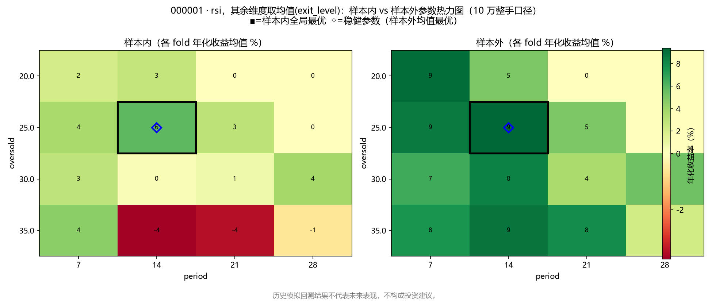

600036 收益-回撤散点图：

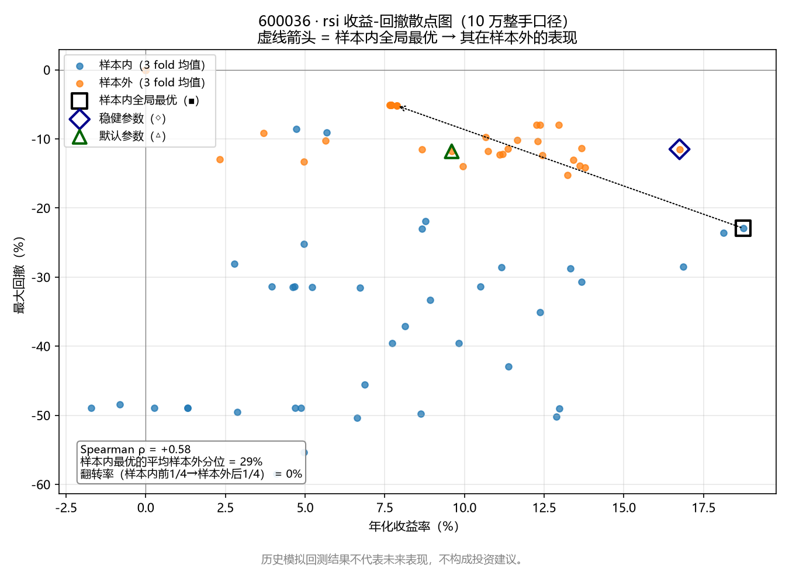

**观察（数据支撑）**：
1. **ρ 全样本最高（+0.58 ~ +0.68，三个可交易标的）**：RSI 的参数排序在样本内/样本外之间保持得最好，是这个参数家族"有真实信息"的最强证据；
2. **第 3 步候选假设 exit_level=50 在 000001 上完整存活**：样本内全局最优（14/25/50）连续 3 折都被选中，样本外年化 +12.11%（默认参数 +6.69%），样本外平均分位 18%——第 3 步 2.2 节"离场阈值是收益的第一杠杆"的结论通过样本外检验；600036 上三折样本内最优也全是 exit_level=50；
3. **但同样的参数不迁移**：300750 上样本内最优是 exit_level=70（14/35/70），600036 的样本外最优是（7/25/70）——"exit_level=50"不是普适真理，只是 000001/600036 这类震荡票上的有效假设；
4. **邻点落差仍然很大**：000001 上样本内最优（14/25/50）沿某根参数轴挪一步（如 oversold 25→20），样本内年化就差 12.8 个百分点——即便 ρ 最高的策略，最优参数也是"尖峰"，不是"平台"。

**结论**：RSI 是 4 个策略中参数最可外推的一个，第 3 步的 exit_level=50 候选假设在震荡票上通过样本外检验。**稳健参数候选：(period=7, oversold=25, exit_level=70)**——在 3 个整手可交易标的上样本外年化全部为正且不低于默认参数（详见 6.5 总表）；同时保留 (14/25/50) 作为震荡票专用候选。两者都是候选假设，仍需更多样本外年份检验。

---

### 6.3 bollinger：布林带均值回归——唯一的"全样本优于默认"候选

**汇总**：

| 标的 | Spearman ρ | 样本内全局最优参数 | 其样本外年化均值 | 样本外平均分位 | 稳健参数（样本外年化均值最优） | 稳健样本外年化 | 默认参数样本外年化 | 粗糙度 IS/OOS（每步） | 翻转率 |
| --- | ---: | --- | ---: | ---: | --- | ---: | ---: | ---: | ---: |
| 000001（平安银行） | +0.49 | period=10,num_std=1.5,trend_period=120 | +1.14% | 19% | period=50,num_std=2.0,trend_period=0 | +9.82% | +4.74% | 0.8%/1.0% | 3% |
| 600519（贵州茅台） | 无定义 | period=10,num_std=1.5,trend_period=0 | +0.00% | 3% | period=10,num_std=1.5,trend_period=0 | +0.00% | +0.00% | 0.3%/0.0% | 100% |
| 600036（招商银行） | +0.39 | period=50,num_std=2.5,trend_period=0 | +7.99% | 40% | period=50,num_std=1.5,trend_period=0 | +8.22% | +1.73% | 1.5%/1.2% | 6% |
| 300750（宁德时代） | +0.45 | period=50,num_std=1.5,trend_period=0 | +15.98% | 44% | period=50,num_std=2.0,trend_period=0 | +16.24% | -1.84% | 2.9%/3.0% | 6% |

**样本内最优的轴邻点落差（bollinger，各标的）**：
| 标的 | 样本内最优参数 | 样本内邻点最大落差（年化） | 样本外邻点最大落差（年化） | 邻点数 |
| --- | --- | ---: | ---: | ---: |
| 000001 | period=10,num_std=1.5,trend_period=120 | +3.91% | +0.67% | 3 |
| 600519 | period=10,num_std=1.5,trend_period=0 | +3.08% | +0.00% | 3 |
| 600036 | period=50,num_std=2.5,trend_period=0 | +11.41% | +9.49% | 4 |
| 300750 | period=50,num_std=1.5,trend_period=0 | +14.33% | +15.98% | 3 |

**fold 级明细（000001 与 300750）**：

| fold | 样本内选出的参数 | 样本内总收益 | 样本外总收益 | 样本外排名 | 该年样本外最优参数 | 默认参数样本外 | 网格样本外均值 |
| ---: | --- | ---: | ---: | ---: | --- | ---: | ---: |
| 1 | period=10,num_std=1.5,trend_period=120 | +24.58% | +0.49% | 5/36 | period=50,num_std=2.0,trend_period=0 | -17.35% | +0.68% |
| 2 | period=50,num_std=2.0,trend_period=0 | +37.69% | +8.57% | 6/36 | period=20,num_std=2.0,trend_period=0 | +39.10% | +4.88% |
| 3 | period=10,num_std=1.5,trend_period=120 | +27.78% | +2.10% | 9/36 | period=50,num_std=2.0,trend_period=0 | +1.84% | +0.93% |

| fold | 样本内选出的参数 | 样本内总收益 | 样本外总收益 | 样本外排名 | 该年样本外最优参数 | 默认参数样本外 | 网格样本外均值 |
| ---: | --- | ---: | ---: | ---: | --- | ---: | ---: |
| 1 | period=50,num_std=1.5,trend_period=120 | +42.27% | +0.00% | 11/36 | period=50,num_std=1.5,trend_period=0 | -14.60% | +9.27% |
| 2 | period=50,num_std=1.5,trend_period=0 | +164.54% | +10.35% | 4/36 | period=10,num_std=1.5,trend_period=60 | -0.37% | +4.57% |
| 3 | period=10,num_std=1.5,trend_period=60 | +60.06% | -2.04% | 33/36 | period=50,num_std=2.0,trend_period=0 | +0.00% | +2.60% |

000001 样本内 vs 样本外热力图：

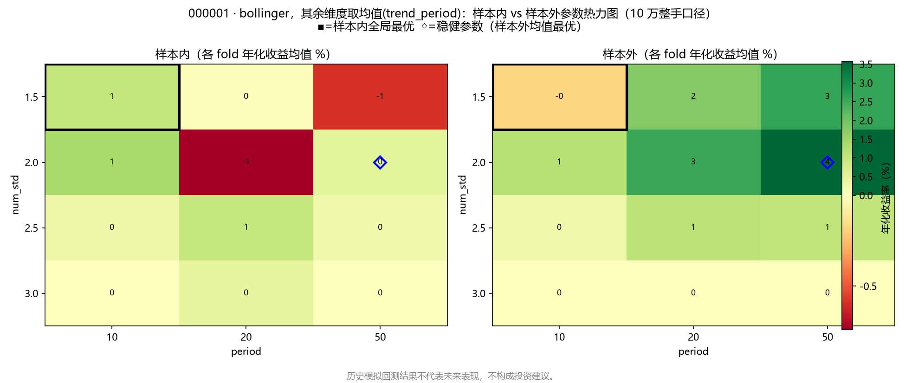

300750 收益-回撤散点图：

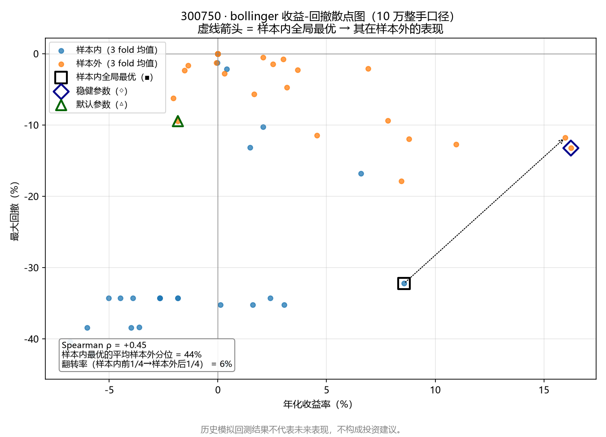

**观察（数据支撑）**：
1. **ρ 中等稳定（+0.39 ~ +0.49）**，且收益面最平坦（粗糙度 0.8%~3.0% 每步，全策略最低）——布林带参数是"平台型"而非"尖峰型"，相邻参数表现接近，这是稳健性的好迹象；
2. **第 3 步被否决的趋势过滤再次被否决**：000001 样本内全局最优（10/1.5/120）带了 MA120 过滤，但其样本外年化只剩 +1.14%（分位 19%），而三只标的的样本外最优全是 trend_period=0——"不在下跌趋势中接飞刀"的过滤条件在样本外持续伤害收益；
3. **宽窗口 + 无过滤的候选（50/2.0/0）在全部 4 只标的上优于默认参数（20/2.0/0）**：000001 +9.82% vs +4.74%、600036 +8.14% vs +1.73%、300750 +16.24% vs -1.84%、600519 小数股 +4.91% vs +3.74%——这是本步唯一一个在**每一只**标的、每一种口径上都跑赢默认参数的参数组合；
4. **样本内最优的样本外分位仍然不高（19%~44%）**：即便最稳健的策略，"选样本内第一"也只能保住样本外前 1/4~1/2 的位置，样本外分位 19% 的 000001 已属最好水平。

**结论**：布林带均值回归的参数在本样本上最稳健，且延续第 3 步 3.2 节"趋势过滤适得其反"的结论。**稳健参数候选：(period=50, num_std=2.0, trend_period=0)**——全标的、全口径优于默认参数（理由见 6.5 总表）；该组合同时把交易频率压到更低（窗口 50 日），成本敏感性上也有优势（第 5 步候选）。

---

### 6.4 momentum：绝对动量——样本内怪兽、样本外平庸；600519 小数股对照

**汇总**：

| 标的 | Spearman ρ | 样本内全局最优参数 | 其样本外年化均值 | 样本外平均分位 | 稳健参数（样本外年化均值最优） | 稳健样本外年化 | 默认参数样本外年化 | 粗糙度 IS/OOS（每步） | 翻转率 |
| --- | ---: | --- | ---: | ---: | --- | ---: | ---: | ---: | ---: |
| 000001（平安银行） | +0.16 | lookback=60,skip=21,threshold=0.0 | +1.20% | 60% | lookback=120,skip=5,threshold=-0.05 | +5.11% | -1.36% | 2.5%/1.1% | 11% |
| 600519（贵州茅台） | 无定义 | lookback=60,skip=5,threshold=-0.05 | +0.00% | 4% | lookback=60,skip=5,threshold=-0.05 | +0.00% | +0.00% | 3.1%/0.0% | 26% |
| 600036（招商银行） | +0.53 | lookback=250,skip=21,threshold=0.0 | +5.35% | 31% | lookback=250,skip=21,threshold=-0.05 | +13.06% | +5.08% | 3.1%/2.6% | 0% |
| 300750（宁德时代） | -0.24 | lookback=60,skip=5,threshold=-0.05 | +19.48% | 42% | lookback=120,skip=5,threshold=-0.05 | +28.96% | +20.80% | 8.6%/6.7% | 4% |

**样本内最优的轴邻点落差（momentum，各标的）**：
| 标的 | 样本内最优参数 | 样本内邻点最大落差（年化） | 样本外邻点最大落差（年化） | 邻点数 |
| --- | --- | ---: | ---: | ---: |
| 000001 | lookback=60,skip=21,threshold=0.0 | +10.19% | +4.95% | 4 |
| 600519 | lookback=60,skip=5,threshold=-0.05 | +12.79% | +0.00% | 4 |
| 600036 | lookback=250,skip=21,threshold=0.0 | +7.63% | +7.71% | 4 |
| 300750 | lookback=60,skip=5,threshold=-0.05 | +39.16% | +9.48% | 4 |

**fold 级明细（300750）**：

| fold | 样本内选出的参数 | 样本内总收益 | 样本外总收益 | 样本外排名 | 该年样本外最优参数 | 默认参数样本外 | 网格样本外均值 |
| ---: | --- | ---: | ---: | ---: | --- | ---: | ---: |
| 1 | lookback=60,skip=5,threshold=-0.05 | +582.86% | -20.09% | 21/27 | lookback=250,skip=21,threshold=0.05 | -13.23% | -11.64% |
| 2 | lookback=60,skip=5,threshold=-0.05 | +188.76% | +93.91% | 3/27 | lookback=60,skip=0,threshold=-0.05 | +90.40% | +63.87% |
| 3 | lookback=60,skip=5,threshold=-0.05 | +490.80% | +23.87% | 10/27 | lookback=120,skip=5,threshold=-0.05 | +26.37% | +18.80% |

300750 样本内 vs 样本外热力图：

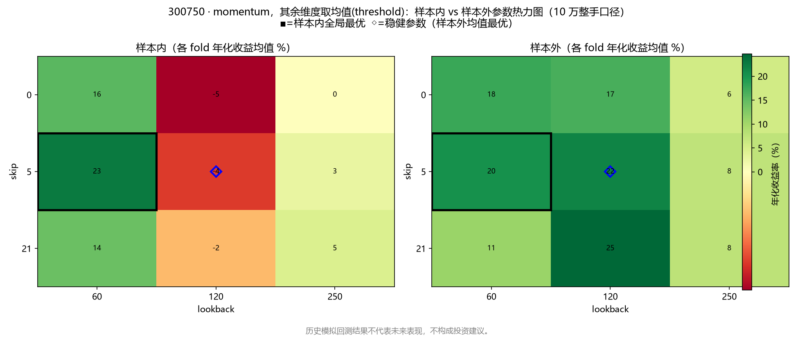

300750 收益-回撤散点图：

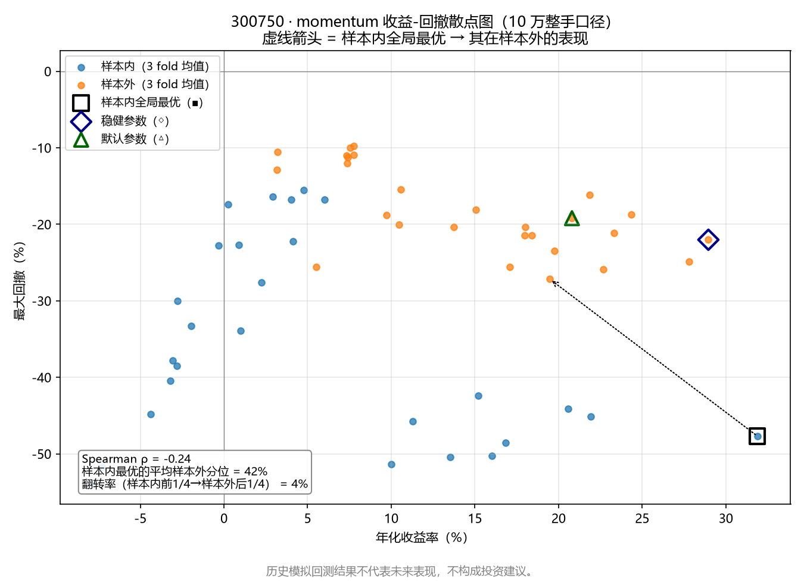

**观察（数据支撑）**：
1. **"样本内怪兽"在 300750 上连续 3 折当选、样本外却平庸**：（60/5/-0.05）样本内总收益 +582.86%/+188.76%/+490.80%，样本外只有 -20.09%/+93.91%/+23.87%（排名 21、3、10）——样本内 +583% 的"最优参数"在第一个样本外年份亏掉 20%，ρ 因此为负（-0.24）；
2. **相邻点剧烈波动的极端案例**：300750 上样本内最优（60/5/-0.05）把 lookback 从 60 挪到 120，样本内年化收益从 +31.9% 变 -7.3%，差 **39.2 个百分点**——而那个样本内亏钱的邻居（120/5/-0.05）恰恰是样本外年化最高（+29.0%）的组合。把参数挪一步，结论从"优秀"变"平庸"甚至反转，这是本步寻找的过拟合迹象的最极端样本；
3. **ρ 在 000001 上只有 +0.16、600036 上 +0.53**：动量参数排序的稳定性随标的剧烈变化，与第 3 步"参数与标的强耦合、不可外推"的结论一致；
4. **600519 小数股口径（整手口径 0 交易，无信息）**：ρ 仅 +0.24（momentum）~-0.08（rsi），样本内最优的样本外分位 57%~79%（bollinger 除外，20%）；各策略网格的样本外均值分化为负（ma_cross 三折 -8.7%~-20.7%、momentum -6.7%~-18.2%）与小幅为正（bollinger +0.8%~+2.6%）——茅台 2023-2025 本身走弱，样本内最优参数同样不可外推。

**600519 小数股口径的 fold 级明细（4 策略；整手口径下该标的全网格 0 交易）**：

| fold | 样本内选出的参数 | 样本内总收益 | 样本外总收益 | 样本外排名 | 该年样本外最优参数 | 默认参数样本外 | 网格样本外均值 |
| ---: | --- | ---: | ---: | ---: | --- | ---: | ---: |
| 1 | short=5,long=20 | +83.34% | -25.12% | 24/24 | short=15,long=60 | -25.12% | -11.70% |
| 2 | short=15,long=30 | +119.94% | -27.59% | 18/24 | short=20,long=250 | -32.21% | -20.74% |
| 3 | short=15,long=30 | +59.25% | -9.77% | 15/24 | short=5,long=60 | -4.39% | -8.68% |

| fold | 样本内选出的参数 | 样本内总收益 | 样本外总收益 | 样本外排名 | 该年样本外最优参数 | 默认参数样本外 | 网格样本外均值 |
| ---: | --- | ---: | ---: | ---: | --- | ---: | ---: |
| 1 | period=14,oversold=35.0,exit_level=50.0 | +93.08% | -0.69% | 34/48 | period=7,oversold=20.0,exit_level=50.0 | +5.08% | -0.33% |
| 2 | period=21,oversold=35.0,exit_level=70.0 | +144.59% | +0.00% | 31/48 | period=7,oversold=20.0,exit_level=70.0 | +0.00% | +4.90% |
| 3 | period=21,oversold=35.0,exit_level=70.0 | +175.35% | -3.77% | 45/48 | period=28,oversold=35.0,exit_level=60.0 | +2.94% | +0.66% |

| fold | 样本内选出的参数 | 样本内总收益 | 样本外总收益 | 样本外排名 | 该年样本外最优参数 | 默认参数样本外 | 网格样本外均值 |
| ---: | --- | ---: | ---: | ---: | --- | ---: | ---: |
| 1 | period=50,num_std=2.5,trend_period=0 | +54.57% | +10.17% | 4/36 | period=20,num_std=1.5,trend_period=0 | +5.36% | +2.60% |
| 2 | period=50,num_std=2.5,trend_period=0 | +106.96% | +9.39% | 2/36 | period=50,num_std=2.0,trend_period=0 | +7.98% | +0.75% |
| 3 | period=50,num_std=2.5,trend_period=0 | +126.40% | +1.07% | 16/36 | period=50,num_std=2.0,trend_period=0 | +5.11% | +1.45% |

| fold | 样本内选出的参数 | 样本内总收益 | 样本外总收益 | 样本外排名 | 该年样本外最优参数 | 默认参数样本外 | 网格样本外均值 |
| ---: | --- | ---: | ---: | ---: | --- | ---: | ---: |
| 1 | lookback=60,skip=5,threshold=-0.05 | +81.73% | -13.10% | 7/27 | lookback=60,skip=0,threshold=0.05 | -13.67% | -18.15% |
| 2 | lookback=60,skip=5,threshold=-0.05 | +57.62% | -25.60% | 25/27 | lookback=120,skip=21,threshold=0.05 | -9.06% | -12.02% |
| 3 | lookback=120,skip=21,threshold=-0.05 | +32.99% | -6.53% | 14/27 | lookback=250,skip=5,threshold=0.05 | -1.61% | -6.67% |

**结论**：动量的参数优化收益大部分是过拟合：样本内最亮的参数在样本外回归平庸，且单参数一步之差的年化收益差可达 39 个百分点。**不给出统一的"稳健参数"**；若按标的分别对待，600036 上（250/21/-0.05）样本外年化 +13.06%（默认 +5.08%）、300750 上（120/5/-0.05）样本外年化 +28.96%（默认 +20.80%）——参数与标的强耦合本身就是结论。

---

### 6.5 跨策略总结：哪类参数值得信任，以及本步选出的稳健参数

#### 6.5.1 参数稳定性排名（Spearman ρ 矩阵）

| 策略 \ 标的 | 000001 | 600036 | 300750 | 600519（小数股） | 稳定性评价 |
| --- | ---: | ---: | ---: | ---: | --- |
| ma_cross | **-0.32** | +0.02 | +0.61 | +0.07 | 最差：两个标的不可外推 |
| rsi | **+0.63** | **+0.58** | **+0.68** | -0.08 | 最好：三个标的都稳定为正 |
| bollinger | +0.49 | +0.39 | +0.45 | +0.21 | 次好：全为正且收益面最平坦 |
| momentum | +0.16 | +0.53 | **-0.24** | +0.24 | 不稳定：随标的剧烈变化 |

#### 6.5.2 第 3 步候选假设的样本外裁决

| 第 3 步候选假设 | 样本外裁决 | 依据 |
| --- | --- | --- |
| rsi exit_level=50 优于 70（2.2 节） | **部分存活** | 000001/600036 上样本内最优连续 3 折全选 exit_level=50 且样本外跑赢默认；300750 上样本内最优是 70——"离场阈值"方向对，具体值分标的 |
| momentum lookback=60 优于 120/250（4.2 节） | **部分存活** | 300750 上样本内最优三折全选 lookback=60（样本外 +19.5% 年化、分位 42%）；600036 上样本外最优是 lookback=250——"季度尺度动量"只在趋势票上成立 |
| bollinger 趋势过滤有害（3.2 节） | **完全存活** | 三只标的样本外最优全部 trend_period=0；带过滤的样本内最优（10/1.5/120）样本外只剩 +1.14% |
| 参数与标的强耦合、不可外推（5.2 节） | **再次确认** | 16 个有效单元（4 策略 × 3 个整手可交易标的 + 600519 小数股 4 策略）里只有 3 个样本内最优保住样本外前 20%，11 个掉出前 40% |

#### 6.5.3 本步选出的稳健参数组（含理由与保留）

按"3 个整手可交易标的的样本外年化均值最大"选出每组候选（600519 小数股单独核验）。**所有候选都是在样本外数据上挑的，只能当候选假设**：

**ma_cross**

- 稳健参数候选：`short=10, long=20`（3 标的样本外年化均值 +11.44%，样本内年化均值 +5.97%）

| 标的 | 候选参数样本外年化 | 候选参数样本内年化 | 默认参数样本外年化 |
| --- | ---: | ---: | ---: |
| 000001（平安银行） | +1.42% | -9.51% | +5.49% |
| 600036（招商银行） | +8.02% | -4.72% | +1.38% |
| 300750（宁德时代） | +24.88% | +32.13% | +16.92% |
- 600519 小数股口径下该候选：样本外年化 -12.61%，样本内年化 +6.16%

**rsi**

- 稳健参数候选：`period=7, oversold=25, exit_level=70`（3 标的样本外年化均值 +15.85%，样本内年化均值 +1.44%）

| 标的 | 候选参数样本外年化 | 候选参数样本内年化 | 默认参数样本外年化 |
| --- | ---: | ---: | ---: |
| 000001（平安银行） | +8.17% | -3.36% | +6.69% |
| 600036（招商银行） | +16.75% | +6.72% | +9.60% |
| 300750（宁德时代） | +22.63% | +0.98% | +19.82% |
- 600519 小数股口径下该候选：样本外年化 -1.76%，样本内年化 +0.37%

**bollinger**

- 稳健参数候选：`period=50, num_std=2, trend_period=0`（3 标的样本外年化均值 +11.40%，样本内年化均值 +2.07%）

| 标的 | 候选参数样本外年化 | 候选参数样本内年化 | 默认参数样本外年化 |
| --- | ---: | ---: | ---: |
| 000001（平安银行） | +9.82% | +1.46% | +4.74% |
| 600036（招商银行） | +8.14% | +4.41% | +1.73% |
| 300750（宁德时代） | +16.24% | +0.36% | -1.84% |
- 600519 小数股口径下该候选：样本外年化 +4.91%，样本内年化 +5.69%

**momentum**

- 稳健参数候选：`lookback=120, skip=5, threshold=-0.05`（3 标的样本外年化均值 +12.13%，样本内年化均值 -1.22%）

| 标的 | 候选参数样本外年化 | 候选参数样本内年化 | 默认参数样本外年化 |
| --- | ---: | ---: | ---: |
| 000001（平安银行） | +5.11% | +2.89% | -1.36% |
| 600036（招商银行） | +2.33% | +0.73% | +5.08% |
| 300750（宁德时代） | +28.96% | -7.27% | +20.80% |
- 600519 小数股口径下该候选：样本外年化 -9.53%，样本内年化 -4.55%

**选择理由汇总**：

| 策略 | 本步结论 | 理由 |
| --- | --- | --- |
| ma_cross | **不选**（无稳健参数） | ρ 非正/近零，样本内最优无样本外溢价，收益面最粗糙 |
| rsi | **候选 (7, 25, 70)** | 3 标的样本外年化全部为正（+8.17%/+16.75%/+22.63%）且不低于默认；ρ 全样本最高；与第 3 步 exit_level 结论一致（70 的变体在趋势票上更优）。震荡票上可另用 (14, 25, 50) |
| bollinger | **候选 (50, 2.0, 0)** | 全标的、全口径优于默认参数（含 600519 小数股 +4.91% vs +3.74%）；收益面最平坦；趋势过滤=0 与第 3 步否决结论一致 |
| momentum | **不选**（按标的区分） | 参数-标的强耦合：600036 用 (250, 21, -0.05)、300750 用 (120, 5, -0.05) 才成立；无跨标的统一参数 |

#### 6.5.4 本步学到的可复用方法

1. **"样本内最优"本身没有价值，它的样本外分位才有**：本步所有策略的样本内最优，样本外平均分位 18%~60%——只报告"我选出了最好参数"而不报样本外分位，就是自我欺骗；
2. **Spearman ρ 是参数稳健性的第一过滤器**：ρ≤0 的策略（ma_cross×000001、momentum×300750）直接判"参数不可外推"，不必再看任何"最优参数"；
3. **粗糙度与"尖峰 vs 平台"是第二过滤器**：bollinger（粗糙度 0.8%~3.0%/步）的参数是平台，选错一步损失小；momentum×300750（8.6%/6.7%/步、邻点落差 39.2 个百分点）是尖峰，选错一步结论反转；
4. **口径失真必须先于任何结论**：600519 整手口径全网格 0 交易（ρ 无定义、翻转率 100% 等"数字"全是假象），小数股口径才给出信号质量——第 3 步 4.2 节的教训在优化阶段再次应验。

#### 6.5.5 下一步候选

1. **组合层面的稳健参数检验**：把 6.5.3 的候选参数放到组合（等权 4 票）层面做样本外检验，并用更长的样本外（换数据源/换时段）交叉验证；
2. **横截面轮动**（第 3 步 5.4 候选 2 顺延）：momentum 在本步再次证明参数不可外推，只有扩展到多标的横截面（真正的 J-T 1993 用法）才可能稳定；
3. **成本敏感性**：bollinger(50/2.0/0) 交易更少，ma_cross/momentum 交易频繁——滑点与冲击成本建模后稳健性排名可能重排；
4. **数据层补齐**（第 1 步原计划继续顺延）：交易日历、证券列表、历史指数成分——样本外年份只有 3 个，样本只有 4 只幸存者，是本章结论推广性的最大软肋。

---

## 7. 组合构建与仓位管理（第 5 步）

### 7.0 本步做什么

把第 4 步 walk-forward 选出的**稳健参数策略**（首选 `rsi period=7,oversold=25,exit_level=70`，次选 `bollinger period=50,num_std=2.0,trend_period=0`，见 6.5.3 节）从单标的推广到 4 只标的的**组合层面**（`scripts/portfolio.py`）：每只标的按策略信号给出 0/1 目标仓位，组合目标权重 = 信号 × 权重方案；支持**等权 / 波动率倒数 / 风险平价**三种权重方案与**定期再平衡**（默认 21 交易日≈月度），可选**回撤目标再平衡**触发；输出组合净值曲线、年化收益率、最大回撤、年化单边换手率，并与**等权买入持有（EW-BH）** 和**沪深300** 对比。

### 7.1 调研：经典组合管理方法（含来源）

| 方法 | 要点（调研所得） | 来源 |
| --- | --- | --- |
| 等权 1/N | 在估计误差面前，"朴素等权"经常不输于甚至优于需要估计期望收益与协方差的均值-方差最优组合（样本外）；没有可估计参数的方案天然规避了估计误差 | DeMiguel, Garlappi & Uppal (2009), "Optimal Versus Naive Diversification: How Inefficient is the 1/N Portfolio Strategy?", *Review of Financial Studies* 22(5), 1915-1953. https://academic.oup.com/rfs/article-abstract/22/5/1915/1592901 |
| 波动率倒数加权 | 只按 1/σ 加权（也称"朴素风险平价"）；经验上低波动股票长期有"低波动异象"（风险与收益不匹配），低配高波动股票的规则在实证上常提高夏普 | Baker, Bradley & Wurgler (2011), "Benchmarks as Limits to Arbitrage: Understanding the Low-Volatility Anomaly", *Financial Analysts Journal* 67(1), 40-54；Roncalli 综述（见下）把 1/σ 归类为忽略相关性的朴素风险平价 |
| 风险平价（等风险贡献 ERC） | 要求每个资产的风险贡献 w_i·(Σw)_i 相等；长仓 ERC 解在正定协方差下存在且唯一；忽略相关性时退化为 1/σ | Maillard, Roncalli & Teiletche (2010), "The Properties of Equally Weighted Risk Contribution Portfolios", *Journal of Portfolio Management* 36(4), 60-70；实现算法与综述：Roncalli, "Asset Return and Risk Parity", http://www.thierry-roncalli.com/download/Asset-Return-and-Risk-Parity.pdf |
| 回撤目标再平衡 / 回撤控制 | 理论解（以回撤为约束的最优投资）会随着净值接近回撤目标而持续降低风险敞口——回撤控制以放弃部分长期增长为代价换回撤上限 | Grossman & Zhou (1993), "Optimal Investment Strategies for Controlling Drawdowns", *Mathematical Finance* 3(3), 241-276；回撤作为风险度量用于组合优化：Chekhlov, Uryasev & Zabarankin (2005), "Drawdown Measure in Portfolio Optimization", *International Journal of Theoretical and Applied Finance* 8(1), 13-58 |
| 定期再平衡 | 再平衡在均值回复市场里"低买高卖"收割波动溢价（volatility harvesting）；在单边趋势市场里则是持续削减赢家仓位 | Bouchey, Nemtchinov, Paulsen & Stein (2012), "Volatility Harvesting: Why Does Diversifying and Rebalancing Create Portfolio Growth?", *Journal of Wealth Management* 15(2), 26-35 |

开源实现参考（学习对照，未直接引用代码）：backtrader（GPLv3）组合与再平衡框架 https://github.com/cloudquant/backtrader （本项目第 3 步已引用）。实现选择：ew/iv/rp 三种权重方案 + 定期再平衡全部落地，回撤目标再平衡以"回撤穿越阈值的额外再平衡触发"落地（`--dd-trigger`）。

### 7.2 组合回测口径（与第 3 步引擎同源，组合特有处逐条声明）

沿用第 3 步统一口径：信号语义（t 日收盘产生目标仓位 → t+1 日开盘成交，无未来函数）、成本（买入佣金万三、卖出佣金万三+印花税万五、未建模滑点）、qfq 前复权、2020-01-01~2025-12-31、初始 10 万元、沪深300（000300）基准。组合特有口径：

| 项目 | 口径 |
| --- | --- |
| 持仓分配 | **小数股**全仓分配（学术口径）：10 万资金 × 25% 权重在 600519 上不足一手，整手约束无法表达任何权重方案（第 3/4 步已论证小数股口径的必要性） |
| 交易日历 | 4 只标的交易日的**并集**；停牌日价格前向填充、信号与持仓冻结 |
| 交易触发 | ① 每 21 交易日定期再平衡；② 任一标的信号 0↔1 边沿当日立即交易；③ 可选回撤触发：组合净值自高点回撤**穿越** `--dd-trigger` 阈值时额外再平衡一次（边沿语义，见 7.5.4） |
| 目标权重 | 信号=1 的"活跃标的"之间按权重方案归一分配，其余资金持现金；无活跃标的时 100% 现金 |
| 权重方案 | ew：1/n；iv：w ∝ 1/σ；rp：ERC 定点迭代 w ← w·√(σ_p²/(n·RC_i))，σ/协方差用最近 60 个交易日收益率（截至触发日前一交易日收盘）估计，协方差按"两两完整观测"构建，估计失败退化 iv。对角协方差时 rp≡iv、任意协方差下风险贡献相等的性质由 `--selftest` 断言守护 |
| 窗口起始 | 窗口首日按 t-1 收盘信号建立初始持仓（组合必须持仓才能存在；单标的引擎"只响应窗口内仓位变化"的规则不适用于组合建仓） |
| 换手率 | 触发日单边换手 = 0.5 × Σ\|交易金额\| / 当日净值；年化单边换手率 = 全窗口交易日均值 × 252 |
| 基准 | EW-BH：窗口首日收盘等权买入 4 只股票、之后不调仓（无成本，沿用第 3 步 BH 口径）；沪深300 同期归一 |

已知局限（诚实声明）：① 组合回测同样只有 4 只"今天还在交易"的幸存者样本（同第 4 步局限 ①）；② 现金不计利息，未建模滑点——高换手配置（见 7.4 观察 5）对这两个假设最敏感；③ 波动率窗口 60 日、再平衡频率 21 日、回撤阈值 10% 都是未做样本外检验的固定超参；④ 沪深300 基准与个股来自不同数据源接口，跨源口径可能有细微差异（同第 3 步声明）。

### 7.3 主要结果（2020-01-02 ~ 2025-12-31，qfq，10 万，佣金万三+印花万五）

**表 7-1：第 4 步首选稳健参数 rsi(7, 25, 70) × 三种权重方案（月度再平衡）**

| 指标 | 等权 ew | 波动率倒数 iv | 风险平价 rp | 等权买入持有 EW-BH | 沪深300 |
| --- | ---: | ---: | ---: | ---: | ---: |
| 总收益率 | **+49.33%** | +39.78% | +37.67% | +233.78% | +11.50% |
| 年化收益率 | **+7.19%** | +5.97% | +5.69% | +23.21% | +1.90% |
| 最大回撤 | **-42.82%** | -42.96% | -44.12% | -55.25% | -45.60% |
| 年化单边换手 | 804.0% | 791.2% | 795.8% | 0 | — |
| 交易天数 | 172 | 172 | 172 | 0 | — |

**表 7-2：第 4 步次选稳健参数 bollinger(50, 2.0, 0) × 三种权重方案**

| 指标 | 等权 ew | 波动率倒数 iv | 风险平价 rp |
| --- | ---: | ---: | ---: |
| 总收益率 | **+28.47%** | +24.06% | +21.93% |
| 年化收益率 | **+4.43%** | +3.80% | +3.49% |
| 最大回撤 | **-40.49%** | -41.07% | -41.41% |
| 年化单边换手 | 611.0% | 606.0% | 603.1% |
| 交易天数 | 144 | 144 | 144 |

**表 7-3：纯权重方案对照（无信号，全部标的始终持仓，仅定期再平衡）**

| 指标 | 等权 ew | 波动率倒数 iv | 风险平价 rp |
| --- | ---: | ---: | ---: |
| 总收益率 | **+149.29%** | +95.79% | +103.77% |
| 年化收益率 | **+17.14%** | +12.34% | +13.12% |
| 最大回撤 | -47.54% | -47.95% | -48.13% |
| 年化单边换手 | 42.0% | 62.4% | 64.0% |
| 交易天数 | 70 | 70 | 70 |

**表 7-4：回撤目标再平衡对照（rsi(7,25,70)，--dd-trigger 0.10 边沿触发）**

| 指标 | ew | ew+回撤触发 | iv | iv+回撤触发 | rp | rp+回撤触发 |
| --- | ---: | ---: | ---: | ---: | ---: | ---: |
| 总收益率 | +49.33% | +49.74% | +39.78% | +39.79% | +37.67% | +37.54% |
| 最大回撤 | -42.82% | -42.77% | -42.96% | -42.92% | -44.12% | -44.10% |
| 年化单边换手 | 804.0% | 804.9% | 791.2% | 792.2% | 795.8% | 796.3% |
| 交易天数 | 172 | 185 | 172 | 186 | 172 | 185 |

图表：`output/portfolio/*_compare.png`（各配置的组合净值曲线 vs EW-BH vs 沪深300，下子图各方案回撤）；每日净值与权重、交易明细、汇总 CSV 同目录。

### 7.4 数据支撑的观察

1. **第 4 步的"稳健参数策略"放到组合层面：跑赢沪深300，但大幅跑输等权买入持有**。rsi(7,25,70)×ew 总收益 +49.33%（年化 +7.19%），同期沪深300 +11.50%、EW-BH +233.78%（年化 +23.21%）。单标的口径下 rsi(7,25,70) 在 000001/600036/300750 上样本外年化 +8.17%/+16.75%/+22.63%（6.5.3 节），组合口径显著更低——**单标的年化不可外推到组合层面**：组合里每只标的的仓位从"0/1 全仓"变成"0/方案权重"、非活跃标的资金空置成现金、且窗口初期信号稀疏（2020-01-02 仅 600519 活跃 → 组合 100% 单票），口径完全不同。
2. **回撤控制有真实效果，但以收益为代价**。策略组合最大回撤 -40%~-44%，比 EW-BH 的 -55.25% 低 11~15 个百分点（择时离场 + 现金缓冲的贡献），但同期总收益只有 EW-BH 的 1/4~1/8。这个方向与 Grossman & Zhou (1993) 的理论一致：回撤上限要靠放弃上涨敞口来买。
3. **权重方案排序 ew > iv > rp（策略组合）与 ew > rp > iv（纯权重）**：波动率倒数/风险平价系统性低配 300750（样本里波动最高、涨幅 +853.89% 的股票），于是跑输等权。这是第 4 步"参数-标的强耦合、样本只有 4 只幸存者"教训在权重维度的翻版：**任何"低配高波动票"的规则都会被样本里的超级赢家惩罚，权重方案优劣与样本选择纠缠，不能脱离样本说"等权/低波动加权更好"**。
4. **本样本上"择时"与"再平衡"都没有提供超额收益**。纯权重 ew（无信号，+149.29%/年化 17.14%）显著跑赢带信号的 rsi/bollinger 组合（年化 3.5%~7.2%）；而定期再平衡的纯权重 ew 又跑输从不调仓的 EW-BH（+233.78%）——再平衡持续把 300750 的仓位拉回 25%，在单边趋势行情里是 Bouchey et al. (2012) "波动收割"的反面。**本样本 6 年的收益几乎全部来自"选股"（4 只事后挑选的幸存者），择时与权重方案是净减项**。
5. **换手率差异一个量级，成本敏感性（第 4 步 6.5.5 候选 3）在组合层面更尖锐**：策略组合年化单边换手 600%~800%（信号边沿 + 月度再平衡），纯权重仅 42%~64%（只修正漂移）。若按 0.1% 单边滑点粗算，前者年化成本约 0.6~0.8 个百分点，足以吃掉 rsi 组合年化收益的 1/10 以上；后者不到 0.06 个百分点。
6. **回撤目标再平衡（-10% 边沿触发）在本样本上接近中性**：rsi×ew 总收益 +49.33%→+49.74%，最大回撤 -42.82%→-42.77%，换手 +0.9 个百分点/年，交易天数 172→185。6 年窗口里 -10% 回撤穿越只额外触发了约 13 次再平衡，没有系统性改善——回撤控制"以增长换上限"的权衡在本样本上代价≈0、收益也≈0（触发语义的坑见 7.5.4）。

### 7.5 本步学到的可复用方法

1. **组合层面必须重新定义"信号语义"**：单标的 0/1 全仓 → 组合层面 0/方案权重 + 现金缓冲。信号稀疏时组合集中度会暴涨（本步 2020-01-02 就是 100% 单票），集中度应当作为组合层面的独立风险指标被监控；
2. **ERC 实现的三个坑**（全部由 `--selftest` 合成数据断言抓出）：① 朴素 w∝1/σ 是"忽略相关性的风险平价"，不是 ERC；② 定点迭代必须选对映射 w ← w·√(σ_p²/(n·RC_i))（等价形式 w←w⊙1/(Σw) 收敛到错误不动点）；③ 协方差的对角（`nanvar` ddof=0）与非对角（`np.cov` ddof=1）口径不一致时，迭代会收敛到"另一个矩阵"的 ERC 解——自检用"对角协方差 ⇒ rp≡iv"和"风险贡献相等"两条性质锁死；
3. **换手率要用"交易前"口径**：与交易后持仓比较永远是 ≈0（交易后已经调到目标），必须用交易前的持仓市值算 Σ|Δ市值|——本步第一版实现就踩了这个坑，输出 0.3%/年的假换手；
4. **回撤触发要定义边沿语义**：连续触发版（回撤期内每个交易日都触发）产生 845 个交易日、+4 个百分点换手的噪声交易；边沿触发版（穿越阈值触发一次）只有 185 个交易日，结果几乎相同——触发语义本身就是结果的一部分，必须先写清楚再跑数据；
5. **权重方案的评价与样本纠缠**：4 只股票样本里 1 只 +853% 的赢家就能反转任何低波动加权的相对排名——先声明样本结构（幸存者、高波动票的存在），再谈方案优劣。

### 7.6 下一步候选

1. **组合层面的 walk-forward 样本外检验**（第 4 步 6.5.5 候选 1 落地）：把权重方案、再平衡频率、波动率窗口、回撤阈值当组合参数做 walk-forward，检验本步的排序是否样本外稳定；
2. **成本敏感性定量化**（6.5.5 候选 3 在组合层面的延续）：600%~800%/年的换手下，滑点/冲击成本假设对策略组合与纯权重组合的排名影响；
3. **横截面动量轮动**（继续顺延）：本步再次确认单标的择时没有组合层面贡献，轮动（相对强弱而不是绝对信号）是下一个自然的假设；
4. **数据层补齐**（第 1 步原计划继续顺延）：交易日历、证券列表、历史指数成分——组合回测的"幸存者"问题比单标的更严重，因为没有退市样本就无法检验组合构建规则的真实成本。

**⚠ 免责声明**：本章全部内容为历史模拟回测（2020-2025、4 只标的），仅用于个人量化学习方法验证；历史模拟回测结果不代表未来表现，不构成投资建议。

---

## 附录：复现命令

```bash
# 基础用法（默认策略 ma_cross 等价于第 2 步）
python scripts/backtest.py 000001 600519 600036 300750 --start 20200101 --end 20251231 --short 5 --long 20

# 任一策略 + 参数覆盖
python scripts/backtest.py 000001 600519 600036 300750 --strategy rsi --params period=14,oversold=30,exit_level=70
python scripts/backtest.py 000001 600519 600036 300750 --strategy bollinger --params period=20,num_std=2.0
python scripts/backtest.py 000001 600519 600036 300750 --strategy momentum --params lookback=120,skip=5,threshold=0.0

# 参数扫描（本日志各扫描表的数据来源，--tag 区分配置、--no-plot 跳过绘图）
python scripts/backtest.py 000001 600519 600036 300750 --strategy rsi --params exit_level=50 --no-plot --tag exit50
python scripts/backtest.py 000001 600519 600036 300750 --strategy rsi --params exit_level=60 --no-plot --tag exit60
python scripts/backtest.py 000001 600519 600036 300750 --strategy rsi --params oversold=20 --no-plot --tag os20
python scripts/backtest.py 000001 600519 600036 300750 --strategy rsi --params oversold=25 --no-plot --tag os25
python scripts/backtest.py 000001 600519 600036 300750 --strategy rsi --params period=7 --no-plot --tag p7
python scripts/backtest.py 000001 600519 600036 300750 --strategy rsi --params period=21 --no-plot --tag p21
python scripts/backtest.py 000001 600519 600036 300750 --strategy bollinger --params num_std=1.5 --no-plot --tag ns15
python scripts/backtest.py 000001 600519 600036 300750 --strategy bollinger --params num_std=2.5 --no-plot --tag ns25
python scripts/backtest.py 000001 600519 600036 300750 --strategy bollinger --params period=50 --no-plot --tag p50
python scripts/backtest.py 000001 600519 600036 300750 --strategy bollinger --params trend_period=60 --no-plot --tag t60
python scripts/backtest.py 000001 600519 600036 300750 --strategy bollinger --params trend_period=120 --no-plot --tag t120
python scripts/backtest.py 000001 600519 600036 300750 --strategy momentum --params lookback=60 --no-plot --tag lb60
python scripts/backtest.py 000001 600519 600036 300750 --strategy momentum --params lookback=250 --no-plot --tag lb250
python scripts/backtest.py 000001 600519 600036 300750 --strategy momentum --params skip=21 --no-plot --tag sk21
python scripts/backtest.py 000001 600519 600036 300750 --strategy momentum --params skip=0 --no-plot --tag sk0
python scripts/backtest.py 000001 600519 600036 300750 --strategy momentum --params threshold=0.05 --no-plot --tag th05

# 高价股信号质量对照（小数股全仓，学术口径）
python scripts/backtest.py 600519 --strategy ma_cross --fractional --no-plot --tag frac
python scripts/backtest.py 600519 --strategy rsi --fractional --no-plot --tag frac
python scripts/backtest.py 600519 --strategy bollinger --fractional --no-plot --tag frac
python scripts/backtest.py 600519 --strategy momentum --fractional --no-plot --tag frac

# 跨策略对比图（读取统一报告产出的每日净值 CSV）
python scripts/plot_compare.py 000001 600519 600036 300750

# 第 4 步 walk-forward 参数优化（第 6 章全部数据的来源；默认 4 策略 × 4 标的）
python scripts/optimize.py

# 单个策略/标的、自定义区间与 fold 结构
python scripts/optimize.py --strategy bollinger --symbols 000001 600036
python scripts/optimize.py --start 20200101 --end 20251231 --train-years 3 --test-years 1

# 600519 小数股全仓口径（整手口径该标的 0 交易，第 6.4 节）
python scripts/optimize.py --fractional --symbols 600519

# 第 5 步组合构建（第 7 章全部数据的来源；默认第 4 步稳健参数 rsi(7,25,70) × 三种权重方案，月度再平衡）
python scripts/portfolio.py --end 20251231

# 第 4 步次选稳健参数 bollinger(50,2.0,0) / 纯权重方案对照（无信号）/ 回撤触发再平衡
python scripts/portfolio.py --strategy bollinger --params period=50,num_std=2.0,trend_period=0 --end 20251231
python scripts/portfolio.py --strategy none --end 20251231
python scripts/portfolio.py --end 20251231 --dd-trigger 0.10 --tag dd10

# 组合权重算法自检（ERC/IV/EW 合成数据断言，不访问网络）
python scripts/portfolio.py --selftest
```

数据落盘与输出：行情 CSV 在 `data/daily/`（不入库，含沪深300基准缓存 `000300_benchmark.csv`）；统一报告在 `output/backtest/`：`<代码>_<策略标签>_equity.csv`（每日净值）、`<代码>_<策略标签>_trades.csv`（交易明细）、`<代码>_<策略标签>.png`（收益曲线）、`summary_<策略名>.csv`（汇总）。第 4 步输出在 `output/optimize/`：`<策略>/<策略>_<代码>[_frac]_{grid,walkforward,diagnostics}.csv`（全网格指标、fold 级选参、过拟合诊断）与 `{heatmap,scatter}.png`（热力图、收益-回撤散点图），全局汇总 `summary_walkforward.csv`。第 5 步输出在 `output/portfolio/`：`<策略标签>_<方案>[_tag]_equity.csv`（每日净值与各标的/现金权重）、`_trades.csv`（交易明细）、`<策略标签>[_tag]_compare.png`（组合净值对比图）与 `summary_<策略名>[_tag].csv`（汇总，含换手率）。

**⚠ 免责声明**：本日志全部内容为历史模拟回测，仅用于个人量化学习，不代表未来表现，不构成投资建议。
