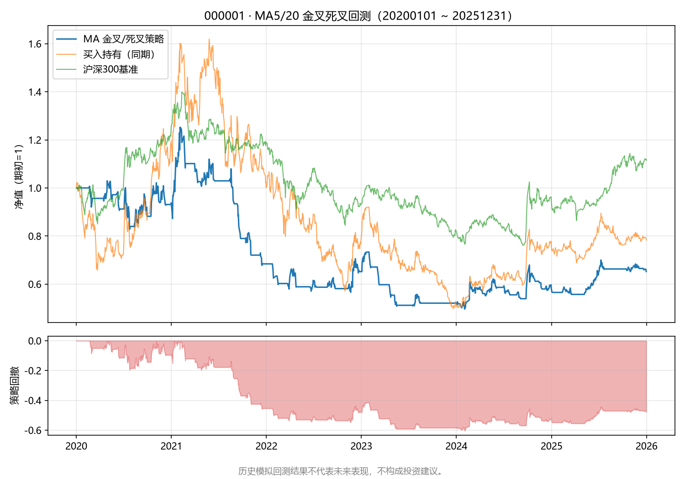
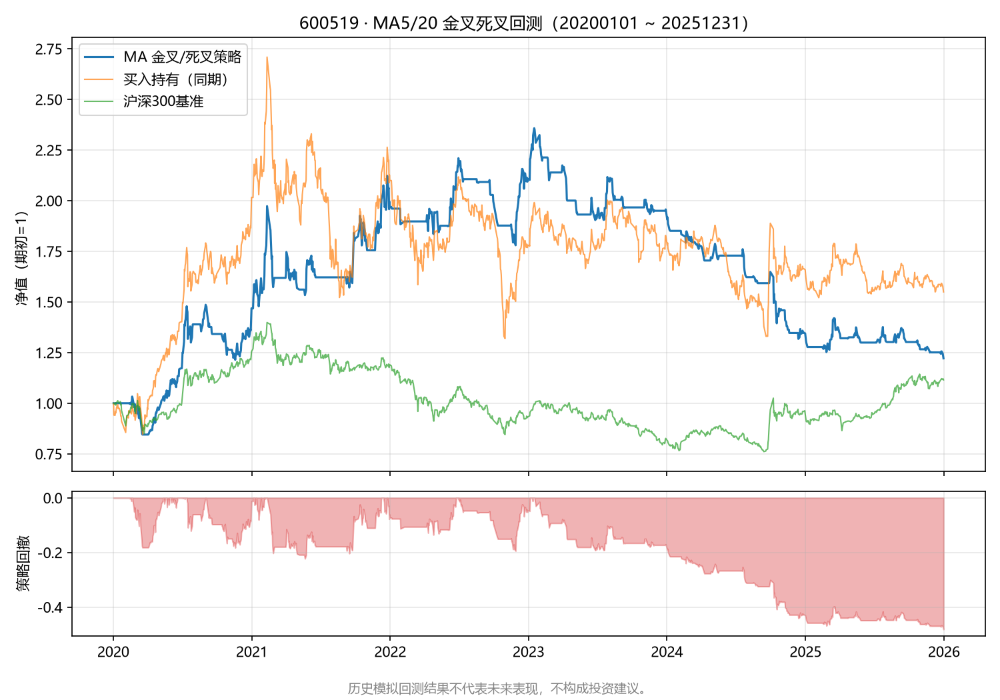
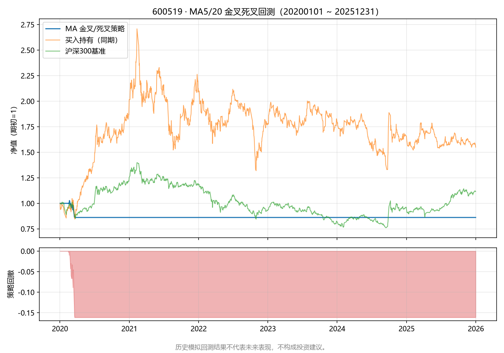

# A 股量化学习平台研究报告：基于开源数据的搭建路径

> 版本：v0.2（第 1 步：地基；第 2 步：MA 金叉/死叉回测框架）
> 范围：数据层调研与数据拉取脚本（第 1 步）、首个策略回测框架与沪深300基准对比（第 2 步）。
> **所有回测均为历史模拟，仅用于学习方法验证，不承诺收益、不构成投资建议。**

## 1. 定位与边界

本项目的目标是**可持续地学习量化研究方法**，而不是直接产出可交易的策略。因此平台搭建的第一原则是：

1. **先保证数据正确，再谈模型好坏**——垃圾数据进、垃圾结论出；
2. **每一步产出都可重复、可验证**——研究结果能复现是学习闭环的前提；
3. **不承诺收益**——历史数据与回测结果不代表未来表现，本项目任何产出均不构成投资建议。

本报告回答三个问题：A 股量化学习平台需要哪些数据、用哪些开源数据源、如何避免数据层面最常见的坑，并给出可持续的迭代方法。

## 2. 平台需要哪些数据

### 2.1 行情数据（核心）

| 类别 | 内容 | 用途 | 本阶段是否必需 |
| --- | --- | --- | --- |
| 日线行情 | OHLCV、成交额、涨跌幅、换手率，**含前/后复权与不复权** | 几乎所有日频研究的输入 | ✅ 必需（第 1 步已实现） |
| 分钟线 | 1/5/15/30/60 分钟 | 择时、微观结构研究 | ⏸ 后续按需 |
| 实时行情 | 快照、盘口 | 模拟/实盘阶段才需要 | ⏸ 后续按需 |

### 2.2 指数数据（核心）

| 类别 | 示例 | 用途 |
| --- | --- | --- |
| 宽基指数 | 上证指数、沪深 300、中证 500、中证 1000、创业板指 | 市场环境刻画、基准对比、收益归因 |
| 行业/主题指数 | 申万一级行业、中证行业 | 行业轮动与分组分析 |
| 指数成分与历史成分 | 沪深 300 历年成分 | **避免幸存者偏差的关键**（见第 5 节） |

> 基准意识是学习平台的第一课：任何策略首先和"同期持有指数"比，跑不赢基准的策略没有讨论价值。

### 2.3 财务数据（第二阶段引入）

| 类别 | 内容 | 关键点 |
| --- | --- | --- |
| 三大报表 | 资产负债表、利润表、现金流量表 | 关注**报告期**与**披露日**两个时间维度（见第 5.4 节） |
| 财务指标 | ROE、毛利率、负债率、市盈率等 | 不同源的指标口径可能不同，需记录计算口径 |
| 事件数据 | 业绩预告、业绩快报、分红送转、股本变动 | 与除权除息联动，解释价格跳变 |

### 2.4 基础信息与辅助数据

| 类别 | 内容 | 用途 |
| --- | --- | --- |
| 证券列表 | 全市场 A 股列表、上市/退市日期、ST 状态 | 构建**时点正确的**股票池 |
| 行业分类 | 申万/中信行业分类（含历史变更） | 分组与中性化 |
| 交易日历 | 交易日、节假日 | 对齐不同频率数据、计算真实持有天数 |
| 宏观数据（可选） | 利率、货币供应 | 宏观择时研究（很靠后） |

**建议的最小起步集合**：日线（复权）+ 宽基指数 + 证券列表 + 交易日历。先把这四个做扎实，再引入财务数据。

## 3. 开源数据源对比

### 3.1 主流开源数据源

| 数据源 | 优势 | 劣势 | 适合场景 |
| --- | --- | --- | --- |
| **akshare** | 免费、覆盖极广（行情/财务/指数/宏观）；聚合东财、新浪、腾讯等免费接口；社区活跃、示例多 | 接口为爬虫聚合，上游改版即失效；无 SLA；版本升级频繁、字段偶有变动；数据质量参差不齐 | 学习阶段主数据源，快速获取各类数据 |
| **tushare** | 结构化程度高、接口规范；数据质量相对可靠；有复权因子、指数成分等专业数据 | 需要注册，部分接口需要积分（付费/活跃度）；免费额度有限 | 校验与补充（财务、指数成分） |
| **baostock** | 免费、稳定、无需注册；**复权因子规范**；日线覆盖全 A 股历史 | 更新较慢（收盘后一段时间才更新）；财务与指数数据有限；接口较老 | 日线数据的交叉校验与备份 |
| **efinance** | 轻量、pip 安装简单、东方财富数据 | 文档少、社区小、接口稳定性一般 | 轻量补充 |
| **mootdx / pytdx** | 直连通达信行情，速度快 | 依赖第三方行情服务器，协议非官方 | 实时行情（远期） |

### 3.2 选型建议（学习阶段）

- **主数据源：akshare**——覆盖面最广，能满足学习阶段几乎全部需求，本项目第 1 步脚本即基于它；
- **交叉校验：baostock 或 tushare**——用第二个源核对关键数据（日线收盘价、复权因子），两个独立源同时出错且错得一致的概率很低；
- **存储原则：原始数据落盘**——每次拉取都保存为带时间戳的原始文件（raw），清洗后再生成 clean 文件。上游接口随时可能变更，落盘的原始数据是研究的稳定基础。

## 4. 数据获取与存储规范

1. **目录分层**：`data/raw/`（原始落盘）→ `data/clean/`（清洗去重后）→ `data/derived/`（衍生指标）；
2. **幂等与增量**：按 `(证券代码, 交易日)` 唯一键去重，重复执行脚本不产生重复行；增量更新时只拉新增区间并与历史合并；
3. **记录来源元信息**：保存文件时记录数据源名称、拉取时间、复权方式，避免日后无法解释数据差异；
4. **限速与重试**：对免费接口保持合理请求间隔，失败自动重试并记录日志，**不要对上游服务造成压力**；
5. **编码统一**：中文表头 CSV 使用 `utf-8-sig`，便于 Excel 直接打开。

## 5. 常见坑（务必在搭地基时就有意识）

### 5.1 复权

- **前复权（qfq）以最新价为基准回推历史**：该股每次发生新的除权除息后，**全部历史数值都会变**。前复权序列适合看图和计算"从过去持有到今天的收益率"，但不适合作为固定研究数据反复增量更新——今天拉的和上个月拉的同一天数据不一样；
- **后复权（hfq）**：绝对价格没有现实意义（会随时间放大），但**序列稳定**，适合算收益率、画净值曲线；
- **不复权 + 复权因子**是最严谨的方案：原始价格不变，需要收益时乘以因子。akshare 日线接口直接提供 qfq/hfq 序列，baostock 提供复权因子；
- **不同源的复权口径可能不一致**（是否考虑分红、送转），交叉校验时如发现差异，先检查复权口径再怀疑数据错误。

### 5.2 停牌

- 停牌期间**没有交易记录**，直接合并序列会少交易日——对齐指数或计算横截面指标时要先补齐日历；
- 长期停牌股复牌后常出现大幅跳空，统计收益率时注意这类异常点；
- 成交量/成交额为 0 或空值要显式处理，不要默默当 0 参与计算。

### 5.3 幸存者偏差

- **用"当前全市场股票列表"回看历史，天然漏掉已退市股票**，是 A 股研究最常见的系统性偏差；
- 对策：使用**上市/退市日期**构建时点正确的股票池，尽可能引入**历史指数成分**（如沪深 300 历年成分）做基准；
- 学习阶段可以先接受这个偏差，但必须**在实验记录中显式声明**，并把它列入后续要解决的数据质量问题。

### 5.4 未来函数

- 财务数据是重灾区：**报告期**（数据反映的会计期间）≠ **披露日**（市场真正看到数据的日期）。A 股年报最晚次年 4 月末披露，若用"报告期"直接回测，等于在披露前几个月就"提前知道"了数据；
- 正确做法是 **point-in-time（PIT）**：每个交易日只使用**当时已经披露**的最新财务数据；
- 其他未来函数来源：全样本统计（如用全期均值的标准化）、幸存者选股、用收盘价算当日信号却在收盘价成交等；
- 学习阶段的务实做法：日频策略优先用行情数据（无披露延迟问题）；引入财务数据时，用"披露日滞后"的方式粗处理并在记录中注明。

### 5.5 其他高频小坑

- **涨跌停限制**：主板 ±10%、创业板/科创板 ±20%、ST ±5%，新股上市初期无限制——异常收益的检查清单；
- **除权除息日价格跳变**：不复权序列的收益率计算必须经过复权处理；
- **交易日历差异**：节假日、临时休市，按自然日推进的回测会算错持有期；
- **接口字段变化**：akshare 上游改版可能导致字段名/单位变动，落盘原始数据 + 字段校验可降低风险。

## 6. 合规与风险提示

1. **数据使用合规**：akshare 等聚合的是第三方免费公开接口，仅适合个人学习研究；**不要商用再分发数据**，遵守各上游平台的服务条款；
2. **访问礼仪**：控制请求频率、失败重试要有退避（backoff），不对上游服务造成压力，不绕过反爬措施；
3. **投资风险**：本项目全部内容为学习方法论与工具，**不构成投资建议**；历史数据不代表未来表现，回测收益 ≠ 实盘收益，过拟合的策略在样本外往往失效；
4. **实盘约束（远期）**：若未来涉及实盘交易，需另行考虑券商接口合规、账户权限与监管要求，本阶段完全不涉及。

## 7. 可持续的学习迭代方法（本报告的重点）

平台的最终目的不是"数据全"，而是支持**高频、低成本、可复现的实验闭环**：

### 7.1 小步闭环

```
提出假设 → 取数 → 快速验证 → 记录结论 → 复盘 → 修正假设
```

每个闭环尽量小（一两天内完成一次），**用实验数量换质量**：一百个记录在案的小实验，胜过十个没记录的大实验。

### 7.2 实验日志强制化

每次实验固定记录：**假设是什么、用了什么数据（数据源+时间范围+复权方式）、什么参数、结果如何、与基准（指数）相比如何、结论与下一步**。模板可以很简单（Markdown 或表格），但必须写。

### 7.3 可复现优先于性能

- 代码进版本库，数据文件带元信息；
- 随机性必须显式设置随机种子；
- 先把流程跑通、结果可复现，再谈优化速度。

### 7.4 数据质量优先于模型复杂度

学习初期最大的误差来源是数据错误，不是模型不够复杂。每引入一类新数据，先做**常识性校验**：价格非负、涨跌停范围内、收益率分布合理、与第二数据源抽查对比。

### 7.5 建议的里程碑（每步一个可交付物）

| 步骤 | 交付物 | 状态 |
| --- | --- | --- |
| 1. 地基 | 研究报告 + 日线拉取脚本（`scripts/fetch_daily.py`） | ✅ 已完成 |
| 2. 回测框架 | 极简向量化回测 + 交易成本模型 + 基准对比（本步：MA 金叉/死叉，见第 9 节） | ✅ 本步 |
| 3. 数据层 | 指数、交易日历、证券列表；数据校验与增量更新 | 待开始 |
| 4. 因子研究 | 单因子检验流程（IC、分层回测） | 待开始 |
| 5. 组合与风控 | 多因子组合、仓位与回撤控制 | 待开始 |

## 8. 本步交付与下一步

- 本步交付：本报告 + `scripts/fetch_daily.py`（akshare 拉取指定股票日线数据，含前复权，保存 CSV，带命令行参数）；
- 用法示例：

```bash
python scripts/fetch_daily.py 000001 600519 --start 20230101 --end 20231231 --adjust qfq --outdir data/daily
```

- 下一步建议（第 2 步候选）：拉取宽基指数与交易日历，建立 `data/raw → data/clean` 的落盘规范与去重增量逻辑，为回测框架打数据基础。（按项目实际安排，第 2 步改为先做回测框架，见第 9 节；数据层顺延为第 3 步。）

## 9. 第 2 步：MA 金叉/死叉回测框架（v0.2）

> **⚠ 免责声明（本步所有结果与图表均适用）：历史模拟回测结果不代表未来表现，不构成投资建议。**

### 9.1 本步做了什么

新增 `scripts/backtest.py`：读取第 1 步产出的 CSV（或自动拉取），实现 MA 金叉/死叉策略回测，输出收益指标、交易明细与收益曲线图，并用同期沪深300作基准对比。

**策略与执行规则（全部显式、可复现）：**

1. **金叉买入**：短期均线上穿长期均线 → 下一交易日以**开盘价**全仓买入；
2. **死叉卖出**：短期均线下穿长期均线 → 下一交易日以开盘价清仓卖出；
3. **信号与成交错开一天**：信号在 t 日收盘产生、t+1 日开盘成交，避免"当日收盘算信号、当日收盘成交"的未来函数；
4. **交易成本**：买入佣金万三（默认），卖出佣金万三 + 印花税万五（默认），均可通过命令行调整；
5. **整手约束**：默认按 A 股 1 手 = 100 股取整买入；`--fractional` 可切换为小数股全仓（学术口径，用于单独研究信号质量）；
6. **期末强平**：回测期末仍持仓按最后收盘价强制平仓，计入交易明细与胜率统计。

**数据来源与基准：** 优先读第 1 步 CSV（`data/daily/<代码>_<复权方式>.csv`），覆盖不足时自动拉取并落盘为同名 CSV；个股行情按 东财→腾讯→新浪 顺序回退（本次实测东财接口被临时限流，自动切换腾讯源）；沪深300（000300）同期日线作基准，东财失败自动切换新浪源。均线计算会自动把拉取起点前移，为长均线预留"热身"数据。

用法示例：

```bash
python scripts/backtest.py 000001 600519 --start 20200101 --end 20251231 --short 5 --long 20
```

### 9.2 回测结果（2020-01-01 ~ 2025-12-31）

口径：前复权（qfq）日线、初始资金 10 万元、佣金万三 + 卖出印花税万五、整手买入（600519 另跑一组 `--fractional` 作对照）。数据为 2026-11-02 拉取的 qfq 快照。

| 标的 | 口径 | 策略总收益率 | 策略年化 | 策略最大回撤 | 胜率 | 交易次数 | 买入持有总收益率 | 沪深300总收益率 |
| --- | --- | ---: | ---: | ---: | ---: | ---: | ---: | ---: |
| 000001 平安银行 | MA5/20，整手 | **-34.76%** | -7.13% | -60.37% | 35.6% | 45 | -21.68% | +11.50% |
| 600519 贵州茅台 | MA5/20，整手 | **-13.84%** | -2.55% | -16.13% | 0.0% | 2 | +54.94% | +11.50% |
| 600519 贵州茅台 | MA5/20，小数股 | **+22.13%** | +3.52% | -48.20% | 35.6% | 45 | +54.94% | +11.50% |





**初步解读（仅为学习观察，不构成投资建议）：**

- 三组策略中两组跑输同期买入持有，最好的 600519 小数股组（+22.13%）也远跑输其买入持有（+54.94%）；000001 上策略比买入持有亏得更多（-34.76% vs -21.68%）。MA 金叉/死叉在这两个样本上**没有展示出相对"傻持"的优势**；
- 000001 策略最大回撤 -60.37%，主要发生在 2021-2025 的漫长阴跌中反复抄底被套；
- 结果再次印证第 1 步立下的原则：任何策略先和"同期持有基准"比，跑不赢就没有讨论价值。

### 9.3 参数敏感性观察（000001，同区间同口径）

把 (短期, 长期) 均线窗口在 5~120 天内扫描 6 组，其余口径不变：

| MA 参数 | 总收益率 | 年化收益率 | 最大回撤 | 胜率 | 交易次数 |
| --- | ---: | ---: | ---: | ---: | ---: |
| 5/20 | -34.76% | -7.13% | -60.37% | 35.6% | 45 |
| 5/60 | +6.41% | +1.08% | -40.32% | 20.8% | 24 |
| 10/20 | -45.00% | -9.83% | -61.71% | 35.0% | 40 |
| 10/60 | +4.63% | +0.79% | -35.95% | 26.3% | 19 |
| 20/60 | +17.40% | +2.82% | -50.40% | 28.6% | 14 |
| 20/120 | +31.96% | +4.92% | -34.48% | 60.0% | 5 |

观察：

1. **结果对参数极其敏感**：总收益率从 -45.00% 到 +31.96%，跨度约 77 个百分点，而策略逻辑完全一样；
2. **窗口越长、交易越少、表现越好**（该样本上）：短参数（5/20、10/20）在震荡与阴跌中被反复"左右打脸"，交易成本（45 次 × 双边约万 11）进一步磨损收益；长参数（20/120）只抓住 5 次大波段；
3. **胜率普遍不高**（20.8%~60.0%）：收益主要来自少数大波段，而非大多数交易——"少数盈利交易扛起全部收益"是趋势跟踪类策略的典型特征；
4. **在 6 组里挑出最好的 20/120 本身就是过拟合**：参数是事后选的，换一段区间或换一只股票，排序大概率重排。没有样本外验证前，任何一组参数的好成绩都只能当作假设，不能当作结论。

### 9.4 本步发现的数据/回测坑

1. **上游接口限流封禁（本步实际遇到）**：东方财富 push2 行情接口对同一 IP 短时间内大量请求会临时封禁（akshare 提示 5 分钟起、反复触发 40 分钟以上）。对策：个股行情按 东财→腾讯→新浪 顺序自动回退并落盘 CSV；基准同样有东财→新浪回退。代价是**跨源复权口径可能有细微差异**，汇总 CSV 的 `data_source` 列记录了每次实际使用的数据源。
2. **均线热身期**：回测区间开头 `long` 个交易日没有长均线、无法产生信号。若用恰好只覆盖回测区间的数据，开头会有一段"哑火期"。脚本自动把拉取起点前移约 `long×1.6+10` 个自然日解决；`--offline` 降级使用覆盖不足的本地 CSV 时会在 stderr 告警。
3. **信号日 ≠ 成交日**：用 t 日收盘价算信号、t+1 日开盘价成交，规避了未来函数；但开盘价可能因隔夜跳空远离信号价，且本框架未建模滑点——实盘成交价只会更差，不会更好。
4. **整手约束会改变一切（本步最直观的坑）**：10 万元回测贵州茅台（qfq 约 880 元/股），两次亏损后资金不足一手，之后 43 次金叉信号全部无法买入，策略净值长期"躺平"（-13.84%，图见下）；同一策略改用小数股全仓后为 +22.13%。**研究信号质量用小数股，研究可实盘性必须保留整手与资金规模约束**，两者结论不可混用。



5. **qfq 前复权数据是"活"的**：以后每次除权除息，历史 qfq 值都会整体变化。同一回测今天跑和明年跑，输入数据不同、结果也会漂移。本步结果对应 2026-11-02 拉取的数据快照；要做严格复现，应落盘带时间戳的原始数据（第 1 步"数据获取与存储规范"一节已提，本步再次验证其必要性）。
6. **基准对齐**：个股停牌日没有行情，与指数对齐时用最近交易日收盘前向填充；长期停牌会造成持有期与基准不同步，统计时需注意。
7. **期末强平口径**：交易次数与胜率包含一笔期末强平（若期末仍持仓），与只统计"金叉→死叉"完整往返的口径略有差异，报告中两种口径都应注明用的是哪一种。
8. **单票回测的幸存者偏差**：只回测 2 只股票，且是今天仍然存在、被特意选出来的股票，样本极小且带事后视角，结论不能推广到全市场。

### 9.5 结论与下一步

- 本步交付：`scripts/backtest.py` + 本报告第 9 节。MA 金叉/死叉框架本身可复现、可扩展（参数、成本、复权、口径均可命令行调整），但**策略表现在本样本上不优于买入持有**；
- 下一步候选：① 把策略横截面推广到几十只股票，检验"平均意义上"是否有 alpha；② 增加滑点与成本敏感性分析；③ walk-forward 样本外检验，直面参数过拟合问题；④ 按第 1 步计划补数据层（指数、交易日历、证券列表）。

---

**免责声明**：本报告仅用于个人量化学习与工具搭建，所有内容不构成任何投资建议；不承诺任何收益。数据来源为公开接口，使用时请自行确认合规性。
